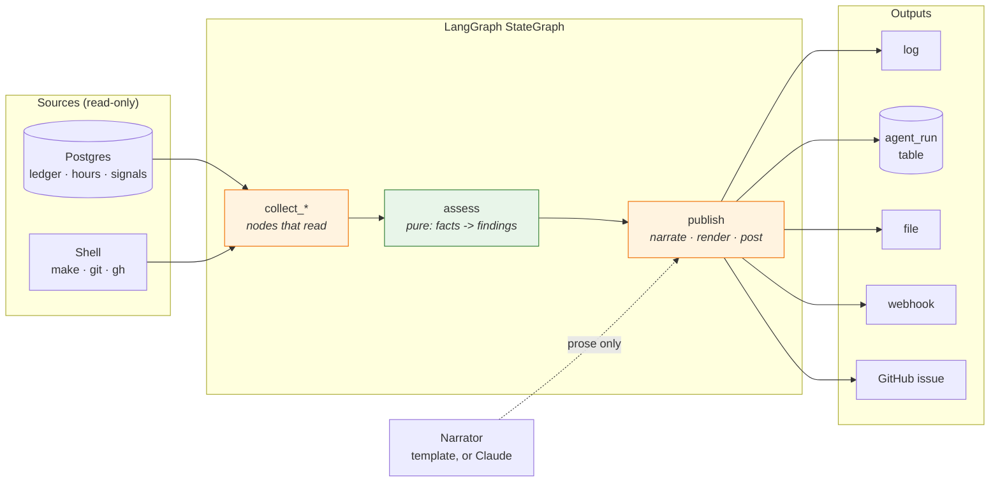
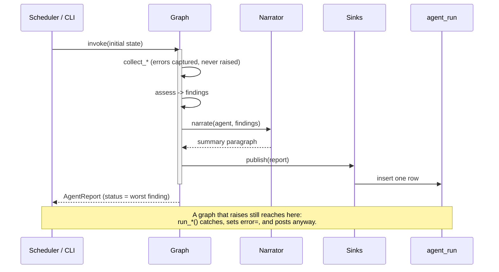

# The agent layer: LangGraph framework design

**Status:** implemented — 2026-10-25 (the agent layer; see `docs/roadmap/`)
**Area:** `candlegraph/agents/`, `candlegraph/cli.py`, `alembic/`, compose, CI

## What an agent is here

An agent is a **LangGraph `StateGraph`** whose nodes are plain Python
functions over a typed state, compiled once and invoked on a schedule. It
observes the system through the same modules the CLI uses (`ledger`,
`quality`, `prices`, the `Makefile`), decides what it has found, and **posts
a report**. It does not trade, does not write market data, and does not
change configuration. Phase 4's two graphs are the CI janitor and the run
observer; phase 5's pipeline graphs and phase 6's signaller follow the same
conventions.

Why LangGraph rather than a function that calls three other functions:

- **The graph is the design.** `graph.get_graph().draw_mermaid()` renders the
  actual control flow, so the documentation and the code cannot drift.
- **Conditional edges make the decisions explicit.** "Only open a PR if the
  fixes changed something and the tree was clean" is an edge with a name, not
  an `if` buried in a 200-line function.
- **Every node is a unit test.** A node takes a state dict and returns a
  partial update; it can be called directly with a hand-built state.
- **Phase 5 and 6 need the same substrate.** Checkpointing, interrupts
  (human approval before a paper trade), and sub-graphs are all there when
  needed without a rewrite.

## Shape of every graph

The same five stages in every agent, whatever it observes. Only the
*collect* stage differs between graphs; everything right of `assess` is
shared code in `base.py`, `narrator.py` and `reporting.py`.



Two things the diagram is making a point about:

- **`assess` is the only box with no arrow to the outside.** It is a pure
  function of the collected facts and the thresholds, which is why the bulk
  of each agent's tests need no database and no subprocess.
- **The narrator's arrow is dotted and one-way, into `publish` only.** The
  model never reaches a source and never reaches a finding. Invariant 22.

## Lifecycle of one run



## Layout

```
candlegraph/agents/
  __init__.py       Registry: name -> graph builder, for the CLI and scheduler.
  base.py           Severity, Finding, AgentReport. The vocabulary every graph speaks.
  shell.py          Subprocess runner behind a Protocol, so graphs that call make/git/gh are testable.
  narrator.py       Turns findings into a summary. Template by default; Anthropic when configured.
  reporting.py      Markdown rendering and the sinks: log, ledger, file, webhook, GitHub.
  ledger.py         The agent_run table: one row per graph run.
  scheduler.py      APScheduler wiring and the `candlegraph agents` loop.
  observer/
    state.py        ObserverState and the thresholds dataclass.
    collect.py      Nodes that read: ledger, quality report, metric windows.
    assess.py       Pure functions from collected facts to findings.
    graph.py        Wires the nodes.
  janitor/
    state.py        JanitorState, CheckResult, the fixer map.
    checks.py       Nodes that run make targets and git/gh commands.
    graph.py        Wires the nodes.
tests/unit/agents/  Mirrors the package. FakeShell (in conftest), FakeDatabase, no network.
tests/unit/test_cli_agents.py     The observe, janitor, agents, agent-runs commands.
tests/integration/test_agents.py  The agent_run table and the observer against real SQL.
docs/agents/<topic>/DESIGN.md     This file and one document per graph.
.claude/skills/run-agents, add-agent   Operating and extending the layer.
```

## Conventions

### State

Each graph owns one `TypedDict` state with `total=False`. Fields a node
*accumulates* (`findings`, `errors`, `log`) are declared with
`Annotated[list[T], operator.add]` so a node returns only its own additions;
fields a node *sets* (`report`, `checks`) are plain. A node never mutates the
state it is given.

### Findings

```python
class Severity(IntEnum):
    OK < INFO < WARNING < CRITICAL


@dataclass(frozen=True)
class Finding:
    kind: str  # "stale", "gap", "drift", "check_failed", ...
    severity: Severity
    subject: str  # the token, run, or check it is about
    message: str  # one sentence a human can act on
    evidence: dict  # the numbers behind it, JSON-serialisable
```

A report's status is the maximum severity of its findings. `OK` findings are
allowed and encouraged: "coverage 97% on ten tokens" is a finding too, and a
report that only lists problems cannot show that something was checked.

### Reports and sinks

`AgentReport` is agent name, run id, timestamps, findings, a narrated summary,
and the Markdown rendering. It is **posted through sinks**, chosen by
`AGENT_REPORT_SINKS`:

| Sink | Where it goes | When to use |
|---|---|---|
| `log` | the service logger | always on in the compose stack |
| `ledger` | the `agent_run` table | always on; this is what `candlegraph agent-runs` reads and what the next run compares against |
| `file` | `AGENT_REPORT_DIR/<agent>-<timestamp>.md` | CI artefacts |
| `webhook` | HTTP POST of `{"text": ..., "status": ..., "agent": ...}` to `AGENT_WEBHOOK_URL` | Slack-compatible channels |
| `github` | a GitHub issue via `gh`, only at `WARNING` or above | repositories that triage in issues |

A sink that fails is logged and skipped; it never fails the run (the same rule
as the ingest ledger, invariant 12). Posting is the last node of every graph
so a crash mid-graph still leaves a ledger row with status `error`.

### Narration

The `Narrator` protocol turns a list of findings into a paragraph. The default
`TemplateNarrator` is deterministic and needs no key. When `AGENT_LLM_MODEL`
and `ANTHROPIC_API_KEY` are set, `AnthropicNarrator` asks the model to write
the paragraph **from the findings only** — it never sees the database and
cannot add a finding. The findings, status, and exit code are the same either
way; the model only changes the prose. Tests inject a fake completion
function, so the unit tier stays offline (invariant 2).

### Side effects

Graphs that run commands go through `Shell`, a Protocol with one method,
`run(args, cwd, timeout) -> CommandResult`. Production uses
`SubprocessShell`; tests use `FakeShell`, which replays scripted results and
records every call. No node calls `subprocess` directly.

Graphs read the database through the existing `DatabaseManager` and
`Statements`; the only new SQL is the `agent_run` table's. Agents **never
write to the market data tables** — invariant 21 in `AGENTS.md`, with 22
(findings are computed, prose is optional) and 23 (the janitor fixes only
what is mechanical).

### Scheduling

`candlegraph agents` runs an APScheduler `BackgroundScheduler` with one job
per graph, built exactly like the ingest worker (`max_instances=1`,
`coalesce=True`, first run immediate). Intervals come from settings;
an interval of `0` disables that graph in that process. The compose stack
runs the observer in the `agents` service and disables the janitor there
because the container has no git checkout; the janitor's schedule is a
GitHub Actions cron (`.github/workflows/janitor.yml`), where it has both
the repo and a token to open a PR.

### Exit codes

Every graph has a one-shot CLI command (`candlegraph observe`,
`candlegraph janitor`). With `--strict` the exit code is non-zero when the
report status is `WARNING` or above, so CI can gate on it.

## Configuration

All under `AGENT_*`, `OBSERVER_*`, `JANITOR_*` in `settings.py`, documented in
`.env.example`. Nothing is read with `os.getenv` (invariant 10).

## Testing

| Tier | What it proves |
|---|---|
| unit | every node with a hand-built state; `assess` functions on synthetic frames; the janitor against `FakeShell`; sinks against `httpx.MockTransport`; the graphs' Mermaid output matches the documented flow |
| integration | the `agent_run` table round-trips JSONB; the observer run end to end against a migrated database with seeded gaps and a stale ledger |
| stack (CI) | `candlegraph observe` runs against the compose stack after ingestion |

## Rejected alternatives

- **An LLM-driven agent that decides what to inspect.** The questions are
  fixed and the answers are numbers; a model choosing which query to run adds
  cost and nondeterminism to a job whose value is being boringly repeatable.
  The model's place is narration, and only optionally.
- **Celery / a queue.** One process and a scheduler are enough for two graphs
  that run every few minutes. Phase 5's event bus is where fan-out belongs.
- **Writing reports into the ingest ledger.** Different grain, different
  readers; mixing them would make `data_fresh` depend on an agent's run.
