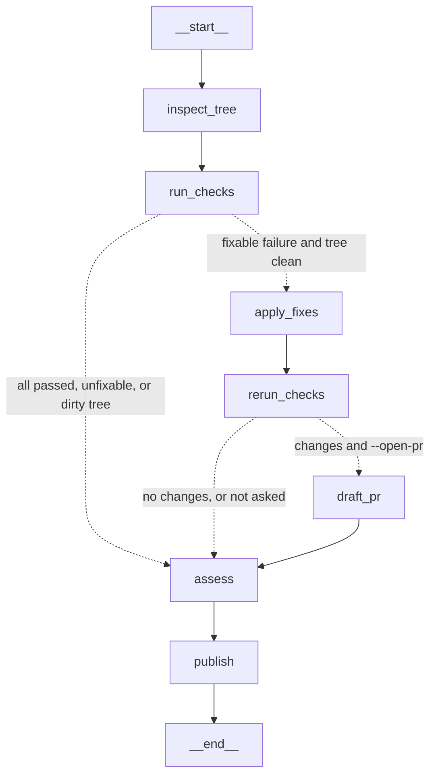
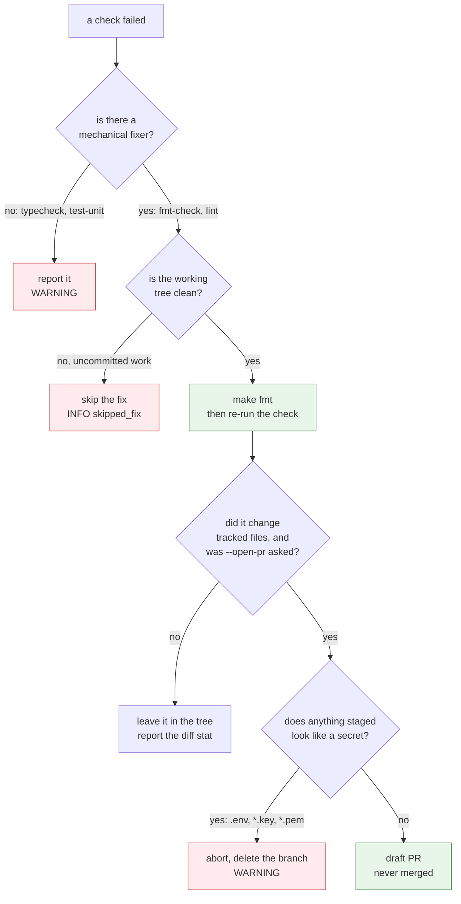

# CI janitor

**Status:** implemented — 2026-10-25
**Graph:** `candlegraph/agents/janitor/graph.py`
**Command:** `candlegraph janitor [--open-pr] [--strict]`, `make janitor`
**Schedule:** `.github/workflows/janitor.yml` (daily cron) and, optionally,
`JANITOR_INTERVAL` in `candlegraph agents`

## Job

Keep the build green without a human noticing it was about to go red. The
janitor runs the repository's own checks, applies the fixes that are safe to
apply mechanically, re-runs the checks to prove the fix, and drafts a pull
request a human reviews. It never merges.

## Flow



`tests/unit/agents/test_janitor.py::test_the_graph_has_the_documented_shape`
pins this node and edge set.

| Node | Does | Writes to state |
|---|---|---|
| `inspect_tree` | `git status --porcelain`, `git rev-parse --abbrev-ref HEAD` | `tree_clean`, `branch` |
| `run_checks` | each `make <target>` in `JANITOR_CHECKS`, in order, with a timeout | `checks: list[CheckResult]`, one finding per failure |
| `apply_fixes` | the fixer for each failed check that has one (`fmt-check`, `lint` → `make fmt`) | `fixes_applied` |
| `rerun_checks` | the failed checks again; `git diff --stat` | `checks` (replaced), `diff_stat` |
| `draft_pr` | `git checkout -b janitor/<stamp>`, `git add -u`, commit, push, `gh pr create --draft`, `git checkout <original>` | `pr_url`, `pr_branch`, or an error |
| `assess` | pure: the final `checks` against `before`, plus fixes, PR, and errors | `findings` |
| `publish` | narrate, render, post to the sinks | `report` |

Findings are computed once, by `assess`, from the *final* picture — not
accumulated as checks run — so a check that failed and was fixed is one
`INFO` finding ("passed after make fmt"), never a `WARNING` followed by an
`OK`.

## The three gates

The janitor is mostly a set of refusals. Each diamond below is a place it
declines to act, and each exists because the alternative is worse than
leaving the work for a person.



Why each refusal:

1. **No fixer for a type error or a failing test.** There is no mechanical
   repair for a wrong type, and a tool that edits a test until it passes
   destroys the only thing that was telling the truth.
2. **No fixing a dirty tree.** The janitor would otherwise fold somebody's
   half-finished work into its own commit.
3. **No committing a secret.** `git add -u` already stages tracked files
   only, so this can fire only if a secret was tracked by mistake — which is
   exactly when it matters. Invariant 20.

## Decisions

- **Checks are Makefile targets, nothing else.** `JANITOR_CHECKS` defaults to
  `fmt-check,lint,typecheck,test-unit`. The Makefile is the single source of
  truth for commands (`AGENTS.md`), so the janitor cannot run a check CI does
  not. `test-integration` is not in the default list because it needs Docker;
  add it where Docker exists.
- **Only mechanical fixes.** The fixer map is `fmt-check → fmt` and
  `lint → fmt` (ruff's `--fix` is in that target). A failing type check or
  test is reported, never "fixed": there is no mechanical fix for a wrong
  type, and a model rewriting a test to make it pass is exactly the failure
  mode `CLAUDE.md` warns about ("the test is usually right").
- **A dirty tree is never fixed in place.** If `git status` shows tracked
  changes, the checks still run and are reported, but `apply_fixes` is
  skipped: the janitor must not fold someone's half-finished work into its
  own commit.
- **The PR is always a draft**, titled `janitor: <what was fixed>`, body is
  the report, and the branch is `janitor/YYYYmmdd-HHMM`. Only tracked files
  are staged (`git add -u`), so `.env` and other untracked files cannot leak
  (invariant 20), and `draft_pr` refuses outright if the staged list contains
  `.env` or anything matching `*.key`/`*.pem`.
- **No key, no problem.** Without `--open-pr` (or with `gh` missing) the
  fixes stay in the working tree and the report carries the diff stat. That
  is the local-developer mode: `make janitor` and look at `git diff`.
- **Secrets never reach the report.** Command output is truncated to the last
  `JANITOR_OUTPUT_LINES` lines and passed through a redaction that masks
  anything shaped like a bearer token or an API key before it is stored or
  posted.

## Report

```
# janitor — 2026-10-25 06:00 UTC — WARNING

janitor finished WARNING: 5 findings (1 warning, 2 info, 2 ok). typecheck: failed
(exit 2): candlegraph/ui/viewmodels.py:88: error: Incompatible return type ...

## Findings
| severity | kind         | subject   | message                                        |
| warning  | check_failed | typecheck | failed (exit 2): ... Incompatible return type  |
| info     | check        | fmt-check | passed after make fmt                          |
| info     | fixed        | make fmt  | 3 files changed; draft PR https://.../pull/42  |
| ok       | check        | lint      | passed in 1s                                   |
| ok       | check        | test-unit | passed in 7s                                   |

## Checks
| check     | before | after  | fixer    | secs |
| fmt-check | failed | ok     | make fmt | 1    |
| ...
```

Status is `OK` when everything passed, `INFO` when something was fixed and
nothing is left, `WARNING` when a check still fails after fixes, `CRITICAL`
when a check could not run at all (timeout, `make` missing).

## Configuration

| Variable | Default | Meaning |
|---|---|---|
| `JANITOR_CHECKS` | `fmt-check,lint,typecheck,test-unit` | Make targets to run, in order |
| `JANITOR_OPEN_PR` | `false` | Push a branch and draft a PR when fixes changed files |
| `JANITOR_BASE_BRANCH` | `main` | PR base |
| `JANITOR_TIMEOUT_SECONDS` | `900` | Per-check timeout |
| `JANITOR_OUTPUT_LINES` | `40` | Tail of command output kept in the report |
| `JANITOR_INTERVAL` | `0` | Seconds between runs in `candlegraph agents`; 0 disables |

## Tests

`tests/unit/agents/test_janitor.py` drives the graph with a `FakeShell`: a
passing run posts an `OK` report and runs no fixer; a failing `fmt-check`
runs `make fmt` once and re-checks; a fix that does not make the check pass
leaves it a `WARNING`; a dirty tree skips fixes; `--open-pr` with a clean fix
issues exactly the git and gh commands above and returns to the original
branch; a staged `.env` aborts the PR and deletes the branch; a failed push
or `gh` is reported and the tree is returned; a timeout is `CRITICAL`; and
command output is redacted before it reaches the report.
