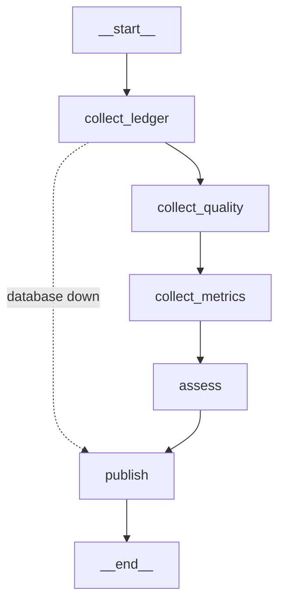
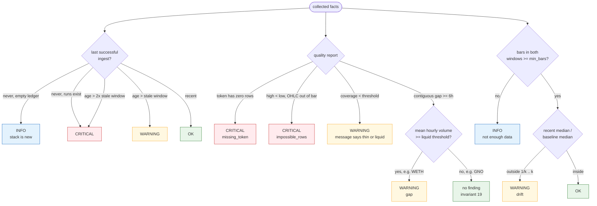

# Run observer

**Status:** implemented — 2026-10-25
**Graph:** `candlegraph/agents/observer/graph.py`
**Command:** `candlegraph observe [--strict]`, `make observe`
**Schedule:** the `agents` compose service, every `OBSERVER_INTERVAL` seconds

## Job

Answer, on a schedule and in writing, the three questions an operator asks of
the data: **is it fresh, is it complete, and does it still look like the
same market?** It reads the ingest ledger, the data-quality report, and a
trailing window of stored rows; it writes a report and nothing else.

## Flow



`tests/unit/agents/test_observer_graph.py::test_the_graph_has_the_documented_shape`
pins this node and edge set.

| Node | Reads | Writes to state |
|---|---|---|
| `collect_ledger` | `ledger.recent_runs`, `ledger.seconds_since_last_success` | `runs`, `seconds_since_success`, `database_up` |
| `collect_quality` | `quality.build_report` over `OBSERVER_BASELINE_DAYS` | `quality` |
| `collect_metrics` | `prices.load_price_history` for every tracked symbol over baseline + recent window | `metrics` (per-symbol recent vs baseline numbers) |
| `assess` | state only — pure | `findings` |
| `publish` | — | `report`, posted to the sinks |

`assess` is a set of pure functions in `observer/assess.py`, each taking the
collected facts and the thresholds and returning findings. They are the part
worth testing exhaustively, and they are tested without a database.

## How a fact becomes a severity

Every rule below is a pure function in `assess.py`. The two branches worth
reading twice are the ones that stop the observer crying wolf: a gap is
tested against the token's own liquidity before it is a finding, and a
window too short to support a statistic produces `INFO`, never a guess.



## What it looks for

### Stale data

`seconds_since_last_success` against `DATA_POLL_INTERVAL`:

| Condition | Severity |
|---|---|
| no successful run ever | `CRITICAL` — unless the ledger is empty too, in which case `INFO`: the stack is new |
| age > `OBSERVER_STALE_INTERVALS` × poll interval | `WARNING` |
| age > 2 × that | `CRITICAL` |

Plus the ledger's own pattern: the last `OBSERVER_FAILURE_STREAK` runs all
`failed` is `CRITICAL`; a `partial` in the most recent run is `WARNING` and
names the targets that failed, read from the run's `errors` JSON.

### Gaps

Invariant 19 governs: **a missing hour is not a fault.** The observer does
not flag gaps as such. It flags:

- a token in `missing_tokens` (configured, zero rows) — `CRITICAL`;
- `IMPOSSIBLE ROWS` — `CRITICAL`;
- coverage below `MIN_EXPECTED_COVERAGE` — `WARNING`, with the same caveat the
  report prints;
- a contiguous gap of at least `OBSERVER_SUSPICIOUS_GAP_HOURS` **on a liquid
  token** — one whose baseline mean hourly volume exceeds
  `OBSERVER_LIQUID_VOLUME_USD`. GNO going quiet for a day is the market; WETH
  going quiet for six hours is a failed run or a subgraph outage. This is the
  distinction `backfill-and-verify` tells a human to make; the observer makes
  it the same way.

### Metric drift

For each tracked symbol, a **recent** window (`OBSERVER_DRIFT_WINDOW_HOURS`,
default 24) is compared with the **baseline** window immediately before it
(`OBSERVER_BASELINE_DAYS`, default 7). Three series:

| Metric | Statistic | Drift when |
|---|---|---|
| hourly `volume_usd` | median | ratio outside `[1/k, k]`, `k = OBSERVER_VOLUME_DRIFT_RATIO` (default 4) |
| realised volatility of hourly log returns | standard deviation, `ddof=1` | ratio outside `[1/k, k]`, `k = OBSERVER_VOLATILITY_DRIFT_RATIO` (default 3) |
| ingest run duration and `token_hours_written` | median over runs in each window | ratio above `OBSERVER_RUN_DRIFT_RATIO` (default 3) |

Ratios of medians are used rather than z-scores because hourly crypto series
are heavy-tailed; a single large hour would otherwise drive the baseline's
standard deviation and hide the drift the test exists to catch. A window with
fewer than `OBSERVER_MIN_BARS` bars (default 12) produces no drift finding at
all — "not enough data" is an `INFO` finding, never a guess. Rolling-window
rule 16 applies: a statistic is computed from a complete window or not at
all.

Drift is `WARNING`. It is not an error signal: a four-fold volume change is
news, and the right action is a human looking, not a page. Severity does not
escalate with the ratio.

## Report

```
# observer — 2026-10-25 06:15 UTC — WARNING

observer finished WARNING: 7 findings (3 warning, 4 ok). WETH: 7h gap
2026-10-24 13:00..2026-10-24 19:00 (7h) on a liquid token (mean hourly volume
$4,812,330). SHIB: median hourly volume x5.2 vs baseline ($18,402 → $95,110).
GNO: coverage 47.5% is below 80% (thin token; likely the market)

## Findings
| severity | kind     | subject | message ... |
| warning  | coverage | GNO     | coverage 47.5% is below 80% (thin token; likely the market) |
| warning  | drift    | SHIB    | median hourly volume x5.2 vs baseline (...) |
| warning  | gap      | WETH    | 7h gap ... on a liquid token (...) |
| ok       | fresh    | ingest  | last successful ingest was 4m ago |
| ok       | ledger   | ingest  | 2016 finished runs in the window: 2015 succeeded, 1 partial, 0 failed |
| ok       | drift    | all     | no volume or volatility drift across 9 symbols (limits x4 / x3) |

## Coverage
| symbol | rows | coverage | gaps | longest | mean hourly volume |
| ...
## Drift
| symbol | bars recent/baseline | volume median recent | baseline | ratio | vol recent | baseline | ratio |
| ...
## Recent ingest runs
| started | trigger | status | token hours | pool hours | secs |
| ...
```

Drift ratios are written `x5.2` rather than with a multiplication sign so
the report is plain ASCII in a terminal and in a webhook body.

## Configuration

| Variable | Default | Meaning |
|---|---|---|
| `OBSERVER_INTERVAL` | `900` | Seconds between observer runs in `candlegraph agents` |
| `OBSERVER_STALE_INTERVALS` | `3` | Poll intervals without a success before data is stale |
| `OBSERVER_FAILURE_STREAK` | `3` | Consecutive failed runs that is critical |
| `OBSERVER_BASELINE_DAYS` | `7` | Baseline window |
| `OBSERVER_DRIFT_WINDOW_HOURS` | `24` | Recent window |
| `OBSERVER_MIN_BARS` | `12` | Minimum bars in a window before drift is judged |
| `OBSERVER_VOLUME_DRIFT_RATIO` | `4.0` | Median hourly volume ratio that is drift |
| `OBSERVER_VOLATILITY_DRIFT_RATIO` | `3.0` | Realised volatility ratio that is drift |
| `OBSERVER_RUN_DRIFT_RATIO` | `3.0` | Run duration or rows-per-run ratio that is drift |
| `OBSERVER_SUSPICIOUS_GAP_HOURS` | `6` | Contiguous gap length that matters on a liquid token |
| `OBSERVER_LIQUID_VOLUME_USD` | `100000` | Baseline mean hourly volume above which a token counts as liquid |

## Tests

`tests/unit/agents/test_observer_assess.py` exercises every rule above with
hand-built inputs: a fresh ledger is `OK`; stale is `WARNING` and doubly
stale `CRITICAL`; a seven-hour gap on WETH is `WARNING` while the same gap on
GNO is not; volume x5 is drift and x2 is not; a thin window yields `INFO`,
never drift; backfills are excluded from run metrics.
`tests/unit/agents/test_observer_graph.py` runs the compiled graph against
`FakeDatabase`, including the database-down short-circuit and a crashing
graph posting an `error` report. `tests/integration/test_agents.py` seeds a
real database with a stale ledger and an eight-hour hole on both a liquid and
a thin token, and asserts only the liquid one is a finding.
