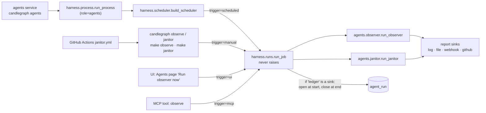

# How the agents are used: who runs them, through what, and what they write

**Status:** living — updated 2026-11-13 after harness rollout step 2. It
describes the code as it is now. Update it when step 3 adds a third
scheduled job.
**Area:** `candlegraph/agents/`, `candlegraph/harness/`, `candlegraph/cli.py`,
`candlegraph/ui/viewmodels.py`, `candlegraph/mcp/tools.py`,
`.github/workflows/janitor.yml`, the `agents` compose service.
**Companions:** [`../framework/DESIGN.md`](../framework/DESIGN.md) (what a
graph is), [`../observer/DESIGN.md`](../observer/DESIGN.md),
[`../janitor/DESIGN.md`](../janitor/DESIGN.md),
[`../../harness/runner/DESIGN.md`](../../harness/runner/DESIGN.md) (the
runner they now go through).

## The two agents

| | Run observer | CI janitor |
|---|---|---|
| Question it answers | Is the data fresh, complete, and still the same market? Is the knowledge layer healthy? | Does the repository pass its own checks, and can the mechanical failures be fixed without a human? |
| Graph (LangGraph) | `collect_ledger → collect_quality → collect_metrics → collect_knowledge → assess → publish` | `inspect_tree → run_checks → apply_fixes → rerun_checks → draft_pr → assess → publish` |
| Reads | `ingest_run`, the quality report, a trailing window of hourly rows, the knowledge tables | the working tree, `make` targets (`JANITOR_CHECKS`) |
| Writes | an `agent_run` row and the report sinks — never market data (invariant 21) | the same, plus a branch and a **draft** PR when `fmt`/`lint --fix` changed files; never merges (invariant 23) |
| Registered job | `observer`, role `agents`, `OBSERVER_INTERVAL` (default 900 s) | `janitor`, role `agents`, `JANITOR_INTERVAL` (default 0, disabled) |
| Where it is scheduled | the `agents` compose service | GitHub Actions cron, 06:17 UTC daily — the container has no git checkout |

Both graphs keep every rule of the framework: findings are computed by a
pure `assess`, status and exit code come from the findings alone, and the
optional narrator (template by default, Claude when configured) may only
phrase them (invariant 22).

## Every way an agent run starts

After step 1 every entry point goes through `harness.run_job`. Before it,
there were two scheduler copies and five direct calls into the graphs.

| Entry point | Command / surface | Trigger | Sinks used | Exit code / result |
|---|---|---|---|---|
| Schedule | `agents` compose service (`candlegraph agents [--jobs …]`) | `scheduled` | `AGENT_REPORT_SINKS` (compose: `log,ledger`) | none; a failure is logged as `Observer run failed; will retry at the next interval` and the next tick runs |
| CLI, in the stack | `make observe` (`observe --progress`) | `manual` | `--sinks`, else `AGENT_REPORT_SINKS` | `0`; `1` with `--strict` at WARNING or worse; `2` when the graph errored |
| CLI, locally / CI | `make janitor ARGS="--open-pr --strict"`; `janitor.yml` calls the same command | `manual` | as above | as above |
| UI | Agents dashboard button | `ui` | `ledger` always, so the run lands in the history the page reads | the report, rendered with its stage strip |
| MCP | `observe` tool (declared as a writer in `TOOLS`) | `mcp` | `AGENT_REPORT_SINKS` | the report payload, redacted |

## How a run is recorded (since step 2)

- The harness writes the `agent_run` row, not the graph. It inserts the row
  when the run starts (`outcome = running`, `status` empty) and updates it
  when the run ends. If the process dies mid-run, the row stays `running`
  and `make runs ARGS='--job observer'` shows it.
- The row is written only if `ledger` is among the run's sinks. The UI
  button always includes it. The janitor in GitHub Actions does not, because
  it has no database.
- `trigger` says why the run happened (`scheduled`, `manual`, `ui`, `mcp`).
  Rows from before the migration have no trigger, shown as `-`.
- `outcome` says whether the run completed. `status` still says what the
  agent found, so `make agent-runs` and the dashboard show the same as before.
  A crashed graph has `outcome = failed` and `status = error`.
- Log lines from a run end with `run=<first 8 characters of run_id>`.

## What changed for the agents in step 1, and what did not

| Changed | Unchanged |
|---|---|
| `candlegraph/agents/scheduler.py` is gone; `observer` and `janitor` are entries in `harness.jobs.JOBS` | both graphs, their nodes, `assess`, the narrator, the sinks |
| `candlegraph agents` is `run_process` over `select(role="agents")`, with an optional `--jobs` list | the compose service, its command, its interval settings, its start-up log line |
| one `run_job` wrapper replaces `observer_tick` / `janitor_tick`; a crashed graph becomes `Outcome.FAILED` with no verdict, rather than a verdict of "error" | `agent_run.status` still means the verdict; `make agent-runs` prints what it printed |
| `candlegraph jobs` (`make jobs`) lists each job's schedule, role and write surface | (step 2 later moved the `agent_run` row from the `ledger` sink into the harness; see above) |

## Reading a run

- `make agent-runs` (`--agent observer`, `--show` for the full report), or
  the Agents dashboard. `make runs ARGS='--job observer'` adds `trigger` and
  `outcome`, and includes runs still in progress. `make logs-agents` follows the scheduled runs.
- A CRITICAL `missing_token` / `stale ingest` on a freshly created volume is
  expected: the observer's first firing is immediate and races the worker's
  first ingest. The next tick, after `make runs` shows a `succeeded` row, is
  the one to read. The `run-agents` skill covers telling a real finding from
  an expected one.
