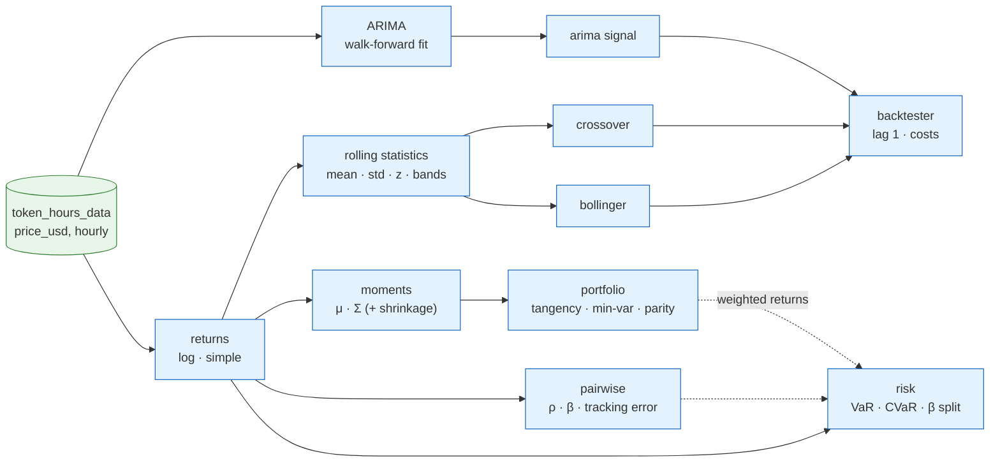

# Statistics and models: the theory, and how candlegraph applies it

**Status:** implemented — 2026-10-30. Describes the code in
`candlegraph/analytics/` and `candlegraph/strategies/` as it is today; a
section is added when a model lands (stage 4 adds momentum and GARCH).
**Area:** `analytics/rolling.py`, `analytics/pairwise.py`,
`analytics/portfolio.py`, `analytics/arima.py`, `strategies/*`,
`strategies/backtest.py`
**Companion:** [`../risk/DESIGN.md`](../risk/DESIGN.md) — tail risk,
systematic versus idiosyncratic risk, and where the risk-free rate comes
from.

This document is the one place the maths is written out. Each section gives
the theory, says in plain words what the equation is doing, and then says
exactly how candlegraph uses it — which function, which command, and which
convention it follows. Where a convention exists because the obvious version
was a bug, the invariant in `AGENTS.md` is named.

## 0. Notation and the conventions everything shares

| Symbol | Meaning |
|---|---|
| $P_t$ | the price at bar $t$ (USD mark, `price_usd`, oldest first) |
| $r_t$ | the simple return over bar $t$ |
| $\ell_t$ | the log return over bar $t$ |
| $W$ | a rolling window length, in bars |
| $A$ | the annualisation factor: bars per year |
| $\bar{x}$, $s_x$ | sample mean and sample standard deviation |
| $w$ | a vector of portfolio weights, one per asset |
| $\mu$, $\Sigma$ | the vector of expected annual returns and the annual covariance matrix |
| $r_f$ | the annual risk-free rate |

**Returns.** Two kinds, used for different jobs:

$$
r_t = \frac{P_t}{P_{t-1}} - 1
\qquad\qquad
\ell_t = \ln\frac{P_t}{P_{t-1}} = \ln P_t - \ln P_{t-1}
$$

A simple return is the fraction of money gained or lost over one bar. A log
return is the *continuously compounded* equivalent. They are nearly equal for
small moves (a 1% simple return is a 0.995% log return) and the difference
matters only in the tails. Log returns have one property worth the trouble:
they **add across time**, so the return over a day is the sum of the 24 hourly
log returns, which is what makes "scale by the square root of time" exact
rather than approximate. candlegraph uses log returns for volatility,
correlation, beta and the portfolio moments (`log_returns`), and simple
returns wherever money is counted — the backtester's equity curve and the
risk report's Value at Risk (`simple_returns`).

**Annualisation.** Bars are hourly, so there are $A = 8760 / h$ bars a year
for bars $h$ hours wide (`periods_per_year`). A mean return scales with time
and a standard deviation with the square root of time:

$$
\mu_{\text{annual}} = A\,\bar{\ell}
\qquad\qquad
\sigma_{\text{annual}} = \sqrt{A}\; s_\ell
$$

Why the square root: independent moves do not add up, they add up *in
variance*. Over $A$ bars the variance is $A$ times one bar's variance, so the
standard deviation is $\sqrt{A}$ times. Every rate and ratio below is
reported annual so that a Sharpe ratio from hourly bars means the same thing
as one from daily bars.

**Sample statistics.** Standard deviations use the sample form with $n-1$ in
the denominator (`ddof=1`):

$$
s_x = \sqrt{\frac{1}{n-1}\sum_{t=1}^{n}(x_t-\bar{x})^2}
$$

The sum is "add up every squared distance from the average"; dividing by
$n-1$ rather than $n$ corrects for the fact that the average itself was
estimated from the same data. On a 20-bar window the two differ by about
2.6%, which is enough to move a Bollinger band across a price — so the
convention is pinned (invariant 16).

**Complete windows or nothing.** A rolling statistic over $W$ bars is defined
only once $W$ bars exist. Before that it is `NaN`, never a mean of two values
pretending to be a mean of twenty (`min_periods=window`, invariant 16).

**Aligned bars.** Any statistic involving two assets uses only the hours
*both* traded. A thin token has no row for an hour with no swaps (invariant
19); filling it and then correlating would measure the fill, not the market.

## 1. Rolling statistics

The rolling mean and standard deviation over the last $W$ bars, recomputed
at every bar:

$$
\bar{x}_t^{(W)} = \frac{1}{W}\sum_{i=0}^{W-1} x_{t-i}
\qquad\qquad
s_t^{(W)} = \sqrt{\frac{1}{W-1}\sum_{i=0}^{W-1}\left(x_{t-i}-\bar{x}_t^{(W)}\right)^2}
$$

In words: look back $W$ bars from where you stand, average them, and measure
how spread out they are around that average; then step forward one bar and do
it again.

**Rolling volatility** is the rolling standard deviation of log returns,
annualised: $\sigma_t^{(W)} = \sqrt{A}\,s_t^{(W)}(\ell)$. **Rolling z-score**
is how many standard deviations the current value sits from its rolling mean:

$$
z_t = \frac{x_t - \bar{x}_t^{(W)}}{s_t^{(W)}}
$$

A flat window has $s = 0$ and the z-score is undefined there — returned as
`NaN`, not infinity.

*In candlegraph:* `rolling_mean`, `rolling_std`, `rolling_volatility`,
`rolling_zscore`, `rolling_summary` in `analytics/rolling.py`;
`candlegraph stats WETH --window 168`; the **Prices & volatility** tab.

## 2. Bollinger bands and the mean-reversion strategy

Bollinger bands are the rolling mean of price with a band of $k$ standard
deviations on each side:

$$
\text{middle}_t = \bar{P}_t^{(W)},\qquad
\text{upper}_t = \text{middle}_t + k\,s_t^{(W)},\qquad
\text{lower}_t = \text{middle}_t - k\,s_t^{(W)}
$$

Two derived quantities: the **z-score** of price against its own band
($z_t$ as above, with $x = P$), and **%B**, where the price sits between the
bands (0 at the lower band, 1 at the upper). **Bandwidth** is the band width
as a fraction of the middle, a volatility gauge.

The strategy fades stretched prices. It opens a long when the price is far
*below* its mean and a short when far *above*, and closes once the price has
come most of the way back:

$$
\text{position}_t =
\begin{cases}
+1 & \text{if flat and } z_t \le -z_{\text{entry}} \\
-1 & \text{if flat and } z_t \ge +z_{\text{entry}} \text{ (and shorting is allowed)} \\
0  & \text{if long and } z_t \ge -z_{\text{exit}}, \text{ or short and } z_t \le +z_{\text{exit}} \\
\text{previous} & \text{otherwise}
\end{cases}
$$

The two thresholds, with $z_{\text{exit}} < z_{\text{entry}}$, are
**hysteresis**. With a single threshold a price hovering at the boundary
would open and close a trade every bar and fees would eat the edge; the gap
between the two is what makes a position persist. The position is
path-dependent (whether $z = 1$ means "hold" or "stand aside" depends on
whether you were already in), which is why it is a loop and not a vectorised
expression.

*In candlegraph:* `bollinger_bands` (`rolling.py`), `bollinger_mean_reversion`
(`strategies/bollinger.py`); defaults $W = 20$, $k = 2$,
$z_{\text{entry}} = 2$, $z_{\text{exit}} = 0.5$; `candlegraph signals WETH
--strategy bollinger`.

## 3. Moving-average crossover

Two simple moving averages of price, a fast one over $W_f$ bars and a slow one
over $W_s > W_f$, and their separation as a fraction of the slow one:

$$
\text{sep}_t = \frac{\bar{P}_t^{(W_f)} - \bar{P}_t^{(W_s)}}{\bar{P}_t^{(W_s)}}
$$

Long while $\text{sep}_t > m$ (the fast average leads), short (optionally)
while $\text{sep}_t < -m$, flat in between. The minimum separation $m$ plays
the same role as Bollinger's hysteresis: two averages crossing and
re-crossing inside noise would otherwise trade every bar.

This is the trend-following counterpart to Bollinger's mean reversion. The
two fail in opposite regimes — a crossover bleeds in a range, Bollinger bleeds
in a trend — which is what makes `backtest --strategy all` worth reading.

*In candlegraph:* `moving_average_crossover` (`strategies/crossover.py`);
defaults $W_f = 12$, $W_s = 48$, long-only.

## 4. ARIMA: forecasting the next bar

ARIMA($p$, $d$, $q$) models a series as three pieces. **I** for *integrated*:
difference the series $d$ times until it is stationary (has a stable mean and
variance). With $d = 1$ on log prices the differenced series is simply the
log return, which is why `use_log_prices=True` is the default. **AR** for
*autoregressive*: the current value depends on the last $p$ values. **MA** for
*moving average*: it also depends on the last $q$ forecast errors. Writing
$y_t$ for the differenced series:

$$
y_t = c + \underbrace{\sum_{i=1}^{p}\phi_i\,y_{t-i}}_{\text{AR: the last } p \text{ returns}}
      + \underbrace{\sum_{j=1}^{q}\theta_j\,\varepsilon_{t-j}}_{\text{MA: the last } q \text{ surprises}}
      + \varepsilon_t
$$

In words: today's return is a weighted mix of the last few returns, plus a
weighted mix of how wrong the last few forecasts were, plus fresh noise. The
$\phi$ and $\theta$ weights are fitted by maximum likelihood (`statsmodels`).
`trend="n"` drops $c$: on differenced prices a constant means a permanent
drift, which is a strong claim to bake into a one-hour forecast.

**Choosing the order.** With `--auto-order` the grid $p \le 3$, $q \le 3$ is
fitted and ranked by the Akaike information criterion,

$$
\text{AIC} = 2k - 2\ln\hat{L}
$$

where $k$ is the number of fitted parameters and $\hat{L}$ the likelihood.
Lower is better: it rewards fit and penalises every extra parameter, so a
model is not chosen just because it has more knobs. $(0, d, 0)$ — a pure
random walk — has no parameters to rank and is skipped.

**From forecast to trade.** The one-step forecast $\hat{y}_{t+1}$ is
exponentiated back into price space to give $\hat{P}_{t+1}$, and the expected
return is $\hat{P}_{t+1}/P_t - 1$. The confidence interval comes back with it;
its width relative to the price is the model saying how sure it is. The
strategy takes a position when the expected return clears a threshold
$\tau$, **and stands aside when the interval is wider than
`max_interval_width`** — a point forecast with a several-percent interval
carries no information worth paying fees for.

**Walk-forward, never in-sample.** At bar $i$ the model is fitted on
`prices[: i + 1]` — history through that bar's close and nothing after — and
the fit is held for `refit_every` bars. Fitting once on the whole series and
reading its in-sample predictions back as signals is the classic way to
manufacture a profitable backtest, and a test pins that appending future
bars does not change past signals (invariant 17).

*In candlegraph:* `fit_forecast`, `select_order` (`analytics/arima.py`),
`arima_signal` (`strategies/arima_signal.py`); defaults $(1,1,1)$ on log
prices, 60 bars minimum, $\tau = 0.2\%$, refit every 6 bars, interval cap
25%; `candlegraph forecast WETH --auto-order`.

## 5. Pairwise comparison

For two assets $a$ and $b$ over their $n$ aligned bars, with log returns
$\ell^a$ and $\ell^b$:

**Pearson correlation** — how much the two move together, from $-1$ to $+1$:

$$
\rho_{ab} = \frac{\sum_t (\ell^a_t-\bar{\ell}^a)(\ell^b_t-\bar{\ell}^b)}
{\sqrt{\sum_t (\ell^a_t-\bar{\ell}^a)^2}\;\sqrt{\sum_t (\ell^b_t-\bar{\ell}^b)^2}}
$$

The numerator asks "when $a$ is above its average, is $b$ above its average
too?" and the denominator scales the answer so the units cancel.

**Spearman correlation** is the same formula applied to the *ranks* of the
returns instead of their values. It ignores the size of each move and so is
not dragged around by one outlier bar; a large gap between Pearson and
Spearman is itself a finding.

**Beta** of $a$ on $b$ — how much $a$ moves per unit move in $b$:

$$
\beta_{ab} = \frac{\operatorname{Cov}(\ell^a, \ell^b)}{\operatorname{Var}(\ell^b)}
$$

A beta of 1.5 means $a$ tends to move 1.5% when $b$ moves 1%. It is the
slope of the best-fit line through the scatter of the two return series. A
flat $b$ has no variance to divide by and beta is undefined (`NaN`), not
infinite.

**Relative return** is $a$'s total return minus $b$'s over the aligned
window. **Tracking error** is the annualised standard deviation of the return
difference, $\sqrt{A}\,s(\ell^a - \ell^b)$: how far the two drift apart bar
by bar even if they end in the same place. The **rolling correlation** is
Pearson over a sliding $W$-bar window, to show whether the relationship is
stable or regime-dependent.

*In candlegraph:* `compare_pair` (`analytics/pairwise.py`);
`candlegraph compare WETH WBTC --window 168`. The risk document builds on
beta to split an asset's variance into the part the benchmark explains and
the part it does not.

## 6. Performance ratios and drawdown

**Sharpe ratio** — excess return per unit of total risk, annualised:

$$
\text{Sharpe} = \frac{\bar{r} - r_f/A}{s_r}\,\sqrt{A}
$$

The risk-free rate is annual, so it is divided by $A$ to put it in the
series' own per-bar units before subtracting; that is the only way the
subtraction is dimensionally meaningful. Multiplying by $\sqrt{A}$
annualises the ratio (mean scales by $A$, standard deviation by $\sqrt{A}$,
so their ratio scales by $\sqrt{A}$). Hourly Sharpe ratios are large in
magnitude in both directions; prefer excess return and drawdown for judgement
(the `run-analytics` skill says the same).

**Sortino ratio** penalises only downside dispersion:

$$
\text{Sortino} = \frac{\bar{r} - r_f/A}{\sqrt{\frac{1}{n_-}\sum_{r_t<0} r_t^2}}\,\sqrt{A}
$$

The denominator is the root-mean-square of the *negative* excess returns only
— "how bad are the bad bars", ignoring the good ones, which a Sharpe ratio
would punish equally.

**Equity curve and drawdown.** Compounding returns gives a wealth index,
$E_t = E_0\prod_{i\le t}(1+r_i)$. The drawdown at $t$ is how far below its
running peak the curve sits, and the maximum drawdown is the worst of those:

$$
\text{DD}_t = \frac{E_t}{\max_{i\le t}E_i} - 1 \le 0
\qquad\qquad
\text{MDD} = \min_t \text{DD}_t
$$

**Calmar ratio** is annualised return over the absolute maximum drawdown: how
much return each unit of worst-case pain bought.

*In candlegraph:* `sharpe_ratio`, `sortino_ratio`, `equity_curve`,
`drawdown_curve`, `max_drawdown` in `rolling.py`; Calmar in `risk.py`. They
appear in every backtest report, the pairwise comparison, and
`candlegraph risk`.

## 7. Modern portfolio theory: the allocation model

### 7.1 The idea

Markowitz's observation: a portfolio's return is the weighted average of its
assets' returns, but its **risk is not** — it depends on how the assets move
*together*. Two assets that do not move in lockstep can be combined into
something less risky than either. For weights $w$ summing to one:

$$
\mu_p = w^\top\mu = \sum_i w_i\,\mu_i
\qquad\qquad
\sigma_p^2 = w^\top\Sigma\,w = \sum_i\sum_j w_i\,w_j\,\Sigma_{ij}
$$

The second sum runs over *every pair* of assets. The diagonal terms
($i = j$) are each asset's own variance scaled by its weight squared. The
off-diagonal terms are the covariances between pairs — and when two assets
are weakly or negatively correlated those terms are small or negative and
*pull the total down*. That is diversification, written as an equation: the
cross terms are the free lunch.

### 7.2 Estimating the inputs

From per-bar log returns over the trailing window (90 days by default), with
every row where any asset is missing dropped so the covariance is measured
over one common set of bars:

$$
\hat{\mu} = A\,\bar{\ell}
\qquad\qquad
\hat{\Sigma} = A\,\operatorname{Cov}(\ell)\ \ (\text{sample, } n-1)
$$

Sample covariance over a few thousand bars and ten assets is noisy, and an
optimiser will happily bet the book on that noise. **Shrinkage** pulls the
matrix part of the way towards its own diagonal:

$$
\Sigma_\delta = (1-\delta)\,\hat{\Sigma} + \delta\,\operatorname{diag}(\hat{\Sigma}),\qquad \delta\in[0,1]
$$

At $\delta = 0$ nothing changes; at $\delta = 1$ every covariance is zeroed
and the assets are treated as independent. A little ($0.1$–$0.3$) conditions
the problem without erasing the relationships. This is the diagonal-target
form of Ledoit–Wolf shrinkage with $\delta$ chosen by the user rather than
estimated; the automatic estimate is stage 4 work.

### 7.3 The objectives

All are solved over the same feasible set: weights sum to one, each weight
inside $[\text{low}, \text{high}]$ (long-only means $\text{low} = 0$;
`--allow-short` opens it to $-\text{high}$). A cap below $1/n$ is infeasible
and is rejected up front.

| Objective | Solves | In words |
|---|---|---|
| `max_sharpe` | $\max_w \dfrac{w^\top\mu - r_f}{\sqrt{w^\top\Sigma w}}$ | the **tangency portfolio**: the most excess return per unit of risk. Where the line from the risk-free rate touches the frontier. |
| `min_volatility` | $\min_w\ w^\top\Sigma w$ | the least risky fully invested mix, ignoring return entirely |
| `target_return` | $\min_w\ w^\top\Sigma w\ \ \text{s.t. } w^\top\mu = \mu^\ast$ | the least risky way to earn exactly $\mu^\ast$; one point on the frontier |
| `risk_parity` | $\min_w \sum_i\big(\text{RC}_i - \overline{\text{RC}}\big)^2$ | every asset contributes the **same share of risk**, whatever its weight |
| `equal_weight` | $w_i = 1/n$ | the naive baseline everything else should beat |

**Risk contribution.** Because $\sigma_p$ is homogeneous of degree one in
$w$, Euler's theorem splits it exactly across the assets:

$$
\text{RC}_i = w_i\,\frac{(\Sigma w)_i}{\sigma_p},\qquad \sum_i \text{RC}_i = \sigma_p
$$

$(\Sigma w)_i$ is asset $i$'s covariance with the whole portfolio; multiplying
by its weight and dividing by portfolio volatility gives the slice of total
volatility it is responsible for. Risk parity makes those slices equal — so a
volatile token gets a small weight and a stable one a large weight, by
construction.

### 7.4 The efficient frontier

Every target return between the minimum-variance portfolio's return and the
highest single-asset expected return is solved as a `target_return` problem;
the resulting (volatility, return) pairs trace the **efficient frontier** —
the set of portfolios no other portfolio beats on both axes. Points that are
infeasible under the bounds are dropped rather than reported as zeros, so a
short frontier means the caps are binding.

### 7.5 Reading an allocation

Beside the weights the result reports annual expected return and
volatility, the Sharpe ratio at the configured $r_f$, and the
**diversification ratio**:

$$
\text{DR} = \frac{\sum_i |w_i|\,\sigma_i}{\sigma_p}
$$

the weighted average of the individual volatilities over the portfolio's
own. It is exactly 1 when diversification bought nothing (one asset, or
perfectly correlated assets) and grows as the cross terms in §7.1 do their
work. Since 2026-10-30 the report also prints the allocation's Value at Risk
and expected shortfall, computed on the weighted return series so that the
diversification shows up in the tail too (see the risk document).

### 7.6 The portfolio strategy as candlegraph uses it today

What is built is a **single-period, static allocation**: estimate $\mu$ and
$\Sigma$ over the trailing window, solve the chosen objective once, report
the weights. It answers "given the last 90 days, how would MPT spread this
book". It is not yet a trading strategy: there is no rebalancing schedule, no
transaction cost on the rebalance, and no out-of-sample evaluation of
whether last quarter's tangency portfolio did anything useful this quarter.
Turning it into one — walk-forward re-estimation at a fixed cadence, costed
through the backtester, and compared against equal weight — is stage 4's
"walk-forward evaluation as a command". Until then the honest reading of a
`portfolio` result is *descriptive*: this is the mix that was efficient in
hindsight over the window, with the estimation error that implies.

Three things to expect, none of them bugs: the optimiser loves stablecoins
(USD-priced assets with near-zero variance dominate any minimum-risk
objective — exclude them with `--symbols` for a risk-asset-only answer);
`max_sharpe` concentrates when one asset had a good quarter (cap it with
`--max-weight`, or shrink); and expected returns estimated from 90 days of
hourly crypto are the least reliable input in the whole system, which is why
`min_volatility` and `risk_parity`, which do not use them, are often the
more defensible choices.

*In candlegraph:* `annualised_moments`, `optimise_portfolio`,
`efficient_frontier` in `analytics/portfolio.py`, solved with SLSQP;
`candlegraph portfolio --objective max_sharpe --risk-free-rate 0.04
--max-weight 0.4 --shrinkage 0.2`; the **Portfolio** tab.

## 8. Backtesting: what the numbers are made of

A strategy emits a target position $s_t \in \{-1, 0, +1\}$ at each bar using
information through that bar's close. It cannot trade at a price it has not
seen, so the position *held* during bar $t$ is the one decided one bar
earlier:

$$
p_t = s_{t-1}
$$

That `shift(1)` is the single most important line in the module (invariant
15). Multiplying an unshifted signal by same-bar returns manufactures a
profitable backtest silently — a test pins that it does.

Costs are charged on position *changes*, sized by how much the position
moved, so flipping long to short costs twice as much as opening from flat:

$$
r^{\text{strat}}_t = p_t\,r_t - c\,|p_t - p_{t-1}|,\qquad
c = (\text{fee}_{\text{bps}} + \text{slippage}_{\text{bps}})\times 10^{-4}
$$

The equity curve compounds $r^{\text{strat}}$; buy-and-hold compounds $r$;
**excess** is the difference of their total returns and is the number to
read first. A strategy that made 18% while the asset made 30% lost money in
the only sense that matters, and on hourly bars at 35 bps a side an active
strategy routinely pays 15–20% of capital in costs over 90 days. A losing
backtest is usually the honest answer, not a bug to tune away.

*In candlegraph:* `backtest`, `compare` in `strategies/backtest.py`;
`candlegraph backtest WETH --strategy all`; the **Strategies** tab.

## 9. How the pieces connect

## 10. Where each piece lives

| Concept | Function | Command / tab | Pinned by |
|---|---|---|---|
| returns, annualisation | `log_returns`, `simple_returns`, `periods_per_year` | everything | `test_rolling.py` |
| rolling mean / vol / z | `rolling_*` | `stats`, Prices tab | `test_rolling.py` (complete windows, `ddof=1`) |
| Bollinger | `bollinger_bands`, `bollinger_mean_reversion` | `signals --strategy bollinger` | `test_signals.py` (hysteresis) |
| crossover | `moving_average_crossover` | `signals --strategy crossover` | `test_signals.py` |
| ARIMA | `fit_forecast`, `select_order`, `arima_signal` | `forecast`, `signals --strategy arima` | `test_arima.py`, no-look-ahead test |
| pairwise | `compare_pair` | `compare` | `test_pairwise.py` (aligned bars only) |
| Sharpe, Sortino, drawdown | `sharpe_ratio`, `sortino_ratio`, `max_drawdown` | every report | `test_rolling.py` |
| MPT | `optimise_portfolio`, `efficient_frontier` | `portfolio`, Portfolio tab | `test_portfolio.py` |
| backtest | `backtest`, `compare` | `backtest`, Strategies tab | `test_backtest.py` (lag, costs) |
| VaR, CVaR, β split | `value_at_risk`, `conditional_value_at_risk`, `decompose_risk` | `risk`, `portfolio` | `test_risk.py` — see the risk document |

## Rejected alternatives

- **Population standard deviation (`ddof=0`).** Marginally simpler, biased
  low, and the bias is largest exactly where windows are short.
- **Partial rolling windows.** `min_periods=1` would make the first bars of
  every series look calm. A partial window is a different statistic.
- **Fitting ARIMA once and reading in-sample predictions.** Fast and
  flattering; invariant 17 exists because of it.
- **Expected returns as the main MPT input.** They are kept, because the
  tangency portfolio needs them, but `min_volatility` and `risk_parity` are
  offered precisely because the return estimate is the weakest number in the
  system.
- **Filling gaps before correlating.** Stage 0's fill policy allows
  interpolation for *display*; every two-asset statistic here uses aligned
  bars only.
