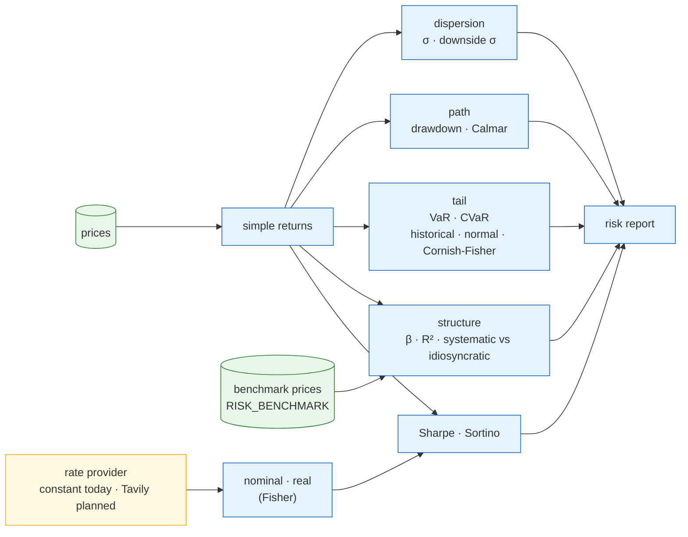
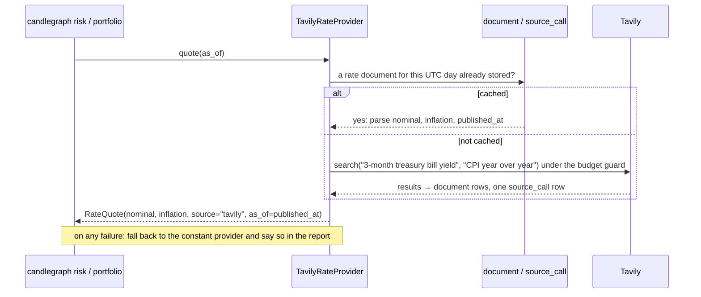

# Risk management: what we measure, how to tune it, and where the rates come from

**Status:** implemented — 2026-10-30 for the measures and the rate seam
(`analytics/risk.py`, `analytics/rates.py`, `candlegraph risk`); the
Tavily-backed rate provider described in §5 is *planned* and lands with the
knowledge layer.
**Area:** `candlegraph/analytics/risk.py`, `candlegraph/analytics/rates.py`,
`candlegraph/analytics/rolling.py` (drawdown, Sharpe, Sortino),
`candlegraph/cli.py` (`risk`, `portfolio`)
**Companion:** [`../models/DESIGN.md`](../models/DESIGN.md) — the maths of
every statistic and model, including the ratios this document leans on.

## What "risk" means here

A single number for risk does not exist; four questions do, and candlegraph
answers each with a different measure.

| Question | Measure | Where it shows |
|---|---|---|
| How much does it move? | annualised volatility, downside deviation | `stats`, `compare`, `risk`, every backtest |
| How far did it fall, and for how long? | drawdown curve, maximum drawdown, Calmar | backtests, the Strategies tab, `risk` |
| **How bad is a bad day?** | **Value at Risk (VaR), Conditional VaR (expected shortfall)** | `risk`, `portfolio` |
| **Which part of the risk is the market, and which part is this token?** | **systematic / idiosyncratic split: beta, $R^2$, the two volatilities** | `risk` |
| Is the return worth the risk? | Sharpe, Sortino, Calmar | everywhere a return is reported |

The first two and the last were already in the analytics layer; the two in
bold are what this document adds, together with the rule for where the
risk-free rate those ratios depend on comes from. Everything is **pure**:
`risk.py` takes a return series and gives numbers back; the CLI does the
loading (invariant 18).

## 1. Systematic versus unsystematic risk

### The theory

Regress a token's returns on a benchmark's — the **single-index model**:

$$
r^a_t = \alpha + \beta\, r^m_t + \varepsilon_t
$$

$\beta$ is how much the token moves per unit move of the market (the same
beta as `compare` reports); $\alpha$ is the return it earned that the market
does not explain; $\varepsilon_t$ is what is left over on each bar. Because
the residual is uncorrelated with the benchmark by construction, the
token's variance splits cleanly in two:

$$
\underbrace{\operatorname{Var}(r^a)}_{\text{total}}
= \underbrace{\beta^2\,\operatorname{Var}(r^m)}_{\text{systematic}}
+ \underbrace{\operatorname{Var}(\varepsilon)}_{\text{idiosyncratic}}
$$

**Systematic** (market, undiversifiable) risk is the part that comes from
moving with the benchmark. Holding more tokens does not remove it, because
they all share it. **Idiosyncratic** (specific, unsystematic) risk is the
token's own noise — an exploit, a listing, an unlock — and *is* what
diversification removes: across many tokens the $\varepsilon$ terms average
towards zero. The share of total variance that is systematic is $R^2$, the
squared correlation:

$$
\text{systematic share} = \frac{\beta^2\operatorname{Var}(r^m)}{\operatorname{Var}(r^a)} = \rho_{am}^2 = R^2
$$

In plain words: an $R^2$ of 0.7 means seventy percent of this token's
hourly wobble is the crypto market wobbling, and only thirty percent is news
about the token itself. A portfolio of such tokens will not be much calmer
than any one of them.

### How candlegraph applies it

- **The benchmark is WETH by default** (`RISK_BENCHMARK`). There is no stored
  market index yet; ether is the asset most of this universe is priced
  against and co-moves with, so it is the closest proxy for "the crypto
  market" the database can offer. A market-cap-weighted index of the tracked
  tokens is the obvious upgrade and is listed under rejected-for-now below.
- **Aligned bars only.** The regression uses the hours both the token and
  the benchmark traded, the same rule as `compare` (invariant 19's
  consequence). The report says how many bars survived.
- **The split is exact.** Systematic variance is $\beta^2 \operatorname{Var}(r^m)$;
  idiosyncratic is total minus that, which the Cauchy–Schwarz inequality
  keeps non-negative; so the two shares sum to one by construction and a test
  pins it.
- **Volatilities are annualised** from the bar width, like everything else.
- A token regressed against itself is skipped (the answer is a tautology),
  as is a benchmark that is not tracked; the report prints the rest and says
  why the split is missing.

## 2. Value at Risk

### The theory

VaR answers "over the next horizon, what loss will I not exceed, with
probability $c$?" Formally, writing $L$ for the loss (a positive number),

$$
\Pr\big(L > \text{VaR}_c\big) = 1 - c
$$

A one-day 95% VaR of 6% means: on 19 days out of 20 the loss is 6% or less;
on the twentieth it is worse — and VaR says **nothing about how much
worse**. That silence is its well-known weakness, and why the next section
exists.

Three ways to estimate it are offered, because they agree on well-behaved
data and disagree exactly when it matters — in fat tails, which hourly
crypto returns have.

**Historical.** Sort the observed returns and read off the $(1-c)$ quantile:

$$
\text{VaR}^{\text{hist}}_c = -\,q_{1-c}(r)
$$

No assumption about the shape of the distribution; the data speaks. Its cost
is that it can only see tails it has already lived through, and with 90 days
of hourly bars the 99% tail is the worst 22 bars.

**Parametric (variance–covariance).** Assume returns are normal with mean
$\mu$ and standard deviation $\sigma$:

$$
\text{VaR}^{\text{norm}}_c = -\big(\mu + z_{1-c}\,\sigma\big),
\qquad z_{0.05} = -1.645,\ z_{0.01} = -2.326
$$

$z_{1-c}$ is the standard normal quantile — "how many standard deviations
out is the $(1-c)$ point of a bell curve". Smooth and stable, and it
**understates** the risk of anything with heavier tails than a bell curve,
which is most of crypto; a test on Student-$t$ data pins exactly that
failure.

**Cornish–Fisher.** Keep the parametric form but bend the normal quantile
by the sample's skew $S$ and excess kurtosis $K$:

$$
\tilde z = z + \frac{(z^2-1)\,S}{6} + \frac{(z^3-3z)\,K}{24} - \frac{(2z^3-5z)\,S^2}{36},
\qquad
\text{VaR}^{\text{CF}}_c = -\big(\mu + \tilde z\,\sigma\big)
$$

Positive excess kurtosis (fat tails) pushes $\tilde z$ further out; negative
skew (crashes bigger than rallies) pushes the loss tail out further still.
On normal data $S = K = 0$ and the correction vanishes, so this collapses to
the parametric estimate — also tested. It is the pragmatic middle: it uses
the whole sample's shape, not just the handful of worst bars, without
pretending the shape is Gaussian.

**Horizon.** A loss over $h$ bars rather than one is scaled by $\sqrt{h}$
(the same square-root-of-time rule as annualisation, exact for the
parametric estimator under its own assumption, an approximation for the
historical one — returns across hours are not quite independent):

$$
\text{VaR}_{c,h} = \sqrt{h}\;\text{VaR}_{c,1}
\quad(\text{dispersion part});\qquad
\mu_h = h\,\mu\ (\text{drift part})
$$

The report always names the horizon it used (`VaR 95% 1d`), so a reader
never has to guess whether a figure is hourly or daily.

### Conditional Value at Risk (expected shortfall)

CVaR answers the question VaR refuses: *given* that the loss breaches the
VaR, how big is it on average?

$$
\text{CVaR}_c = \mathbb{E}\big[\,L \;\big|\; L \ge \text{VaR}_c\,\big]
$$

Historically that is the mean of the bars beyond the quantile. For the normal
case there is a closed form —

$$
\text{CVaR}^{\text{norm}}_c = \sigma\,\frac{\varphi(z_{1-c})}{1-c} - \mu
$$

where $\varphi$ is the normal density: "the height of the bell curve at the
cut-off, spread over the tail's probability mass". For Cornish–Fisher the
adjusted quantile is averaged numerically across the tail.

CVaR is always at least the VaR (the average of the tail cannot be better
than its edge — tested for all three estimators), and it has a property VaR
lacks: it is **sub-additive**, so the CVaR of a portfolio is never more than
the sum of its parts. VaR can violate that, which means VaR can tell you that
diversifying *increased* your risk. When one number has to be chosen, choose
CVaR.

### Portfolio VaR

The allocation report (`candlegraph portfolio`) prints the VaR and CVaR of
the **solved portfolio**, computed on the weighted return series
$r^p_t = \sum_i w_i\,r^i_t$ over the common bars, not as a weighted sum of
the assets' individual VaRs. That is what lets the diversification the
optimiser found show up in the tail: a 50/50 mix of two imperfectly
correlated assets has a smaller VaR than its riskier leg, and a test says so.

### How candlegraph applies it

- **Losses are positive numbers** in every report. A VaR of 0.03 is "a 3%
  loss or worse".
- **Arithmetic returns**, because a loss is a fraction of money, not a log;
  at hourly horizons the two are within rounding. Everything else in the
  package uses log returns for the reasons in the models document.
- **Minimum 30 observations** (`min_observations`). A 95% VaR from 20 bars is
  the single worst bar wearing a statistic's name; the function refuses
  rather than guesses (invariant 11's spirit: a number that is not there is
  not zero).
- **Defaults:** 95% confidence, 24-bar (one-day) horizon, historical
  estimator. All three are settings and flags (§4).

## 3. Measures already in the layer

Volatility, downside deviation, drawdown, Sharpe, Sortino and Calmar are
defined with their equations in the models document (§0, §6). The risk
report gathers them in one place beside the tail measures, together with the
sample **skew** and **excess kurtosis** — printed deliberately, because they
are the reader's warning about which VaR estimator to trust: with excess
kurtosis above about 1 the parametric figure is optimistic.

## 4. Tuning

Everything that changes a risk number is a setting with a flag override, in
the same shape as the analytics knobs that already exist.

| Setting | Flag | Default | Effect |
|---|---|---|---|
| `RISK_CONFIDENCE` | `--confidence` | `0.95` | the tail probability $1-c$. Must be above 0.5: a "VaR" at 40% confidence describes a typical bar, not a tail. |
| `RISK_HORIZON_BARS` | `--horizon` | `24` | bars the loss is measured over; 24 hourly bars is one day |
| `RISK_VAR_METHOD` | `--method` | `historical` | `historical` / `parametric` / `cornish_fisher` |
| `RISK_BENCHMARK` | `--benchmark`, `--no-benchmark` | `WETH` | the market proxy for the systematic split; empty disables it |
| `RISK_FREE_RATE` | `--risk-free-rate` | `0.0` | annual nominal rate for Sharpe and Sortino |
| `RISK_FREE_RATE_SOURCE` | — | `constant` | which provider supplies the rate (§5) |
| `INFLATION_RATE` | — | `0.0` | annual inflation, for the real rate printed beside the nominal |
| `ANALYTICS_LOOKBACK_DAYS` | `--days` | `90` | the sample window |

Guidance, not rules:

| You want | Set |
|---|---|
| a regulatory-style figure | `--confidence 0.99 --horizon 240` (ten trading days) — and read CVaR, not VaR |
| to compare estimators on one token | run `risk` three times with each `--method`; a large spread between `parametric` and `historical` is the tail telling you it is fat |
| a token's own risk, market removed | the `idiosyncratic vol.` line; it is what adding that token to a diversified book actually costs |
| to know whether adding a token diversifies | low `systematic share` and low beta — both printed |
| stable numbers on a thin token | a longer `--days`; thin tokens have fewer aligned bars and the split says how many |

## 5. The risk-free rate: nominal, real, and where it comes from

### Why it matters

Every Sharpe and Sortino ratio and the tangency portfolio subtract the
risk-free rate. At $r_f = 0$ (today's default) the Sharpe ratio of a
stablecoin is undefined and the tangency portfolio is the maximum-return
mix, which is wrong in a world where cash earns 4–5%. The rate is therefore a
first-class input, and the design question is where it comes from.

### Nominal versus real

The **nominal** rate is the yield a riskless instrument pays. The **real**
rate is what that yield is worth after inflation, by the Fisher relation:

$$
1 + r_{\text{real}} = \frac{1 + r_{\text{nominal}}}{1 + \pi}
\qquad\Longrightarrow\qquad
r_{\text{real}} = \frac{1 + r_{\text{nominal}}}{1 + \pi} - 1
$$

The shortcut $r_{\text{nominal}} - \pi$ is close at low rates and off by
tenths of a percent at crypto-era ones, so the exact form is used. A 4% bill
under 5% inflation is a real return of **−0.95%**: the money is shrinking.

**Convention: ratios use the nominal rate.** The Sharpe ratio compares a
strategy with the yield the same money could actually have earned, and
that yield is nominal — the inflation hits the strategy's return and the
bill's alike, so it cancels in the comparison. The real rate is **reported
beside it** so the reader deciding whether a return is worth having sees
whether cash itself was losing purchasing power. That is the honest split:
compute with nominal, show both.

### The seam: `RateProvider`

`analytics/rates.py` defines one Protocol, `quote(as_of) -> RateQuote`, where
a quote carries the nominal rate, the inflation rate, its source and its
timestamp, and derives the real rate. The only implementation today is
`ConstantRateProvider`, built from `RISK_FREE_RATE` and `INFLATION_RATE`.
Callers ask the provider; none reads the setting directly — that is the whole
point of the seam.

### Planned: a Tavily-backed provider

The knowledge layer (stage 1, `docs/knowledge/tavily/DESIGN.md`) brings a
metered web-search source, a document store, and a `source_call` ledger with
a budget guard. A `TavilyRateProvider` reuses all of it:

Four rules it will follow, recorded now so the step cannot drift:

1. **One search per UTC day**, cached in the database — the same
   `(subject, day)` cache rule the Tavily document sets for assets.
2. **No look-ahead.** For a backtest over history the rate at bar $t$ is the
   latest quote whose `published_at ≤ t`; a quote retrieved today is not
   applied to last month's Sharpe ratio (invariant 17's shape).
3. **Fail soft.** Budget refused, network down, or an unparseable result
   falls back to the constant provider, and the report's rate line names
   the source actually used.
4. **Numbers are computed; prose is optional** (invariant 22). The provider
   parses a figure out of a retrieved document; no model is asked what the
   rate is.

Until it exists, `RISK_FREE_RATE_SOURCE=tavily` is refused with a message
naming the one source that does (tested), so a configuration that expects
live rates fails at the command line rather than silently using zero.

## 6. Reading the numbers honestly

- Hourly crypto returns are **fat-tailed and negatively skewed**. Expect the
  historical and Cornish–Fisher VaR to exceed the parametric one, often by a
  third or more at 99%. When they do not, the window was calm, not the asset.
- A one-day 95% VaR on a major token is typically several percent; a tail
  twice the parametric figure is normal, not a bug.
- **CVaR over VaR** when one number must be chosen. VaR is the threshold;
  CVaR is the bill.
- A high systematic share on a stablecoin pair is an artefact of near-zero
  variance in the denominator — read the volatilities, not the share.
- Few aligned bars (thin token against WETH) make beta noisy; the report
  prints the bar count for exactly this reason.
- None of these numbers is a forecast. They describe the window they were
  measured on.

## Rejected for now

- **Monte Carlo VaR.** Simulating paths needs a model of the return
  distribution; with GARCH and the other models in stage 4 it becomes
  meaningful. Without them it would be the parametric estimate with extra
  randomness.
- **EWMA / GARCH volatility** for a time-varying VaR. Stage 4.
- **A market-cap index of the tracked tokens as the benchmark.** The right
  upgrade from WETH; it needs supply data per token to be stored first.
- **Using the real rate in the Sharpe ratio.** Non-standard and it cancels in
  the comparison it is meant to inform; reported instead.
- **Pulling rates from a dedicated data API** (FRED and similar). Correct and
  simple, but another credential and another client for a number Tavily can
  retrieve through infrastructure the knowledge layer is building anyway.
  Revisit if the Tavily parse proves brittle.

## Pinned by tests

`tests/unit/analytics/test_risk.py`: historical VaR equals the empirical
quantile; parametric VaR and CVaR match the normal closed forms;
Cornish–Fisher collapses to parametric on normal data and exceeds it on
fat tails; CVaR ≥ VaR for every estimator; more confidence means more loss;
the horizon scales by $\sqrt{h}$; the systematic and idiosyncratic shares
sum to one and recover a known generating model; a token against itself is
all systematic, an independent one almost none; a flat benchmark has no beta;
a diversified portfolio's VaR is below its riskiest leg.
`tests/unit/analytics/test_rates.py`: the Fisher relation, the constant
provider, and the refusal of a source that does not exist.
`tests/unit/test_cli_analytics.py`: the `risk` command end to end, flags
reaching the report, the real rate printed, and `portfolio` printing the
allocation's tail risk.
