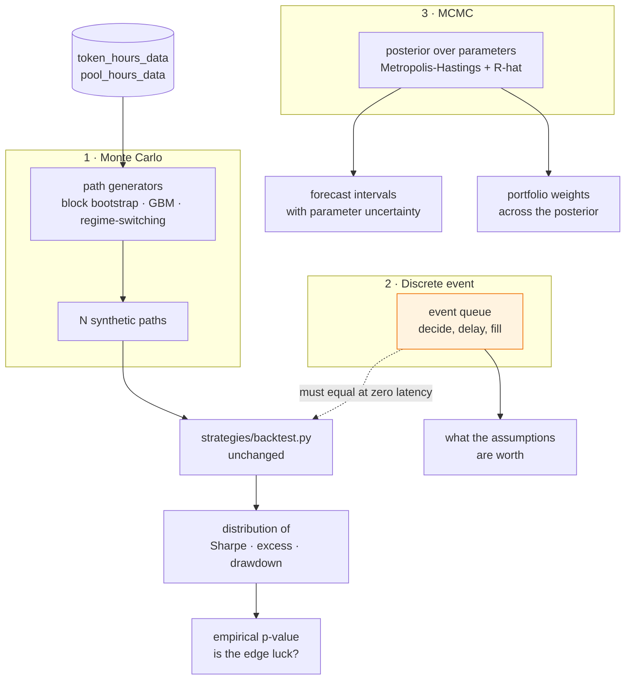

# Simulation: testing strategies against markets that did not happen

**Status:** proposed — 2026-11-09. No code yet; this document is the
argument, and `docs/rollout/ROLLOUT.md` sequences the build.
**Decision:** three simulators with three different jobs — **Monte Carlo**
for "is this edge luck?", **discrete-event** for "does the vectorised
backtester lie about execution?", and **MCMC** for "how wrong might the
parameters be?". They are not three ways of doing one thing, and the
clearest way to get this wrong is to build them as if they were.
**Companion:** [`../models/DESIGN.md`](../models/DESIGN.md) §8
(backtesting), [`../risk/DESIGN.md`](../risk/DESIGN.md),
[`../../roadmap/DESIGN.md`](../../roadmap/DESIGN.md).

## The problem

`candlegraph backtest WETH --strategy all` reports one number per strategy
over one price path: the one that happened. That is a sample of size one.
It cannot distinguish a rule with an edge from a rule that was lucky, it
cannot say how much of the result depended on the particular sequence of
hours, and it quietly assumes every order filled instantly at the close at
a fixed cost.

Three different doubts, three different instruments:

| Doubt | Instrument | Answers |
|---|---|---|
| "Would this have worked on a different sample of the same market?" | **Monte Carlo** over resampled or modelled paths | A *distribution* of Sharpe, excess and drawdown instead of one draw |
| "Would this have filled the way the backtester assumed?" | **Discrete-event simulation** of an order lifecycle | What the `shift(1)` and the flat bps cost are worth, measured |
| "How confident are the parameters the model is built on?" | **MCMC** over model posteriors | Forecast and portfolio intervals that include *parameter* uncertainty |

The existing deterministic layer is the thing being tested, not replaced.
Every simulator reuses `strategies/backtest.py` and the analytics
functions unchanged; none of them becomes a second implementation of the
same arithmetic.

## 1. Monte Carlo — is the edge luck?

**What it does.** Generate many synthetic price paths with the same
statistical character as the real one, run the existing strategy and
backtester over each, and report the distribution of the metrics rather
than a point.

**Path generators, and what each trades away.**

| Generator | Preserves | Destroys | Right for |
|---|---|---|---|
| IID bootstrap of returns | the return distribution (fat tails included) | **all** autocorrelation and volatility clustering | a null hypothesis: what a rule scores on a market with no exploitable structure |
| Stationary block bootstrap | short-range dependence and clustering, within the block length | structure longer than the block | the default; hourly crypto has strong volatility clustering |
| Geometric Brownian motion | drift and volatility only | fat tails, clustering, mean reversion | a sanity baseline, not a realistic market |
| ARIMA residual resampling | the fitted model's dynamics; reuses `analytics/arima.py` | whatever the model does not capture | testing a strategy against the model that forecasts it |
| Markov regime-switching | bull/bear persistence and regime-dependent volatility | within-regime structure | drawdown and tail questions, where regimes dominate |

**The default is the stationary block bootstrap.** An IID bootstrap of
hourly crypto returns destroys the volatility clustering that most of
these strategies are implicitly trading, so it flatters mean reversion and
punishes trend following for reasons that have nothing to do with either.

**The honest caveat, stated on every surface.** A bootstrap of a bull
sample simulates bull markets. Monte Carlo widens the sample along one
axis only — the *ordering* and *recombination* of moves that actually
happened. It says nothing about a regime the window does not contain, and
a confident-looking 10,000-path distribution from 90 days of one market is
still 90 days of one market.

**What it gives the existing code.** Two things the roadmap already wants:

- **A null distribution for a backtest.** Run the strategy on *N*
  shuffled paths; the fraction of them beating the real result is an
  empirical p-value for "this rule has an edge". A Sharpe of 1.2 that 40%
  of random paths also achieve is not an edge.
- **ARIMA forecast calibration.** `analytics/arima.py` already returns a
  confidence interval. Simulating forward and counting how often the
  realised path lands inside it is the test of whether that interval means
  what it says. A 95% interval containing 70% of outcomes is a bug
  report, and there is currently no way to notice.

**Determinism.** Every run takes a seed and records it. A simulation whose
result changes between two readings of the same page is not evidence.

## 2. Discrete-event simulation — does the backtester lie?

**What it does.** Replace the vectorised `position * returns` with an
explicit event queue: bar arrives → strategy decides → order submitted →
latency elapses → order fills (or does not) → position updates. Time
advances event by event rather than row by row.

**Why this is worth building, when a fast backtester already exists.**
Not to replace it. **To be the reference implementation it is checked
against.** The vectorised backtester encodes three assumptions as
arithmetic:

1. the decision at bar *t* becomes a position at *t+1* exactly
   (`shift(1)`);
2. the fill happens at the close, in full, always;
3. the cost is a flat `(fee + slippage)` bps regardless of size or
   liquidity.

A discrete-event run with zero latency, full fills and a flat cost must
reproduce the vectorised result *to floating-point tolerance*. That
equality is the deliverable — it is what makes the fast path trustworthy.
Then each assumption gets relaxed one at a time and the divergence is
measured: latency of one bar, partial fills sized against
`pool_hours_data` volume, slippage scaled by order size against liquidity.
The output is a number for "what the convenient assumptions are worth",
which no amount of reasoning about `shift(1)` can produce.

**Scope discipline.** A full limit-order-book simulator is not in scope
and probably never is: candlegraph has hourly bars, not tick data, so a
queue-position model would be fabricating microstructure it has no data
for. The event model stops at bar granularity, which is the resolution the
data actually supports.

**What it needs from storage.** Volume and liquidity per hour, which
`pool_hours_data` already carries — and which, per the data-model note, is
the *only* place per-pair volume and TVL are reachable.

## 3. MCMC — how wrong might the parameters be?

**What it does.** Sample from the posterior distribution of a model's
parameters given the data, rather than taking a single point estimate and
treating it as truth.

**Two concrete uses, both on code that already exists.**

- **Forecast intervals that include parameter uncertainty.**
  `analytics/arima.py` and `analytics/statespace.py` both fit parameters
  and then forecast as if those parameters were known exactly. The
  resulting interval covers innovation noise only, so it is too narrow —
  systematically, and more so on short windows. Sampling the posterior and
  forecasting from each draw produces an interval that includes both
  sources. This connects directly to the stage-0 work: the `causal`
  estimator's band is scaled by a volatility *point estimate*, and the
  same criticism applies to it.
- **Portfolio weights with a posterior.** Mean-variance optimisation's
  well-known failure is that it treats estimated expected returns as
  known, and `optimise_portfolio` inherits that; `shrinkage` is the
  current blunt mitigation. A posterior over the mean vector gives a
  *distribution of optimal portfolios*, and "these weights are stable
  across the posterior" is a far stronger statement than one frontier.

**Sampler choice.** A hand-rolled random-walk Metropolis-Hastings, in
numpy, with Gelman-Rubin R-hat and effective sample size as the
convergence diagnostics. Rejected: `pymc` and `numpyro` are large
dependencies with compilation toolchains, for models of two or three
parameters where a 60-line sampler is auditable and deterministic under a
seed. Revisit if the models grow past a handful of parameters or acquire
hierarchy — at which point a real sampler earns its weight, and the seam
will already exist.

**The diagnostics are not optional.** An MCMC run that has not converged
produces confident nonsense, and unlike a failed optimisation it does not
announce itself. R-hat and ESS are reported with every posterior, and a
run that fails them is surfaced as a refusal rather than a result.

## A terminology trap worth naming

"Markov chain Monte Carlo" and "a Markov chain used for Monte Carlo
simulation" are different things, and both are plausibly wanted here:

- **MCMC** (section 3) is a *parameter estimation* technique. The Markov
  chain wanders through parameter space; its stationary distribution is
  the posterior.
- **A Markov regime-switching model** is a *path generation* technique — a
  transition matrix between bull/bear/choppy states, each with its own
  drift and volatility. That belongs in section 1 as a Monte Carlo
  generator, not here.

They share a name and nothing else. The build covers both, in the two
places they belong, and the UI must never present them as one control.

## How they fit together

## Rules these inherit

- **Nothing simulated is ever written to `token_hours_data`.** The same
  rule the fill cache follows, for the same reason: coverage and the
  quality report must keep measuring what was actually ingested. If a
  simulation result needs persisting, it gets its own table and its own
  placement decision.
- **Invariants 15-17 do not relax.** A simulated path is still a price
  series; a strategy run over it still lags execution by one bar and still
  may not look ahead. The Monte Carlo harness calls the *existing*
  backtester precisely so this cannot drift.
- **Every run is seeded and the seed is reported.** Determinism is what
  separates evidence from decoration.
- **Purity.** Generators and samplers are pure functions of
  `(data, parameters, seed)` and live in `analytics/`; anything touching
  the database stays outside it (invariant 18).
- **A result that says "no edge" is the expected outcome.** The deterministic
  backtester already reports losing strategies honestly; the simulators
  exist to make that conclusion *stronger*, not to find a way around it.

## Exit criterion

`candlegraph simulate WETH --strategy bollinger --paths 1000` prints the
distribution of excess return with an empirical p-value against the real
backtest; a discrete-event run at zero latency reproduces the vectorised
backtester to tolerance, and reports what one bar of latency costs; and
`candlegraph forecast WETH --posterior` prints an interval wider than the
point-estimate one, with R-hat reported and a refusal if it has not
converged.
