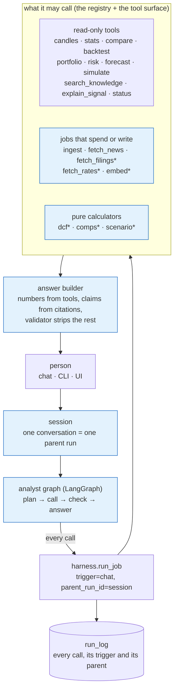

# The analyst: candlegraph answering questions in conversation

**Status:** proposed — 2026-11-14. Nothing here is built. This is the
target the harness work is aiming at, written down now so the pieces
built before it fit it. It does not replace stage 2
([`../runner/DESIGN.md`](../runner/DESIGN.md) is the substrate; the
pipeline design comes next) and it does not change any decision already
made.
**Related:** [`../runner/DESIGN.md`](../runner/DESIGN.md) (jobs and runs),
[`../../knowledge/mcp/DESIGN.md`](../../knowledge/mcp/DESIGN.md) (the tool
surface), [`../../knowledge/sources/DESIGN.md`](../../knowledge/sources/DESIGN.md)
(where new data comes from), [`../../agents/framework/DESIGN.md`](../../agents/framework/DESIGN.md)
(what a graph is), [`../../roadmap/DESIGN.md`](../../roadmap/DESIGN.md)
(stages 3 and 4, which this depends on).

## What is being asked for

A person types or says:

- "Pull the news on SOL and ETH this week."
- "What happened to GBP against the dollar yesterday?"
- "Get me NVDA's last four 10-Qs and run a DCF."
- "Is my WETH mean-reversion rule still working, net of costs?"
- "Why did you flag a gap on GNO last night?"

and gets an answer that is **computed, cited and reproducible**, not
generated. The last two questions are already answerable by code in this
repository; the first three are not, and the gap is mostly data, not
intelligence.

## The one rule this design exists to protect

**The model chooses what to call. It never produces a number.**

Every figure in an answer comes from deterministic code that is already
tested — `analytics/`, `strategies/`, the quality report — and every
claim about the world comes from a stored document with a URL and a
timestamp. This is the rule `signals --explain` already follows: the
narrator sees findings and citations and may only phrase them, and a
sentence citing an unknown document is stripped (`knowledge/validate.py`).
The analyst is that rule applied to a conversation instead of a bar.

Three consequences:

1. A question that needs a number the code cannot compute gets "I can't
   compute that yet", not an estimate.
2. Every answer can be replayed: the tool calls are runs, the runs are
   rows, the inputs are stored.
3. The analyst can be wrong about *which* tool to call — a recoverable,
   visible error — but cannot be wrong about arithmetic.

## Shape



`*` does not exist yet.

### Why a graph and not a loop

The repo already has two LangGraph agents and a framework document for
them. The analyst is a third graph with the same contract: typed state,
nodes that do one thing, a pure step that decides, and a publish step.
What differs is that its "findings" are an answer with citations, and one
of its nodes calls `run_job`.

### Why every tool call is a `Run`

Because it already is. Step 1 made `run_job` the only way work starts,
step 2 gave every run a `trigger` and a `parent_run_id`, and step 3 gave
jobs without a ledger a generic `run` row. A conversation becomes:

| Field | Value |
|---|---|
| `job` | `analyst_session` for the conversation; the tool's own name per call |
| `trigger` | `chat` (new value; the column is free text and `TRIGGERS` is a list) |
| `parent_run_id` | the session's run id, on every call it makes |
| `counts` / `detail` | tokens read, credits spent, documents cited |

So "what did it do when it answered that?" is `SELECT * FROM run_log
WHERE parent_run_id = …` — the question stage 2's pipeline runs will ask
in exactly the same way. Nothing new is needed to get this; it is why
`parent_run_id` was added before anything used it.

## What has to exist first, in order

This is the honest part. Four of these are roadmap stages already; the
analyst is what they add up to, not a detour around them.

| # | Piece | Why it blocks the analyst | Where it is |
|---|---|---|---|
| 1 | **The `instrument` supertype** — tokens, equities, FX pairs, rates as one entity with one id space | "NVDA" and "GBP/USD" cannot be asked about while the only entity is a Uniswap token address. `asset` in the knowledge layer already generalises; `token` does not | roadmap stage 3 |
| 2 | **A second and third ingestion adapter** — an equity price source, an FX source | a DCF needs a share count and a price; "GBP yesterday" needs a series | stage 3 |
| 3 | **Fundamentals** — SEC EDGAR filings and XBRL financials as stored, dated facts | DCF inputs must be citable rows with a filing date, not scraped numbers | sources design, #6 |
| 4 | **A rate source** — FRED, vintage-aware | the discount rate in a DCF and the risk-free rate in every Sharpe ratio. `analytics/rates.py` is already a seam with a constant behind it | sources design, #3 |
| 5 | **Valuation as pure analytics** — `analytics/valuation.py`: DCF, WACC, terminal value, sensitivity grid | the calculation has to be testable without a model in the loop, like every other number here | new, small, no blockers |
| 6 | **Session state and a conversation surface** | somewhere to hold "the ticker we are talking about" across turns | new |
| 7 | **A spend guard for live questions** | a person asking twelve questions about twelve tickers can spend a month of credits in a minute | extends `knowledge/budget.py` |

Order matters: 5 can be built today against a hand-supplied input set and
is the cheapest way to settle what a DCF means here before any of the
data arrives. 1 and 2 are stage 3. 3 and 4 follow the sources document's
adoption order. 6 and 7 are the analyst's own work.

## The parts that are new, in detail

### Valuation (`analytics/valuation.py`), pure

Same rules as the rest of `analytics/`: no I/O, typed inputs, a result
object, and every assumption named in the output rather than buried.

```python
@dataclass(frozen=True)
class DCFInputs:
    free_cash_flows: Sequence[float]  # explicit forecast years
    discount_rate: float  # WACC, as a decimal fraction
    terminal_growth: float
    net_debt: float
    shares_outstanding: float
    as_of: datetime  # every input is dated; see below


@dataclass(frozen=True)
class DCFResult:
    enterprise_value: float
    equity_value: float
    value_per_share: float
    pv_by_year: Sequence[float]
    terminal_share: float  # how much of EV is the terminal value
    sensitivity: pd.DataFrame  # value per share across (WACC, g)
    inputs: DCFInputs
```

Two opinions worth stating now, both of which have equivalents already in
this repo:

- **A DCF reports its sensitivity or it is not reported.** A single
  value-per-share from one WACC and one growth rate is the valuation
  equivalent of a backtest with no distribution — and the repo already
  refuses that (`simulate` exists because a single backtest is a sample
  of size one). `terminal_share` is printed for the same reason costs are
  printed next to a backtest: if 85% of the value is terminal, the reader
  should know before arguing about year three.
- **Inputs are dated, and the date is checked.** The no-look-ahead rule
  (invariants 15–17, and `retrieved_at <= bar` in retrieval) applies:
  valuing a company "as of" a past date may not use a filing published
  after it. This is the same discipline, in a new place, and it is why
  `as_of` is on the inputs rather than implied.

### The analyst graph

| Node | Does | Pure? |
|---|---|---|
| `understand` | the question plus session state → a typed request (entities, window, what is being asked) | no (model) |
| `plan` | request → an ordered list of tool calls; refuses what it has no tool for | yes, given the registry |
| `execute` | each call through `run_job`, with the session as parent; collects results and citations | no (I/O) |
| `check` | numbers present? citations resolve? spend inside budget? anything stale? | yes |
| `answer` | results + citations → prose; the validator strips any sentence citing something that is not in the result set | no (model), bounded |

`plan` being pure and registry-driven is what keeps this testable: given
a request and a registry, the planned calls are a fixed list, and a test
can assert "this question plans a `fetch_filings` then a `dcf`, in that
order, and nothing else".

### Refusals are answers

The repo already refuses rather than guesses in four places: a
non-causal fill policy, an unconverged MCMC chain, a budget-exhausted
search, `RETRIEVAL_BACKEND=ragflow`. The analyst continues that list:

| Situation | Answer |
|---|---|
| no instrument for the symbol | "I don't track NVDA yet; I track …" |
| no tool for the question | "I can't compute that. The closest I have is …" |
| budget exhausted | "I'd need a search to answer that and today's budget is spent; here is what I have stored" |
| data too stale or too thin | the finding, with the number of bars, not a smaller-sample answer |
| the model wants to cite something not retrieved | the sentence is dropped before the answer is shown |

## What I would build first, and why

1. **`analytics/valuation.py` with the sensitivity grid**, tested against
   hand-worked examples. No dependencies, settles the shape of a DCF
   here, useful the day equities land.
2. **`trigger = "chat"` and a session run**, exercised by a thin CLI
   (`candlegraph ask "…"`) that plans and calls existing tools only.
   This proves the whole loop against what already exists — candles,
   stats, backtests, news search — before any new data source.
3. **The spend guard extension**, before the first metered source is
   reachable from a chat prompt rather than from a daily job.

That order means the first two steps need nothing from stages 3 and 4,
and the result is already useful: an interactive front end to the
analytics that exist, with every number computed and every claim cited.

## Longer tasks: the research loop

This design covers one question and one answer. A brief that takes days
("review these tokens, report Thursday") needs a loop with memory,
limits and stop rules. That is designed separately in
[`../research-loop/DESIGN.md`](../research-loop/DESIGN.md); it reuses
everything above and adds a notebook, a guard and a pause.

## Risks

- **Scope.** "Personal quant analyst" is four roadmap stages wide. The
  mitigation is the order above: each step is useful alone.
- **Plausible nonsense.** The one rule at the top is the whole defence,
  and it only holds if `answer` can never introduce a figure. The
  citation validator exists; a number validator (every figure in the
  prose must appear in the tool results) does not yet and should be
  built with it.
- **Cost.** A chat surface makes metered calls demand-driven for the
  first time — the Tavily design explicitly chose a cost that depends on
  the calendar, not on demand. The guard has to come before the surface,
  not after.
- **Latency.** A DCF over four filings plus a search is seconds, not
  milliseconds. Runs are already asynchronous and recorded; the
  conversation should show progress from the stage records rather than
  block silently.
