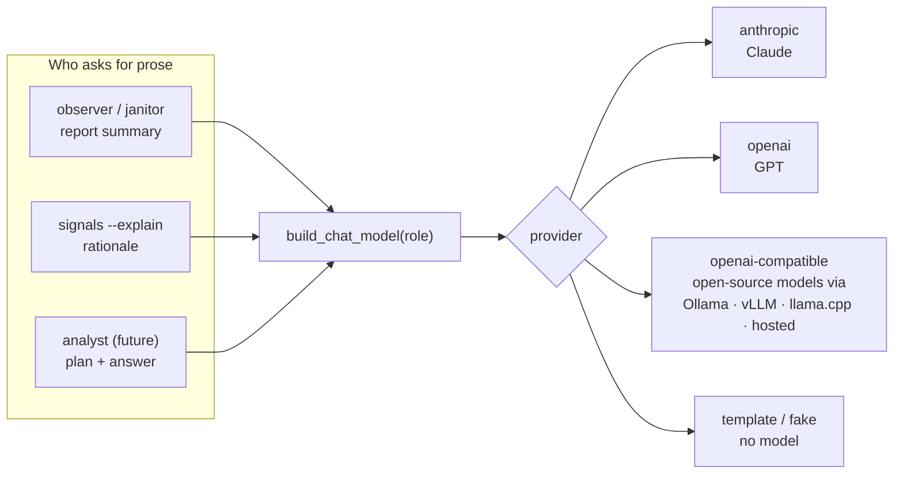

# Models: what the stack uses today, and how to make it switchable

**Status:** proposed — 2026-11-15. The audit describes the code as it
is. The design (one chat-model seam with Claude, OpenAI and open-source
providers) is not built.
**Related:** [`../../knowledge/embeddings/DESIGN.md`](../../knowledge/embeddings/DESIGN.md)
(the embedding decision, unchanged here), [`../../agents/framework/DESIGN.md`](../../agents/framework/DESIGN.md)
(narrators), [`../analyst/DESIGN.md`](../analyst/DESIGN.md) (the main
future user of a chat model).

## Audit: where a model is used today

There are only **two kinds** of model use in the whole stack: turning
text into vectors (embeddings), and writing a paragraph of prose
(narration). Everything else that looks "intelligent" is plain code.

| Task | Model today | Setting | Required? | Code |
|---|---|---|---|---|
| Embed news chunks for search | `bge-m3` on the local Ollama service | `EMBEDDING_PROVIDER=ollama`, `EMBEDDING_MODEL=bge-m3` | Yes, for the meaning-based half of search. Without it search is keyword-only | `knowledge/embed.py` |
| Embed (hosted alternative) | OpenAI `text-embedding-3-large`, cut to 1024 numbers | `EMBEDDING_PROVIDER=openai` | No | `knowledge/embed.py` |
| Embed (tests) | a hash, no model | `EMBEDDING_PROVIDER=fake` | Tests only | `knowledge/embed.py` |
| Write the paragraph in `signals --explain` | Claude, if named; otherwise a template | `KNOWLEDGE_LLM_MODEL`, falls back to `AGENT_LLM_MODEL`; `ANTHROPIC_API_KEY` | No — the template is a full answer | `knowledge/explain.py` |
| Write the summary in observer/janitor reports | Claude, if named; otherwise a template | `AGENT_LLM_MODEL`; `ANTHROPIC_API_KEY` | No | `agents/narrator.py` |
| Find which tokens a news chunk mentions | none — alias word matching | `config/tokens.yaml` aliases | — | `knowledge/mentions.py` |
| Rank search results | none — a fixed formula (reciprocal rank fusion) | — | — | `knowledge/retrieve.py` |
| Decide findings, severities, exit codes | none — pure code | — | — | `agents/*/assess.py` |
| Check citations in prose | none — pure code | — | — | `knowledge/validate.py` |
| Decide whether a search is affordable | none — pure code | `TAVILY_*` | — | `knowledge/budget.py` |

### What the audit found

1. **Bug, fixed this session:** `AGENT_LLM_MODEL` did nothing for the
   agents. It was documented, but the observer and janitor always built
   the template narrator. Both now ask `NarratorSelector(settings).build()`
   — one place that reads the setting — with a regression test.
2. **Trap, fixed this session:** `EMBEDDING_PROVIDER=openai` with the
   default `EMBEDDING_MODEL=bge-m3` sent an Ollama model name to OpenAI
   and failed mid-run. `check_provider_model` now refuses any pair that
   cannot work, in either direction, before a request is made.
3. **Chat models are Claude only, and hard-wired twice.** The Anthropic
   call is copied in `agents/narrator.py` and `knowledge/explain.py`.
   There is no way to use OpenAI or an open-source model for prose.
4. **The model setting does not say which company.** `AGENT_LLM_MODEL=
   claude-sonnet-5-5` works only because the code assumes Anthropic.
5. **Nothing records which model wrote a report.** Embeddings are stamped
   with their model on every row; prose is not. A report written by a
   model and one written by the template look the same in the ledger.
6. **Test isolation, fixed this session:** a developer shell with
   `AGENT_LLM_MODEL` or `ANTHROPIC_API_KEY` exported could make unit tests
   call a real model. Those variables are now cleared in `tests/conftest.py`.

Embeddings are already switchable and are not the problem. The work is
on the chat side.

## Design: one seam for chat models

The embedding side already has the right shape: an `Embedder` protocol,
a few providers, one factory, a fake for tests. Chat models get the same.



### The interface

```python
class ChatModel(Protocol):
    name: str  # "anthropic:claude-sonnet-5-5", stamped on output

    def complete(self, prompt: str, *, max_tokens: int) -> str: ...
```

Small on purpose. Today's two narrators need nothing more: they send one
prompt built from findings and get one paragraph back. The analyst will
need tool calls later; that is a second method added when it is needed,
not now.

### Four providers

| Provider | Covers | Key setting | Notes |
|---|---|---|---|
| `anthropic` | Claude models | `ANTHROPIC_API_KEY` | today's code, moved behind the interface |
| `openai` | OpenAI GPT models | `OPENAI_API_KEY` (already exists for embeddings) | plain HTTP via `httpx`, like `OpenAIEmbedder` — no new SDK |
| `openai-compatible` | **open-source models**: Qwen, Llama, DeepSeek, gpt-oss, Mistral and others | `OPENAI_COMPATIBLE_URL` (+ optional key) | Ollama, vLLM, llama.cpp and most hosted open-model services all speak the OpenAI chat format, so one provider covers them. Locally, the Ollama service already in the stack can serve one |
| `template` | no model | — | today's default, kept as the default |

Why one "compatible" provider instead of one per open-source vendor: the
models change every few months, the API format does not. The choice of
*which* open model is a setting, not code.

### How you pick a model

One setting per **role** (what the prose is for), written as
`provider:model`:

```
AGENT_LLM_MODEL=anthropic:claude-sonnet-5-5      # report summaries
KNOWLEDGE_LLM_MODEL=openai:<gpt-model>           # explanations
ANALYST_LLM_MODEL=openai-compatible:qwen3:32b    # future analyst
```

- **Old values keep working.** A bare name (`claude-sonnet-5-5`) means
  `anthropic:`, which is what it meant before.
- **Unset still means the template.** No key, no model, no network — the
  stack stays fully usable for free.
- **Roles can differ.** A cheap local model for nightly summaries and a
  stronger hosted one for the analyst is a normal setup.

### Rules that do not change

- **The model only phrases; it never decides** (invariant 22). Findings,
  severities and exit codes come from code. A model can be swapped
  without any test about findings changing.
- **A failed call falls back to the template**, logged, never raised —
  as today.
- **Citations are still checked** by `knowledge/validate.py` whatever
  wrote the sentence.

### New: record which model wrote it

Every report and explanation records `narrator: "anthropic:claude-
sonnet-5-5"` (or `"template"`) in its `detail`, the way every chunk
records its `embedding_model`. That makes "did the summaries get worse
when we switched?" answerable from the ledger.

### Embeddings: what to add, and what not to

Already switchable between local (`bge-m3` on Ollama) and hosted
(OpenAI). One small addition: let the Ollama provider point at any
Ollama-format server, so a stronger open embedding model (for example a
Qwen3 embedding model, truncated to 1024 with `EMBEDDING_TRUNCATE`) can
be tried. The rules in the embeddings design stand: one active model,
1024 numbers per vector, `make reembed` to switch.

## Choosing a model from the UI

The pipelines design adds a model picker per role on a Pipelines page
([`../pipelines/DESIGN.md`](../pipelines/DESIGN.md) §9). Paid providers
(Anthropic, OpenAI) are selectable only when their API key is set in the
environment; the UI never accepts or stores a key. Choices are rows in a
small `model_choice` table and apply from the next step, with no restart.

## How to choose between models

Do not pick by reputation. Build a small fixed test set and score each
candidate on it:

| Role | Test set | Score |
|---|---|---|
| Report summary | 20 saved finding lists | mentions every WARNING+ finding; mentions nothing else; length |
| Explanation | 20 saved explain contexts | citations kept by the validator; sentences stripped (lower is better) |
| Embedding | the eval set planned in the embeddings design | recall of the right chunk for a known question |

Run it with `make eval-models ARGS='--role agent'` (new target), and
record results in this document. A model change is then a decision with
numbers, like every other change here.

## Cost

Hosted chat models cost money per call; today nothing tracks that.
Summaries are small (one call per observer run, ~every 15 minutes, a few
hundred tokens), so cost is low — but the analyst will not be. The
budget manager design ([`../../knowledge/budget-manager/DESIGN.md`](../../knowledge/budget-manager/DESIGN.md))
is written for Tavily credits and is built so a second metered source
(a model API) can get its own pools later.

## Build order

| # | Change | Size | Behaviour change |
|---|---|---|---|
| 1 | `ChatModel` protocol, `anthropic` and `template` providers; both narrators use it. Delete the duplicate Anthropic code | S | none |
| 2 | `provider:model` parsing, bare names = anthropic; stamp `narrator` in detail | S | new detail field only |
| 3 | `openai` and `openai-compatible` providers, tested with `httpx.MockTransport` | S | new options |
| 4 | The model eval target and its first results | M | none |

Steps 1–3 are one small rollout and need nothing from stage 2. Step 1 is
worth doing before the analyst is built, because the analyst is the
third user and should not be the third copy.
