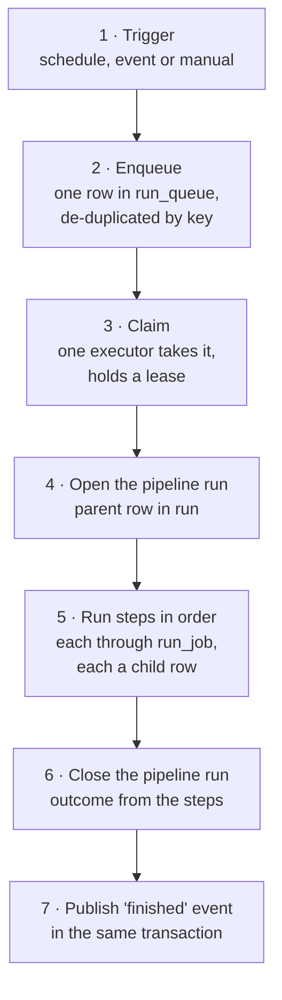
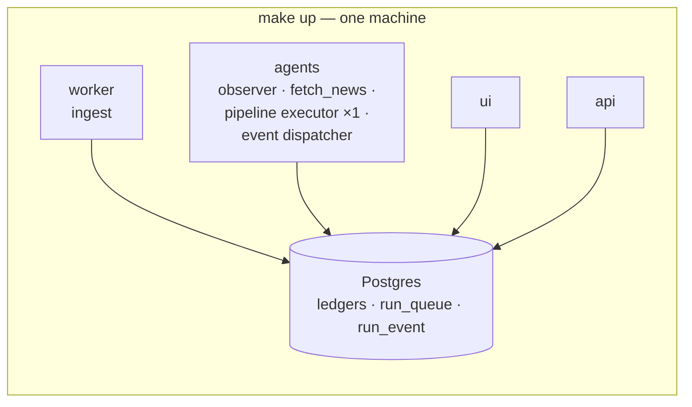
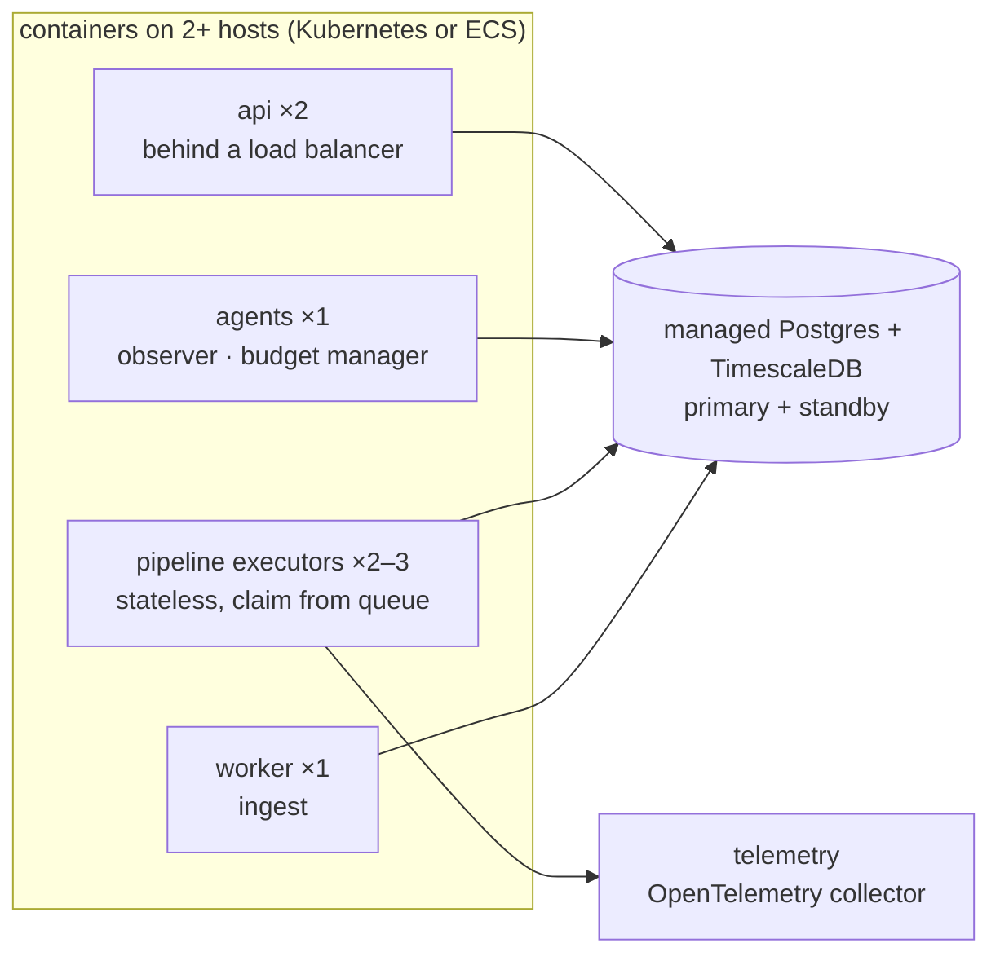

# Pipelines: running several jobs as one reliable unit

**Status:** proposed — 2026-11-15. Nothing here is built. Rollout step 2
(`docs/rollout/ROLLOUT.md`): this document must be reviewed before any
pipeline code is written in step 3.
**Builds on:** [`../runner/DESIGN.md`](../runner/DESIGN.md) — jobs,
`run_job`, the three ledgers, `parent_run_id`. All of it stays.
**Related:** [`../models/DESIGN.md`](../models/DESIGN.md) (how a step gets
a model), [`../../knowledge/budget-manager/DESIGN.md`](../../knowledge/budget-manager/DESIGN.md)
(spend limits a step must respect), [`../../roadmap/DESIGN.md`](../../roadmap/DESIGN.md) §2.

---

## 1. Summary

A **pipeline** is a named, ordered list of registered jobs that run as
one unit: for example *ingest finished → check quality → compute
statistics → write signals*. Today each of those runs on its own timer
and nothing ties them together; a failed quality check does not stop
signals being written from bad data.

This design adds:

1. a **YAML spec** for pipelines, validated in full before anything runs;
2. a **pipeline executor** that runs steps in order through the existing
   `run_job`, with retries, timeouts and a clear rule for what a failure
   does to the rest;
3. **durable execution**: a pipeline run survives a process crash and
   can resume from the step that did not finish;
4. **event triggers**: "when ingest succeeds, run *hourly*", delivered at
   least once and de-duplicated;
5. a **model choice** per step, with the UI showing which providers are
   usable (a paid provider is usable only when its API key is set in the
   environment).

It is written for **two environments** — local development (one laptop,
`make up`) and production (several hosts, managed Postgres, real users) —
and says, for each decision, what differs between them.

---

## 2. Goals and non-goals

### Goals

| # | Goal | Measured by |
|---|---|---|
| G1 | A pipeline either finishes, or stops at a known step with a recorded reason. Never silently half-done. | every pipeline run ends with an outcome; every child step has a row |
| G2 | A crash (process, container, host) loses no more than the step in flight, and that step is re-run. | kill test: `docker kill` mid-run → the run resumes and completes |
| G3 | Retrying is always safe. | every registered job is idempotent (contract + test) |
| G4 | One trigger produces exactly one completed pipeline run, even if the trigger is delivered twice. | dedup test: the same event twice → one run |
| G5 | Bad specs never reach production. | `candlegraph run --check` in CI; load-time validation with line numbers |
| G6 | The same code runs locally and in production; only configuration and deployment differ. | no `if production:` branches in the executor |
| G7 | Paid models are used only when explicitly configured with a key. | no key in env → provider shown as unavailable and cannot be selected |

### Non-goals (for this design)

- **Branching graphs, fan-out/fan-in, dynamic steps.** Pipelines are
  linear. The analyst and research loop (`../analyst/`,
  `../research-loop/`) are where non-linear work goes, and they are
  LangGraph graphs.
- **Users writing pipelines in the UI.** Specs live in git and go through
  review. The UI runs and inspects them.
- **Per-user API keys.** Keys come from the environment only. Keys in a
  user session belong to the later Next.js frontend (§11.4).
- **A workflow product** (Airflow, Temporal, …). Considered in §13; not
  adopted now, with the conditions that would change that.
- **Real-time market streaming.** Hourly bars are the input. §10 says
  what would be added if that changes.

---

## 3. Background: what exists

| Piece | Today | What this design uses it for |
|---|---|---|
| Job registry | `harness/jobs.py`: `ingest`, `observer`, `janitor`, `fetch_news` | steps name registered jobs; nothing else can be a step |
| `run_job` | runs one job, never raises, writes the ledger row before and after | executes every step |
| Ledgers | `ingest_run`, `agent_run`, generic `run`; `run_log` view over all three | the pipeline is a parent row in `run`; each step is a child row |
| `trigger`, `parent_run_id` | on every row since the pre-work | a step records the pipeline's trigger and points at the pipeline run |
| Scheduler | one APScheduler builder; `max_instances=1` per process | schedules pipelines on a clock — but see §7.3, it is not enough across processes |
| Writes | every write path upserts on a natural key | makes re-running a step safe (G3) |

Missing today, and supplied here: a way to group jobs, durable progress
across a crash, retries, timeouts, cross-process locking, event delivery,
and a per-step model choice.

---

## 4. Requirements

### Functional

- F1. Define a pipeline in YAML: name, trigger(s), ordered steps; each
  step = a registered job + params + failure policy.
- F2. Start a pipeline from a schedule, an event, or by hand (CLI, UI).
- F3. Run steps in order; pass context (trigger, as-of time, parent run)
  to each.
- F4. Retry a step on transient failures; time it out; decide whether the
  pipeline continues.
- F5. Resume an interrupted pipeline run from its first unfinished step.
- F6. Show pipeline runs and their steps in `make runs`, the UI and MCP.
- F7. Choose a model per step role; show which providers are available.

### Non-functional

| | Local | Production |
|---|---|---|
| Hourly pipeline finishes within | best effort | **15 min after ingest succeeds, 99% of hours** |
| Lost work on a crash | the step in flight | the step in flight |
| Duplicate completed runs per trigger | 0 | 0 |
| Recovery from a dead worker | on next start | within one lease period (**2 min**) |
| Scale | 1 process | 2+ executor replicas, any host |
| Secrets | `.env` | secret manager; never in images, logs or the database |

---

## 5. The spec

### 5.1 Format

```yaml
# pipelines/hourly.yaml
name: hourly
description: Turn each new hour of data into checked statistics and signals.
version: 1

triggers:
  - event: { job: ingest, outcome: [succeeded, partial] }
  - schedule: { every: 3600 }        # safety net if an event is missed

concurrency: one_at_a_time          # default; see §7.3
deadline: 15m                       # whole run; see §7.5

defaults:
  retry: { attempts: 3, backoff: 30s, max_backoff: 5m }
  timeout: 5m

steps:
  - id: validate
    job: validate
    on_failure: stop                # bad data must not reach signals

  - id: analyse
    job: analyse
    params: { window: 24 }

  - id: signal
    job: signal
    params: { strategies: all }
    on_partial: continue

  - id: explain
    job: explain
    model_role: knowledge            # §9
    on_failure: continue             # prose is optional (invariant 22)
    timeout: 2m
```

### 5.2 Rules, checked at load time

The spec is parsed into pydantic models (as `settings.py` and
`tokens.py` already are). Loading **fails the whole file**, with the line
number, if any of these hold:

| Check | Why |
|---|---|
| unknown key anywhere | a typo must not become a silently ignored setting |
| `job` is not in `JOBS` | only registered jobs can run (invariant 27) |
| `params` do not match the job's declared param model | each job declares a pydantic `Params` class; the spec is checked against it |
| a step's job declares `market_data` in `writes` | only the worker's `ingest` job writes market data (invariant 21). Pipelines react to ingest; they do not run it (§7.1) |
| a job that is not idempotent | it cannot be retried or resumed safely (§6.2) |
| an event trigger names this pipeline, or a pipeline that triggers this one | a loop (A finishes → B → A …) |
| duplicate step ids, empty step list, unknown `model_role` | basic integrity |
| `deadline` shorter than the sum of step timeouts | the deadline would always fire |

`candlegraph run --check pipelines/*.yaml` runs the same checks without
running anything, and **CI runs it on every change** (G5).

### 5.3 Versioning

`version` is stored on every pipeline run. Changing a step's order or
meaning bumps it. A run is always resumed with the version it started
with; a resume against a changed spec is refused with a message saying
so, rather than mixing two definitions in one run.

---

## 6. Execution model

### 6.1 One run, start to finish



Every arrow goes one way. Retries happen *inside* box 5 and are described
as a table below, not as extra arrows.

### 6.2 The contract every step job must meet

A job can be a pipeline step only if it is **idempotent**: running it
twice with the same inputs leaves the same state as running it once.

| Job | Why it is idempotent today |
|---|---|
| `ingest` (not a step; reacted to) | upsert on `(token_id, period_start_unix)` |
| `fetch_news` | `(asset, UTC day)` cache; documents upsert on `url_hash` |
| `signal` (new) | upsert on `(strategy, symbol, period_start_unix)` |
| `embed` (new) | only embeds chunks without the current model's vector |
| `validate`, `analyse` (new) | read only |
| `explain` (new) | upsert on `(strategy, symbol, period_start_unix)` |
| `observer` | writes only its own ledger row |

`Job` gains one field, `idempotent: bool`, defaulting to **False**, and
a test fails if a job is marked idempotent without a test that runs it
twice and compares state. This turns "retrying is safe" from a hope into
a checked property.

**Why this matters more than any retry logic:** with idempotent steps,
the system can be *at-least-once* everywhere — re-deliver events, re-run
steps after a crash, retry on timeouts — and the result is still
*effectively once*. Exactly-once delivery is not needed, and is not
attempted.

### 6.3 Inputs flow through the database, not through memory

Steps do not hand Python objects to each other. Each step reads what it
needs from the database, bounded by the pipeline run's **as-of time**
(fixed when the run opens). `analyse` does not receive `validate`'s
result; it reads the same bars, and `validate`'s outcome only decides
whether `analyse` runs at all.

This costs a few extra reads. It buys:

- **resume works** — a restarted step needs nothing from a process that
  died;
- **no look-ahead between steps** — every step sees data as of the same
  moment, the no-look-ahead rule (invariants 15–17) applied to a whole
  run;
- **steps can later run on different hosts** without changing them.

### 6.4 What a step's outcome does next

| Step outcome | Default | Can be set to | Pipeline outcome |
|---|---|---|---|
| `succeeded` | next step | — | — |
| `partial` | **continue** | `stop` | `partial` at worst |
| `failed` (after retries) | **stop** | `continue`, `skip_rest` | `failed` if stopped, else `partial` |
| timed out | treated as `failed` | same as failed | same |
| skipped (an earlier step stopped) | — | — | recorded as `skipped` in detail |

The pipeline's outcome is the worst outcome among steps that ran, except
that a step with `on_failure: continue` downgrades its own failure to
`partial` for the pipeline. Every skipped step still gets a row in
`detail.steps`, so "what didn't run" is never an absence.

### 6.5 Retries

| Error | Example | Retried? |
|---|---|---|
| **Transient** | network timeout, HTTP 5xx, connection reset, Postgres `OperationalError`, lease lost mid-step | yes, up to `attempts` |
| **Rate limited** | HTTP 429 from The Graph or a model API | yes, with the server's `Retry-After` if given |
| **Budget refused** | Tavily guard says no | **no** — it is the guard working; the step returns `succeeded` with the refusal counted (as `fetch_news` already does) |
| **Permanent** | bad config, missing key, validation error, a bug | **no** — retrying cannot help |

Classification lives in one function, `harness.errors.classify(exc)`,
with the existing exception types mapped once (`SubgraphError` with a 5xx
→ transient, `TavilyRateLimitError` → rate-limited, `NewsError` →
permanent, …). A job can override for its own exception types.

Backoff is exponential with full jitter: attempt *n* waits a random time
between 0 and `min(max_backoff, backoff × 2ⁿ)`. Jitter matters in
production: without it, every replica that failed together retries
together and fails together again.

Each attempt is its own child row (`attempt: 1, 2, 3`), so retries are
visible in `run_log` rather than hidden inside one row.

### 6.6 Why a plain loop and not LangGraph

The roadmap said pipelines would be LangGraph graphs. For a **linear**
pipeline, LangGraph buys nothing the loop does not already have:

| LangGraph offers | A linear pipeline needs it? |
|---|---|
| conditional edges | no — "stop on failure" is one `if` |
| shared state between nodes | no — §6.3 deliberately passes nothing in memory |
| checkpointing | yes, but it must be **in our own ledger**, readable by `run_log` and the UI. LangGraph's checkpointer is a second store with its own format |
| human-in-the-loop interrupts | not for pipelines; yes for the research loop |

**Decision: a plain loop**, behind a small `Executor` interface so a
graph executor could be swapped in later. LangGraph stays the tool for
agents, the analyst and the research loop, where branching and model-led
decisions are the point. The roadmap's line is updated to say so.

---

## 7. Fault tolerance

This section is the core of the design. Each mechanism answers one
specific failure.

### 7.1 Who writes market data

Pipelines **react to** ingest; they never run it. Ingest stays the
worker's job, on its own schedule, because:

- a 90-day backfill must not share an executor with the hourly pipeline;
- one writer of market data is easier to reason about than two;
- invariant 21 can then be checked at load time (§5.2) instead of hoped.

### 7.2 Durable queue: `run_queue`

Every trigger becomes a row before anything runs:

| Column | Purpose |
|---|---|
| `id`, `pipeline`, `version` | what to run |
| `dedup_key` | **unique** with `pipeline`. For the hourly pipeline: the bar hour. A second event for the same hour is a no-op insert (G4) |
| `trigger`, `cause_run_id` | why; the run that caused it (for events) |
| `state` | `queued` → `claimed` → `done` / `dead` |
| `available_at` | not before this time (used for retry delay and backoff) |
| `attempts`, `last_error` | how many times it was claimed |
| `claimed_by`, `lease_expires_at` | which executor holds it, until when |

Executors claim work with the standard Postgres queue pattern:

```sql
UPDATE run_queue SET state = 'claimed', claimed_by = :me,
       lease_expires_at = now() + interval '2 minutes', attempts = attempts + 1
 WHERE id = (SELECT id FROM run_queue
              WHERE state = 'queued' AND available_at <= now()
              ORDER BY available_at
              FOR UPDATE SKIP LOCKED LIMIT 1)
RETURNING *;
```

`SKIP LOCKED` lets any number of executors poll the same table without
blocking each other or taking the same row. No new service is needed.

### 7.3 One run of a pipeline at a time

APScheduler's `max_instances=1` only protects **one process**. With two
executor replicas in production, two hourly runs could overlap. The
executor therefore also takes a **Postgres advisory lock** keyed on the
pipeline name for the duration of the run. It must be the
**session-level** lock (`pg_try_advisory_lock`), not the transaction one:
a run spans many transactions. A session lock is also released
automatically if the executor's connection dies, which is what we want
after a crash. If the lock is taken, the queue row goes back to `queued`
with `available_at` pushed out. The same mechanism fixes the double-spend race flagged in
the budget-manager design.

### 7.4 Crashes: leases and heartbeats

An executor renews its lease every 30 seconds while working. If a
process, container or host dies, the lease expires (2 minutes) and a
**reaper** (part of every executor's loop) does two things:

1. puts the queue row back to `queued`, so another executor resumes it;
2. closes the dead step's child row as `failed` with
   `detail.reason = "lease_expired"`.

The pipeline run then **resumes**: steps whose latest attempt
`succeeded` are skipped; the first unfinished step runs again. Because
every step is idempotent (§6.2), re-running the step that was in flight
is safe.

After `max_claims` (default 5) the queue row goes to `dead` instead —
a poison run that keeps crashing its executor must not take every
replica down in turn. A dead row is a CRITICAL finding for the observer.

### 7.5 Timeouts

| | Local | Production |
|---|---|---|
| Step timeout | **cooperative**: the step checks a deadline between units of work (per token, per batch). Python cannot safely kill a thread. | **enforced**: each claimed run executes in a child process; the supervisor sends SIGTERM, then SIGKILL after a grace period. The lease and resume handle the rest |
| Pipeline deadline | marks the run `failed`, remaining steps `skipped` | same |

Cooperative timeouts are enough for development, where a stuck step is
visible in the terminal. Production needs the hard kill, because a stuck
HTTP call with no timeout would otherwise hold a lease forever — so every
outbound client must also set its own timeout (most already do).

### 7.6 Dependencies that are down

| Dependency down | Behaviour |
|---|---|
| Postgres | executors back off and retry the claim; nothing runs without the ledger, by design |
| The Graph | ingest fails → no `ingest succeeded` event → the hourly pipeline does not start; the schedule trigger still fires and `validate` reports stale data |
| Ollama (embeddings) | `embed` fails transiently, retried; retrieval works lexical-only meanwhile (existing behaviour) |
| Tavily | `fetch_news` records the error; pipeline continues (`on_failure: continue`) |
| A model API | the narrator falls back to the template (existing behaviour); step `succeeded`, `detail.narrator = "template"` |

A **circuit breaker** per external dependency stops hammering a service
that is clearly down: after 5 consecutive transient failures within 5
minutes, calls fail fast for 2 minutes, then one trial call is let
through. Its state is in process memory locally and in a small Postgres
table in production, so all replicas share it.

### 7.7 Events: transactional outbox

"Ingest finished" must reach the pipeline even if the executor is
restarting at that moment. Postgres `LISTEN/NOTIFY` alone loses
notifications when no one is listening, so:

1. when a run closes, its ledger update and an insert into `run_event`
   happen **in the same transaction** — the event exists if and only if
   the outcome was recorded;
2. a dispatcher reads undispatched `run_event` rows, enqueues matching
   pipelines into `run_queue` (dedup makes this safe to repeat), and
   marks the event dispatched;
3. `NOTIFY` is sent as well, but only to **wake** the dispatcher early.
   If it is lost, the dispatcher's 10-second poll finds the event anyway.

This is the *transactional outbox* pattern. It gives durable,
at-least-once events with no new infrastructure.

### 7.8 Failure scenarios, end to end

| Scenario | What happens | Data correct? |
|---|---|---|
| Executor killed during `signal` | lease expires; another executor resumes; `signal` re-runs and upserts the same rows | yes |
| Same ingest event delivered twice | second insert into `run_queue` hits the dedup key; nothing new runs | yes |
| `validate` finds a missing token | step `failed`, `on_failure: stop`; `analyse`/`signal` skipped and recorded as skipped | yes — no signal from bad data |
| Model API returns 500 three times | narrator falls back to template; step succeeds; detail says `template` | yes |
| Postgres restarts mid-run | step errors are transient, retried with backoff; the lease survives a short outage (2 min) | yes |
| A spec with a typo is merged | CI `run --check` fails the build before deploy | never runs |
| A step deadlocks with no timeout | prod: hard kill at timeout; local: visible in terminal, `run --resume` after Ctrl-C | yes |
| A run keeps crashing its executor | moved to `dead` after 5 claims; observer CRITICAL | yes; nothing loops forever (invariant 8 in spirit) |

---

## 8. Where it runs: local versus production

### 8.1 Local development



- The executor and dispatcher run inside the existing `agents` process.
  **No new compose service**, so the two October start-up post-mortems
  stay respected.
- Cooperative timeouts; circuit-breaker state in memory.
- `candlegraph run pipelines/hourly.yaml` runs a pipeline in the
  foreground for debugging, through the same queue and executor.
- Secrets from `.env`.

### 8.2 Production



| Concern | Production choice | Why |
|---|---|---|
| Executors | separate deployment, 2–3 replicas, stateless | a crashed replica's work is resumed by another (§7.4) |
| Database | managed Postgres with TimescaleDB (Timescale Cloud, or self-managed on RDS-compatible hosts with the extension), point-in-time recovery, a hot standby | the queue, the ledgers and the data are all here; it is the one stateful piece |
| Connections | PgBouncer in **session** mode for executors (advisory locks are per session), transaction mode for the API | advisory locks break in transaction pooling |
| Secrets | cloud secret manager (AWS Secrets Manager, GCP Secret Manager, or Vault), injected as env at start | never baked into images or written to the database |
| DB permissions | executors use a role **without** write access to `token_hours_data` / `pool_hours_data` | invariant 21 enforced by the database, not only by a test |
| Hard timeouts | child process per claimed run | §7.5 |
| Deploys | rolling; an executor finishing a step gets SIGTERM, stops claiming, finishes or releases its lease within the grace period | no run is cut mid-write |
| Spec rollout | specs ship in the image; a version bump drains old runs first | §5.3 |

### 8.3 Production observability

| Signal | What | Alert when |
|---|---|---|
| `pipeline_runs_total{pipeline, outcome}` | counter | failed rate > 5% over 1 h |
| `pipeline_duration_seconds{pipeline}` | histogram | p99 > deadline × 0.8 |
| `queue_lag_seconds` | now − oldest `queued.available_at` | > 5 min |
| `event_dispatch_lag_seconds` | now − oldest undispatched `run_event` | > 1 min |
| `step_retries_total{job, class}` | counter | sudden rise per dependency |
| `dead_runs_total` | counter | any |
| `circuit_open{dependency}` | gauge | open > 10 min |
| Traces | one trace per pipeline run, one span per step attempt (rollout step 6) | — |
| Logs | every line carries `run=` (already built) and `pipeline=` | — |

**SLO:** the hourly pipeline completes within 15 minutes of a successful
ingest for 99% of hours in a 30-day window. The observer reads the same
numbers from `run_log`, so local development gets the same findings
without Prometheus.

### 8.4 Capacity

| | Rows per year |
|---|---|
| Hourly pipeline: 1 parent + ~5 steps × 24 × 365 | ~53,000 in `run` |
| Retries (assume 5%) | ~2,600 more |
| `run_queue`, `run_event` | ~9,000 each; done rows older than 30 days are pruned |

This is small for Postgres. The ledgers stay plain tables (invariant
24). `run_queue` and `run_event` are the first tables here that are
**deleted from** on purpose: they are work queues, not history — the
history is in `run`. Their placement is recorded in
`docs/storage/table-placement/DESIGN.md` before the migration.

---

## 9. Models in pipelines, and the model picker in the UI

> **Superseded in part by §16, answer 3.** The choice is **per step**,
> not only per role, and the resolution order and the state it needs are
> in [`../models/DESIGN.md`](../models/DESIGN.md) ("Switching per step"
> and "Context memory"). The availability rules below — paid providers
> usable only with a key in the environment, nothing about keys in the
> UI — are unchanged.

### 9.1 How a step gets a model

A step that writes prose declares a `model_role` (`agent`, `knowledge`,
later `analyst`). The step does not name a model. The model for a role is
resolved, in order:

1. a **choice saved from the UI** for that role (§9.3), if it is still
   usable;
2. the role's setting in the environment (`AGENT_LLM_MODEL`,
   `KNOWLEDGE_LLM_MODEL`, as written in `provider:model` form by the
   models design);
3. the **template** — always available, costs nothing.

The resolved model is stamped on the step's child row
(`detail.model = "anthropic:claude-sonnet-5-5"` or `"template"`), so
every piece of prose can be traced to what wrote it.

### 9.2 Which providers are usable

| Provider | Kind | Usable when |
|---|---|---|
| Template | built-in | always |
| Open-source via Ollama (already in the stack) | open, local, free | `OLLAMA_URL` reachable and the model pulled |
| Open-source via an OpenAI-compatible server (vLLM, llama.cpp, a hosted open-model service) | open | `OPENAI_COMPATIBLE_URL` set and reachable |
| Anthropic (Claude) | paid | **`ANTHROPIC_API_KEY` set in the environment** |
| OpenAI (GPT) | paid | **`OPENAI_API_KEY` set in the environment** |

A paid provider with no key is shown as **"needs key"** and cannot be
selected. Nothing in the UI accepts, displays or stores a key. The
availability check is a pure function of settings plus a cheap
reachability probe for local servers, so it is unit-testable.

### 9.3 The picker

A **Models** panel on a new **Pipelines** dashboard page:

| Shows | Detail |
|---|---|
| each role | agent summaries, explanations, (later) analyst |
| for each role | the current model and where it came from: *UI choice*, *environment*, or *template* |
| a dropdown per role | grouped **Open source** / **Paid**; unavailable ones greyed with the reason ("needs `OPENAI_API_KEY`") |
| a Save button | behind a confirm step, per the UI's rule for anything that writes |
| history | who changed which role, when, from what to what |

Saved choices go in a small `model_choice` table (role, provider, model,
changed_by, created_at), one new row per change, newest wins — the same
pattern as the budget manager's `budget_policy`. Executors read it at the
start of each step, so a change applies to the next step with no restart.

If a saved choice stops being usable (the key was removed), resolution
falls through to the environment, then the template, and the step
records **why** (`detail.model_fallback = "anthropic key missing"`).

### 9.4 Later: keys per user (not now)

When the frontend moves to a production framework (Next.js), keys could
come from the signed-in user rather than the environment. Recorded here
so today's design does not block it:

- keys would be stored server-side, encrypted with a cloud KMS key,
  referenced by id — never sent back to the browser after entry;
- resolution (§9.1) gains a step before (1): "the run's owner has a key
  for this provider";
- a pipeline run gains an `owner` column, so a scheduled run (no user)
  never uses a personal key.

None of this is built in this design.

---

## 10. Streaming and other technology

### 10.1 What is proposed now

| Need | Choice | New service? |
|---|---|---|
| Durable queue | Postgres table + `SKIP LOCKED` | no |
| Events | Postgres outbox + `LISTEN/NOTIFY` wake-up | no |
| Cross-process locking | Postgres advisory locks | no |
| Metrics and traces | OpenTelemetry API (already in `uv.lock`); a collector **only in production** | prod only |
| Connection pooling | PgBouncer | prod only |
| Secrets | cloud secret manager | prod only |

Everything needed for local development is Postgres, which the stack
already runs. That keeps `make up` the same and keeps the number of
things that can fail at start-up where the October post-mortems left it.

### 10.2 When to add a streaming platform

Hourly bars do not need one. These are the signals that would:

| Trigger | Why Postgres stops being enough |
|---|---|
| Market data arrives as a live stream (exchange websockets, stage 3 equities intraday) | thousands of messages a second; a table is the wrong buffer |
| More than a handful of independent consumers of the same events (alerting, the analyst, a dashboard, an external webhook) | each needs its own position in the stream and replay |
| Events must be replayed from days ago to rebuild a derived view | the outbox is pruned; a log is kept |
| Event rate past ~100/s sustained | polling and NOTIFY become the bottleneck |

| Candidate | Strength | Cost | Fit |
|---|---|---|---|
| **Redpanda** (Kafka API) | Kafka protocol, single binary, no ZooKeeper; huge client ecosystem; durable replayable log | one more stateful service; partition planning | **first choice for market-data streams** |
| **NATS JetStream** | very light, simple ops, good request/reply plus persistence | smaller ecosystem for stream processing | first choice if the need is **service-to-service events**, not market data |
| Apache Kafka (managed: MSK, Confluent) | the standard; strongest tooling | heaviest to operate; managed is costly at small scale | when a team already runs it |
| Redis Streams | already familiar to many teams; simple | weaker durability guarantees; another stateful service | only if Redis is already there for caching |

**Recommendation:** do not add one now. When a trigger above is hit,
start with Redpanda for market data or NATS JetStream for internal
events. The `RunHook` seam (an event hook) and the outbox mean the
switch replaces the dispatcher, not the pipelines.

---

## 11. Security

| Risk | Control |
|---|---|
| A pipeline writes market data | load-time check (§5.2) **and**, in production, a DB role without that grant |
| A spec runs arbitrary code | specs can only name registered jobs and typed params; no shell, no expressions |
| Secrets leak through logs or run detail | all detail and errors pass through the existing redaction; keys never enter the database |
| UI choosing a model spends money | paid providers usable only with a key in env; choice saves behind a confirm; every change is a row with who and when |
| A runaway pipeline spends search credits | steps go through the existing budget guard; the budget manager's pots apply per trigger |

---

## 12. Data model changes

Recorded in `docs/storage/table-placement/DESIGN.md` before any migration.
All plain tables.

| Change | Purpose |
|---|---|
| `run`: add `attempt`, `pipeline_version`, `as_of` | retries as separate rows; resume against the right spec; one as-of time per run |
| new `run_queue` | durable work queue (§7.2); `UNIQUE (pipeline, dedup_key)` |
| new `run_event` | transactional outbox (§7.7) |
| new `model_choice` | UI model choices per role (§9.3) |
| new `circuit_state` (production only uses it) | shared breaker state (§7.6) |
| `run_log` view | unchanged columns; pipeline rows already appear through `run` |

---

## 13. Alternatives considered

| Option | What it gives | Why not now | Would reconsider when |
|---|---|---|---|
| **Temporal** | durable execution, retries, timeouts, history — the closest match to §7 | a server cluster plus its own database to operate; a second programming model for every step; our steps are already idempotent and short | many long multi-day workflows with complex compensation (the research loop at scale) |
| **Airflow** | scheduling, a UI, a huge operator library | heavy; DAG files are their own world; its UI duplicates ours; weak at event triggers | the team already runs Airflow |
| **Dagster / Prefect** | modern data orchestration, assets, good UI | same trade: a second run store and UI; ours already exist (`run_log`) | asset lineage across many teams |
| **Celery / RQ** | task queues | brings a broker (Redis/RabbitMQ) for what `SKIP LOCKED` does; no pipeline concept | high task volume needing a broker anyway |
| **LangGraph for pipelines** | graph executor + checkpointer | §6.6 — nothing extra for linear runs; a second checkpoint store | pipelines need branching on model output |
| **Kafka now** | streaming backbone | §10.2 — no trigger met yet | a trigger in §10.2 |

The cost of the chosen design is that we own the queue, lease and retry
logic (~400 lines). The test suite covers it with a fake clock and
`FakeDatabase` for unit tests, and real Postgres for the locking and
`SKIP LOCKED` behaviour.

---

## 14. Testing

| Tier | What it proves |
|---|---|
| unit | spec loading and every rejection rule with line numbers; outcome rules (§6.4); retry classification and backoff with a fake clock; model resolution order and availability (§9) |
| unit | every job marked `idempotent` passes a run-twice-compare-state test |
| integration (real Postgres) | two executors never claim the same row; advisory lock blocks a second run; lease expiry and resume; dedup key; outbox written in the same transaction as the ledger |
| fault injection (integration) | kill the executor mid-step → resumed and completed; Postgres restart mid-run → completed; a step that always crashes → `dead` after 5 claims |
| stack | `make up`; ingest → hourly pipeline runs once per hour, visible in `make runs ARGS='--all'` with children |

---

## 15. Rollout

Maps onto `docs/rollout/ROLLOUT.md` steps 3–6:

| Step | Delivers from this document |
|---|---|
| 3 | spec + loader + `run --check` (§5); queue + claim + lease + resume (§7.2–7.4); plain-loop executor; one example pipeline; `idempotent` on `Job` |
| 4 | `validate`, `analyse`, `signal`, `embed` (and `explain`, with `--no-search`) jobs; `pipelines/hourly.yaml`; retries and timeouts (§6.5, §7.5); per-step model resolution + `model_choice` + the Pipelines page picker |
| 5 | outbox + dispatcher + event triggers (§7.7); circuit breaker (§7.6) |
| 6 | OpenTelemetry metrics and traces (§8.3); production deployment notes (§8.2) |

Each step ships behind its own tests; none changes compose until step 6,
and that change is an optional production overlay, not the default
stack.

---

## 16. Answers (settled 2026-11-16)

These were open when the document was written; they are now decided and
the rest of the document follows them.

| # | Question | Answer |
|---|---|---|
| 1 | Hourly SLO | **15 minutes after a successful ingest.** §4 and §8.3 stand as written. |
| 2 | `explain` and search credits | **Explain by default, from stored news only.** The hourly pipeline runs `explain` with `--no-search`; spending a credit stays something a person asks for (the UI button, the CLI) or the daily news job does. |
| 3 | Model picker scope | **Per step, switchable like Cursor's model dropdown**, with a role default behind it. §9 is replaced by the resolution order in `../models/DESIGN.md` and the context memory described there. |
| 4 | Production target | **A single VM running compose first.** §8.2's replica advice becomes "later"; the queue, leases and locks still earn their place on one VM, because they are what make a restart safe. |
| 5 | `run` retention | **One month** of pipeline history, then deleted. The per-job ledgers (`ingest_run`, `agent_run`) keep their current retention; only the generic `run` rows are pruned, by a scheduled job. |

### What answer 4 changes

One VM means a smaller version of §8.2, not a different design:

| §8.2 said | On one VM |
|---|---|
| 2–3 executor replicas | **one** executor process; the queue and lease still handle restarts and deploys |
| managed Postgres + standby | the compose Postgres, with a **nightly `pg_dump` off the box** and PITR when it matters |
| PgBouncer | not needed at one process; the session-lock rule still applies when it arrives |
| secret manager | `.env` on the VM with `chmod 600`, and a plan to move to a manager |
| rolling deploys | `make up` with the executor draining on SIGTERM |

The things that survive the cut are exactly the ones that make a single
box safe: a durable queue, leases, resume, idempotent steps.

### What answer 5 changes

A new `prune` job, scheduled daily, deletes `run` rows (and their
`run_queue`/`run_event` rows) older than `RUN_RETENTION_DAYS` (default
30). It is the second table deleted from on purpose, after the fill
cache; invariant 4 is about *observations*, and a pipeline run is not
one. `ingest_run` and `agent_run` are untouched — they are the history
the observer's drift rules read.

## 17. Open questions

None outstanding; §16 records the answers. New questions raised by the
system review of 2026-11-16 are in
[`../../audit/2026-11-16-system-review/FINDINGS.md`](../../audit/2026-11-16-system-review/FINDINGS.md).
