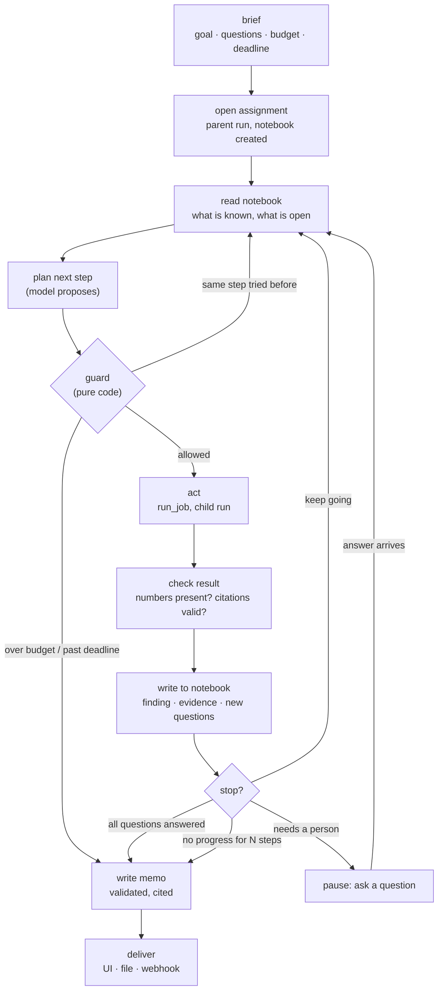
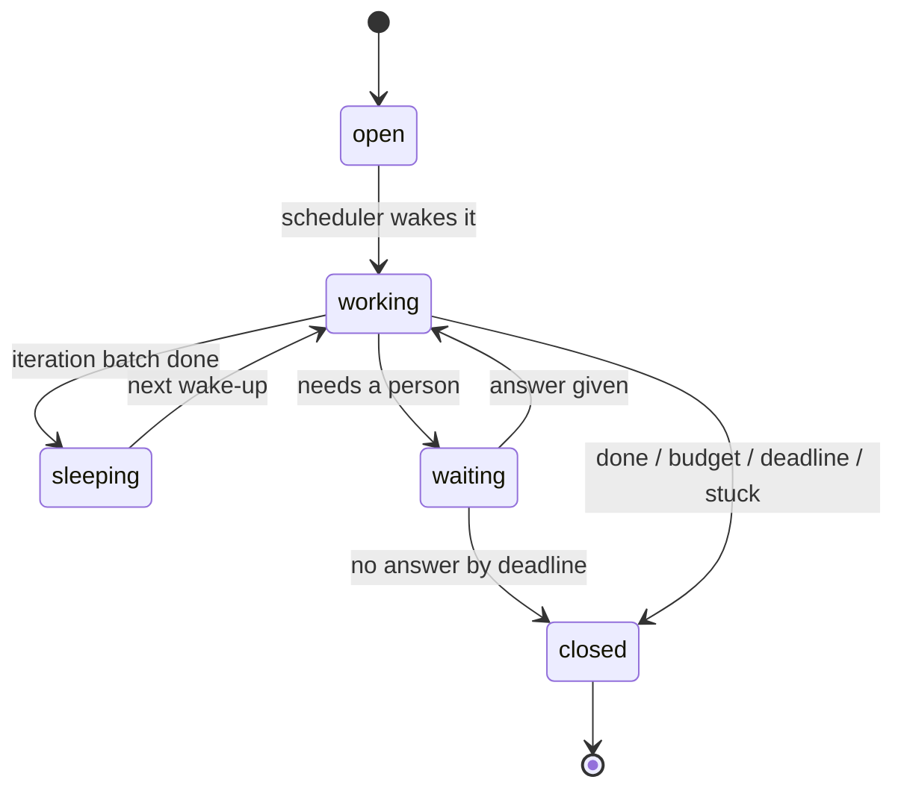

# The research loop: giving the analyst an assignment that takes days

**Status:** proposed — 2026-11-15. Exploration only; nothing is built.
It extends [`../analyst/DESIGN.md`](../analyst/DESIGN.md), which covers
one question and one answer. This covers one brief and one memo, with
many steps in between.
**Builds on:** [`../runner/DESIGN.md`](../runner/DESIGN.md) (jobs, runs,
`parent_run_id`, the scheduler), `knowledge/budget.py` (spend limits),
`knowledge/validate.py` (citation checks).

## The problem

In an office, you give an analyst a brief: "Look at the L2 tokens. Which
ones are worth a position over the next quarter? Come back Thursday."
They go away, read, pull data, run numbers, change their mind, and come
back with a memo and a recommendation.

The analyst design today is question-and-answer. A brief like this is
too large for one answer. It needs:

- many steps, spread over hours or days;
- memory between steps;
- a way to decide what to do next from what was found;
- limits, so it does not run forever or spend the month's budget;
- a point where it stops and reports, or asks.

"Loop engineering" is the practice of building that kind of loop so it
stays useful and under control. This document checks whether its
principles fit candlegraph. **Short answer: yes.** Most of the parts
already exist because of the harness pre-work.

## Loop engineering, in eight rules

These are the principles, stated plainly. Each one has a concrete
meaning in this repo.

| # | Rule | Means here |
|---|---|---|
| 1 | **A written goal and a done test.** The loop knows what "finished" looks like before it starts. | The brief has questions to answer and a deliverable (a memo). Done = every question has an answer or an explicit "could not". |
| 2 | **A fixed budget.** Time, money and steps are capped up front. | Max iterations, max credits, a deadline. Reaching any cap ends the loop with a report, not an error. |
| 3 | **Small steps, each checked.** Plan one step, do it, check the result, then plan the next. | One iteration = one planned tool call (or a few), run through `run_job`, checked by pure code. |
| 4 | **State lives outside the model.** The loop can be stopped and resumed with nothing lost. | A notebook in the database: findings, evidence ids, open questions. The model reads it at the start of each step; it does not "remember". |
| 5 | **Code verifies, the model proposes.** | Numbers come from tools; citations are checked by `validate.py`; the model only chooses steps and writes prose (the analyst's one rule). |
| 6 | **Clear stop conditions.** | Done, budget spent, deadline reached, no progress for N steps, or a question only a person can answer. |
| 7 | **Human checkpoints at fixed points, not interruptions.** | The loop can pause with a question ("Include stablecoins?") and resume when answered. It never waits silently. |
| 8 | **Everything is recorded.** | The assignment is a parent run; every step is a child run in `run_log`. You can replay what it did and why. |

## How the loop runs

The inner part (read → plan → guard → act → check → write) is one
**iteration**. Each iteration is short: seconds to a few minutes. Time
between iterations is what makes it "a few days": the scheduler wakes the
assignment, it does a few iterations, and it sleeps.

### Why it wakes on a schedule instead of running continuously

- Data arrives on a schedule anyway: hourly candles, daily news. Running
  between arrivals mostly re-reads the same data.
- A sleeping loop costs nothing and holds no connection.
- It fits what exists. An assignment is a job the scheduler already
  knows how to wake (`Every(seconds)`), with `max_instances=1` so two
  wake-ups never overlap.

## Assignment states

These are states of the **assignment**, not of a run. Each wake-up is a
normal run with the usual outcomes (`succeeded`, `partial`, `failed`).
`waiting` is not a run outcome; nothing is running while it waits.

## Mapping onto what exists

| Loop need | Already in the repo | Missing |
|---|---|---|
| Wake on a schedule, never overlap | `harness.scheduler`, `max_instances=1` | an "assignments due now" job |
| Record every step, link steps to the assignment | `run_job(parent_run_id=…)`, `run_log` | nothing |
| Step outcome | `RunOutcome` | nothing |
| Spend limits | `knowledge/budget.py` (monthly/daily caps) | a per-assignment cap on top |
| Citations checked | `knowledge/validate.py` | a check that every number in prose came from a tool result |
| Stored evidence | `document`, `chunk`, `source_call` | nothing |
| No look-ahead | `retrieved_at <= bar`, invariant 17 | pin `as_of` per assignment (see below) |
| Notebook | — | an `assignment` table and an `assignment_note` table |
| Pause and ask | — | the `waiting` state and a way to answer (UI, CLI) |
| Memo | the report renderer and sinks in `agents/reporting.py` | a memo template |

### The two new tables (proposed)

Both are plain tables, for the same reason as the ledgers: rows are
updated by id, not by time. They would be recorded in
`docs/storage/table-placement/DESIGN.md` before any migration.

| Table | One row is | Key columns |
|---|---|---|
| `assignment` | one brief | `id`, `brief` (text), `questions` (JSONB), `state`, `budget` (JSONB: steps, credits), `spent` (JSONB), `deadline`, `as_of`, `parent_run_id`, `memo` |
| `assignment_note` | one thing learned | `assignment_id`, `kind` (`finding` / `question` / `dead_end` / `decision`), `text`, `evidence` (JSONB: document ids, run ids), `created_at` |

A `dead_end` note is important: it is how the guard knows a step was
already tried and failed, so the loop does not repeat it (rule 6, "no
progress").

### Pinning time

An assignment fixes `as_of` when it opens, or moves it forward only at
the start of an iteration and records the move as a note. Otherwise a
memo written over three days mixes Monday's prices with Wednesday's
without saying so. This is the repo's no-look-ahead rule applied to a
long task: every number in the memo carries the time it was true.

## What can go wrong, and the control for each

| Failure | Control |
|---|---|
| Runs forever | step cap, deadline, "no progress for N steps" stop |
| Spends the month's credits | per-assignment credit cap, checked by the guard before every step; the global Tavily guard still applies underneath |
| Repeats the same failing step | `dead_end` notes; the guard rejects a planned step identical to one already noted |
| Drifts off the brief | each plan must name which open question it serves; a plan that serves none is rejected |
| Makes up a number | numbers only from tool results; prose is checked against them |
| Errors pile up (one wrong finding feeds the next) | every finding cites evidence; the memo shows the evidence, so a person can follow the chain |
| Silent while stuck | `waiting` is visible on the dashboard and posts to a sink; it has its own deadline |
| Data changes mid-task | `as_of` pinned; moving it is a recorded decision |

## A worked example

Brief: *"Review my five active tokens. For each: is the current signal
still working net of costs, and is there news that changes the picture?
Budget: 40 steps, 10 credits, deadline Friday."*

| Day | Wake-up | What happens |
|---|---|---|
| Mon 09:00 | 1 | Opens notebook. Plans `backtest --strategy all` for each token (5 steps). Notes: WETH and GNO rules beat buy-and-hold net of costs; three do not. |
| Mon 13:00 | 2 | Plans `simulate` for the two winners. Notes: GNO's edge has p≈0.31 over 1,000 paths — not convincing. |
| Tue 09:00 | 3 | `fetch_news` already ran overnight (cached, free). Plans `search_knowledge` for each token as of now. Notes two relevant stories for WETH. |
| Tue 13:00 | 4 | Asks: "SHIB has had no signal for 9 days; skip it?" → `waiting`. |
| Wed 10:00 | — | You answer "yes, skip". |
| Wed 13:00 | 5 | Resumes. Writes the memo: one rule worth keeping (WETH), one not proven (GNO), two losing, one skipped. Every number links to a run; every claim links to a document. |

Total: 23 steps, 0 new credits (news came from the daily job), closed
two days early.

## Is it feasible here?

Yes, and cheaper than it sounds, because:

- the scheduler, the parent/child run records, the budget guard and the
  citation validator already exist;
- the tools it would call already exist (backtest, simulate, risk,
  search, explain);
- the hard parts — a notebook, a guard, a pause — are small and mostly
  pure code that can be tested without a model.

What it does **not** remove: the model still chooses the steps. The
loop makes a poor choice cheap and visible; it does not make it
impossible.

## Suggested order

1. **The guard and the stop rules as pure functions.** Given a notebook,
   a budget and a planned step: allow, reject (with reason) or stop.
   Fully unit-testable, no model.
2. **The two tables and a `research` job** that wakes open assignments.
   Steps limited to existing read-only tools, so the first version
   spends no credits.
3. **The memo**, through the existing report sinks, with the citation
   check and a new number check.
4. **`waiting`** and a way to answer from the CLI, then the UI.
5. Only then let it call jobs that spend (`fetch_news`, later filings).

Steps 1–3 need nothing from stages 3 or 4 and would already be useful
for the "weekly review of my tokens" kind of brief.

## Rejected for now

- **A free-running agent with no step cap.** Breaks rules 2 and 6.
- **Keeping the notebook in the model's context only.** Breaks rule 4:
  a restart or a context limit loses the work.
- **Letting the loop write strategies or change settings.** Out of scope;
  it reports and recommends. Paper trading only, as everywhere else.
