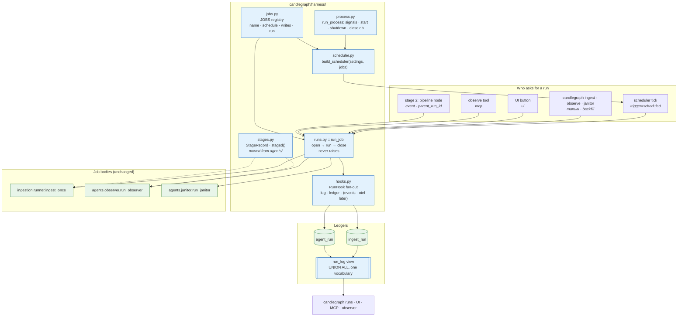
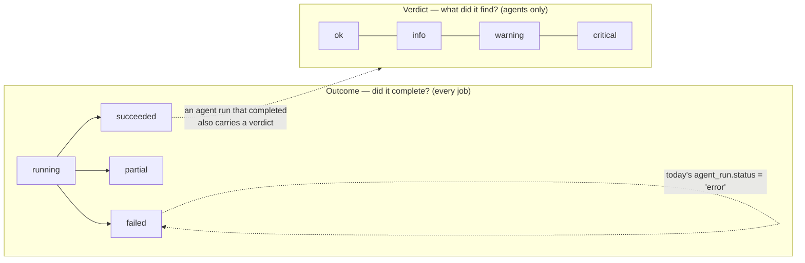
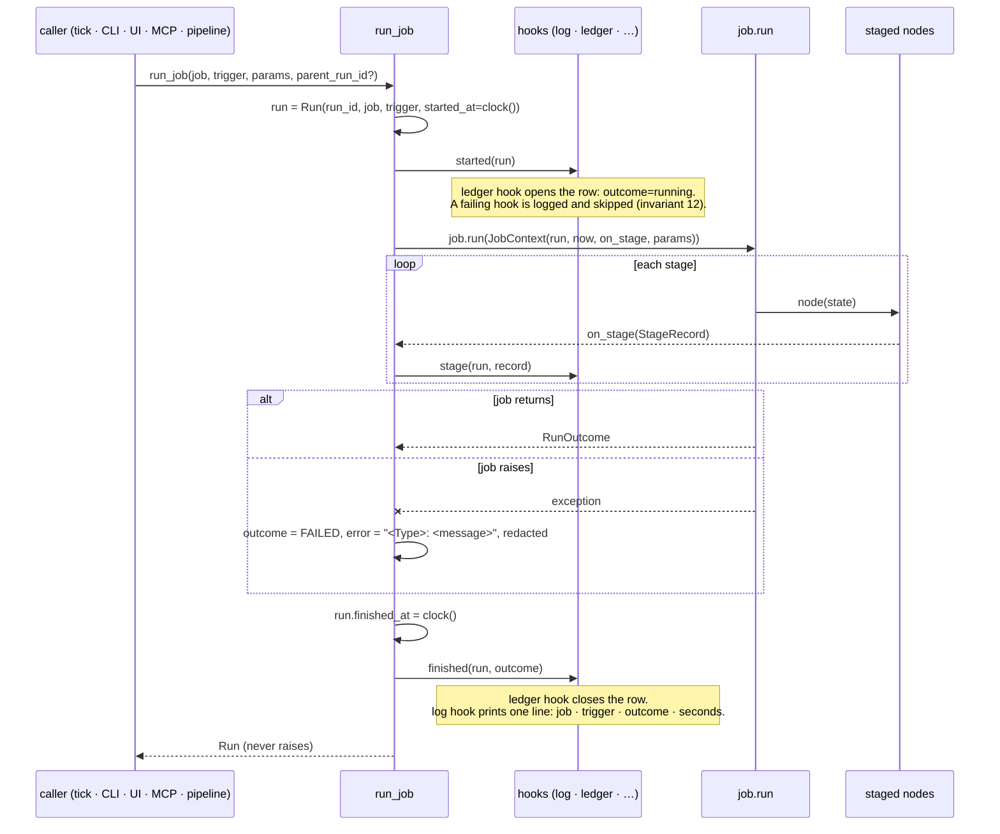

# The runner: one way to schedule, run and record a job

**Status:** proposed — 2026-11-11. Nothing described here exists yet; the
sequence that builds it is [`../../rollout/ROLLOUT.md`](../../rollout/ROLLOUT.md)
(harness pre-work). This is the substrate stage 2 (the harness) is built
on, not stage 2 itself: no pipeline specs, no event broker, no
OpenTelemetry exporter. Each of those gets its own document under
`docs/harness/` when it is designed.
**Area:** new package `candlegraph/harness/`; `candlegraph/ingestion/worker.py`,
`candlegraph/agents/scheduler.py`, `candlegraph/api/app.py`,
`candlegraph/ingestion/ledger.py`, `candlegraph/agents/ledger.py`,
`candlegraph/agents/stages.py`, `candlegraph/cli.py`, one migration.
**Companions:** [`../../agents/framework/DESIGN.md`](../../agents/framework/DESIGN.md)
(what a graph is; unchanged by this), [`../../storage/table-placement/DESIGN.md`](../../storage/table-placement/DESIGN.md)
(where the ledgers live), [`../../roadmap/DESIGN.md`](../../roadmap/DESIGN.md) §2
(what the harness will want from this).

## The problem

Three processes run work on a clock, and the machinery under them was
written three times:

| Process | Command | Loop | Job | Interval setting | Never-raise wrapper | Ledger |
|---|---|---|---|---|---|---|
| worker | `candlegraph worker` | `ingestion/worker.py::run_worker` → `build_scheduler` | `ingest_tick` → `run_ingest` | `DATA_POLL_INTERVAL` | `ingest_tick` | `ingest_run` (two-phase: `running` row first, updated at the end) |
| agents | `candlegraph agents` | `agents/scheduler.py::run_agents` → `build_scheduler` | `observer_tick`, `janitor_tick` | `OBSERVER_INTERVAL`, `JANITOR_INTERVAL` (0 disables) | both ticks | `agent_run` (one insert at the end, by the `ledger` sink) |
| API | `candlegraph serve` with `INGEST_ENABLED=true` | `api/app.py::lifespan` reusing the worker's builder | `ingest_job` → `ingest_tick` | `DATA_POLL_INTERVAL`, `INGEST_ENABLED` | `ingest_tick` | `ingest_run` |

It is two scheduler implementations across three processes rather than
three, because the API already borrows the worker's builder. The
duplication that matters is around them:

- **Two `build_scheduler` functions** with the same five options
  (`interval`, `next_run_time=now`, `max_instances=1`, `coalesce=True`,
  UTC) and two `run_*` loops with the same signal handling, the same
  `start`/`shutdown(wait=True)`/`get_db().close()` sequence.
- **Two ledgers with two vocabularies.** `ingest_run.status` says whether
  the run *completed* (`running | succeeded | partial | failed`);
  `agent_run.status` says what the run *found* (`ok | info | warning |
  critical | error`). They are different axes stored under one column
  name, so "how many runs failed last night" is a different query per
  table and the observer's `failed_runs` rule can only read one of them.
- **Runs without a record.** `candlegraph knowledge fetch-news`, `fill`,
  `embed`, `link-mentions` and `signals --store` each do a unit of work
  and leave no run row; `source_call` records calls, not runs. An
  observer run started from the UI's button, the `observe` MCP tool, the
  CLI or the schedule writes an identical `agent_run` row, so nothing
  says *why* it ran.
- **Observability only on one side.** `agents/stages.py` gives a graph
  run a `StageRecord` per node, a `--progress` stream and a stage strip
  on the dashboard; an ingest run has per-token log lines and
  `detail.hours_by_symbol`. A slow ingest and a slow observer are
  diagnosed with different tools.

None of this is wrong today. It becomes expensive the moment stage 2
asks for a pipeline run that owns an ingest run, a validation run and a
signal run, reacts to "ingest finished", and traces all of it: every one
of those features would have to be written against two loops and two
ledgers, and stage 3's second ingestion adapter would make it three.
[`../../rollout/ROLLOUT.md`](../../rollout/ROLLOUT.md) put it as the
difference between the harness being a new layer and the harness being a
rewrite.

## The decision

One package, `candlegraph/harness/`, holding four things, each of which
exists exactly once afterwards:

1. **A `Job` registry.** A job is a named, schedulable unit of work with
   a declared schedule setting, a declared write surface, and a `run`
   callable. `ingest`, `observer` and `janitor` are the first three.
   Like `agents.AGENTS` and `mcp.tools.TOOLS`, the registry is what the
   CLI, the scheduler, the docs and the tests read, so a job that is
   missing from it does not exist.
2. **One function that runs a job: `run_job`.** It opens a `Run`, calls
   the job, closes the run, fans the lifecycle out to hooks, and never
   raises. The scheduler's tick is `run_job`; `candlegraph ingest`,
   `observe` and `janitor` are `run_job` with a `manual` trigger; the
   `observe` MCP tool and the UI button are `run_job` with their own
   triggers; stage 2's pipeline node will be `run_job` with a
   `parent_run_id`.
3. **One scheduler builder and one process loop.** `build_scheduler
   (settings, jobs)` and `run_process(settings, jobs, stop)`. The
   `worker` and `agents` commands become two *selections of jobs* over
   the same code; the API's in-process ingest is the same builder with
   the same selection.
4. **One shape of a run, `Run`**, recorded two-phase in a per-job ledger
   and readable across jobs through one view. The outcome axis and the
   verdict axis are separated; the trigger is always recorded; a
   `parent_run_id` is there for pipelines to use.



What the diagram is making a point about: **every arrow into a job body
passes through `run_job`**, and **every ledger row is written by a hook,
not by a job**. Those two properties are what make a pipeline, an event
bus and a tracer additive later.

### What does *not* collapse: the processes

The three processes stay three. The worker is separate so a 90-day
backfill cannot compete with GraphQL traffic for the pool or the event
loop; the agents container has no git checkout, which is why the janitor
runs from GitHub Actions; the API must come up when the subgraph is down
(invariant 7). Each of those is a reason to keep a process boundary, and
none is a reason to keep a second scheduler implementation. Compose is
untouched by this design: the services, their commands, their health
probes and the one-migrator rule (invariants 25 and 26) stay exactly as
the two October post-mortems left them.

The one wart this leaves is a name: the `agents` service will become the
natural home of any job that needs the network and the database but not
a checkout — the news fetch, later the feed observer — and "agents" will
be a loose description of it. Renaming a compose service renames its
containers and is not free for every worktree running a stack; the right
moment is when stage 2 adds the pipeline runner to that process and the
name is wrong for a bigger reason.

## The vocabulary

### `Job`

```python
@dataclass(frozen=True)
class Job:
    name: str  # "ingest", "observer", "janitor", later "fetch_news"
    run: Callable[[JobContext], RunOutcome]
    schedule: Schedule  # Every(seconds) today; Daily(at=...) when a job needs it
    interval_setting: str  # the Settings field the interval is read from; 0 disables
    role: Literal["worker", "agents"]  # which process selects it by default
    writes: frozenset[str]  # "market_data", "ledger", "knowledge", "cache", "reports"
    description: str  # one line; `candlegraph jobs` prints it
```

- **`schedule` keeps the settings it already has.** `DATA_POLL_INTERVAL`,
  `OBSERVER_INTERVAL` and `JANITOR_INTERVAL` are public configuration in
  `.env.example`, compose and the README; renaming them for symmetry
  would be churn. The registry maps a job to its field, and `0` disables
  everywhere, which today is true for the agents and not for ingest.
  `INGEST_ENABLED` stays as the API-process switch.
- **`writes` is declared, and a test reads it.** Only `ingest` may
  declare `market_data`. This is invariant 21 applied to the registry
  the way the MCP "writes nothing" test applies it to `TOOLS`: a job
  added without a truthful declaration fails the build.
- **`role` is a default selection, not a binding.** `candlegraph worker`
  runs the jobs whose role is `worker`; `candlegraph agents` the rest.
  A process can be handed an explicit list (`--jobs`), which is what the
  API uses to host `ingest` alone.

### `JobContext` and `RunOutcome`

```python
@dataclass(frozen=True)
class JobContext:
    settings: Settings
    db: DatabaseManager
    run: Run  # run_id, trigger, started_at, parent_run_id
    now: datetime  # the clock, injected; every job already takes `now`
    on_stage: StageHook | None  # the --progress stream
    params: Mapping[str, Any]  # lookback_days for a backfill; open_pr for the janitor


@dataclass(frozen=True)
class RunOutcome:
    outcome: Outcome  # SUCCEEDED | PARTIAL | FAILED
    counts: Mapping[str, int] = {}  # tokens_written, findings_total, documents_stored, ...
    errors: Mapping[str, str] = {}  # per-target errors, the ingest shape
    verdict: Severity | None = None  # agents only: the worst finding
    detail: Mapping[str, Any] = {}  # JSON-safe; stages land here
    payload: Any = None  # IngestResult / AgentReport, for the caller that wants it
```

The context is the contract a stage 2 pipeline step receives, and the
outcome is what it hands back. Settling both now is what lets a YAML spec
later name jobs from this registry instead of describing a second kind of
step. `payload` is deliberately untyped at this level: the CLI's
`ingest` still prints an `IngestResult` and `observe` still prints an
`AgentReport`; the harness does not flatten them, it carries them.

### `Run`, and the two axes of status



| Field | `ingest_run` today | `agent_run` today | `Run` |
|---|---|---|---|
| identity | `run_id` | `run_id` | `run_id` |
| which job | implicit | `agent` | `job` |
| why it ran | `trigger` (`scheduled`, `manual`, `backfill`) | — | `trigger` (`scheduled`, `manual`, `backfill`, `ui`, `mcp`, `event`) |
| did it complete | `status` | folded into `status = 'error'` | `outcome` |
| what it found | — | `status` | `verdict` (agents only) |
| when | `started_at`, `finished_at` (nullable: two-phase) | `started_at`, `finished_at` (NOT NULL: one insert) | both nullable-finished, two-phase |
| what happened inside | `detail.hours_by_symbol` | `detail.stages`, `findings`, `report` | `detail.stages` for every job |
| who owns it | — | — | `parent_run_id` (nullable; pipelines) |

**Decision: separate the axes, keep the tables.** `agent_run` gains
`outcome`, `trigger` and `parent_run_id`; `ingest_run` gains
`parent_run_id`; `agent_run.finished_at` becomes nullable so an agent
run is recorded two-phase like an ingest run. `agent_run.status` keeps
meaning the verdict, because `make agent-runs`, the dashboard, the MCP
tools and the e2e tests read it that way, and `ingest_run.status` keeps
meaning the outcome for the same reason. A read-only view, `run_log`,
unions both into the `Run` vocabulary:

```sql
CREATE VIEW candlegraph.run_log AS
SELECT run_id, 'ingest' AS job, trigger, status AS outcome, NULL::text AS verdict,
       started_at, finished_at, duration_seconds, parent_run_id, detail
  FROM candlegraph.ingest_run
UNION ALL
SELECT run_id, agent AS job, trigger, outcome,
       CASE WHEN outcome = 'failed' THEN NULL ELSE status END AS verdict,
       started_at, finished_at, duration_seconds, parent_run_id, detail
  FROM candlegraph.agent_run;
```

`candlegraph runs --job observer` reads the view; `candlegraph runs`
with no filter keeps printing ingest runs, as it does today, so nothing
a reader has learned stops being true.

Why not one generic `run` table replacing both: `/status`, the observer's
`collect_ledger`, the Agents dashboard, three MCP tools and the e2e
suite read the two tables by name and by column, and `ingest_run`'s
typed count columns are what `make runs` prints. A data migration that
re-pointed all of them would spend the pre-work's budget on readers and
leave the harness no better off; a view gives the cross-job read for the
cost of one `CREATE VIEW`. A generic `run` table does have a place: for
jobs that have no ledger of their own. It is created the first time such
a job is registered (the news fetch, rollout step 3), not before, and the
view grows a third branch then. Its placement is recorded as *plain* in
the table-placement document ahead of the migration, as the rule
requires.

### `run_job`: the lifecycle



Three rules inside it, each one an existing rule made general:

- **Never raises.** An exception escaping a tick stops APScheduler from
  rescheduling the job, which is why `ingest_tick` and `observer_tick`
  both swallow everything today. `run_job` is where that happens once.
  The CLI turns `Outcome.FAILED` into exit code 1 exactly as `_ingest`
  does now.
- **Hooks never fail the run.** The same contract as the report sinks
  and the ingest ledger: logged, skipped, never raised. The ledger is a
  hook. The janitor running in GitHub Actions with no database keeps
  working, with a warning, as it does today.
- **The job's own error handling stays its own.** `run_observer` still
  catches a failing graph and *publishes an error report*, because a
  crashed observer must still post (invariant 21). `run_job` sees the
  `AgentReport` with `error` set and records `FAILED`; it does not
  replace the agent's publish step.

### Where the agent ledger row moves

Today the `agent_run` row is written by the `ledger` *sink* inside the
graph's `publish` node. Under this design the harness opens the row
before the graph starts and closes it after. The `publish` node still
assembles the report, and the harness's close writes `findings`,
`summary`, `report` and `detail` from the `AgentReport` the job returns.

`ledger` remains a valid name in `AGENT_REPORT_SINKS`: it keeps meaning
"record this run in `agent_run`", which is now always true for a run
that reaches a database, so the name is accepted and logged once as
redundant rather than rejected. `.env.example` says so. The alternative
— leaving the sink as the writer and exempting agents from the two-phase
rule — is the fallback named in the rollout's cut line, and the reason
not to prefer it is operational: a hung observer is invisible today, and
a `running` row that never closes is the cheapest possible detector.

### Stages everywhere

`agents/stages.py` moves to `harness/stages.py` unchanged; the old path
re-exports it. The ingest run is then expressed as four staged steps —
`token_metadata`, `token_hours`, `pool_discovery`, `pool_hours` — with
`hours_by_symbol` as the detail of the second, so `candlegraph ingest
--progress` prints the same lines `observe --progress` does and
`ingest_run.detail.stages` renders on the same dashboard strip. The
records are facts about the run, never findings; nothing about the
observer's `run_drift` rule changes.

### Hooks: the seam the event bus and the tracer will use

```python
class RunHook(Protocol):
    def started(self, run: Run) -> None: ...
    def stage(self, run: Run, record: StageRecord) -> None: ...
    def finished(self, run: Run, outcome: RunOutcome) -> None: ...
```

Two implementations now, `LogHook` and the per-job `LedgerHook`s; a
composite fans out and isolates failures. This *is* the stage 2 event
bus in its first and smallest form: an in-process, synchronous fan-out of
typed lifecycle events with two subscribers. A broker-backed
implementation (the observer reacting to `finished(ingest)` from another
process) is one more `RunHook`, and an OpenTelemetry span per run and
per stage is another. Neither is built here, and neither needs this
design to change.

### Correlation in the log

`run_id` goes into a `contextvar` for the duration of `run_job`, and a
logging filter appends `run=<first 8 chars>` to every line emitted
inside it. A reader of `make logs-worker` can then tie "Ingested 40
hourly rows for WETH" to the ledger row it belongs to, which today takes
timestamps and guesswork. This is the trace-id slot; stage 2 fills it
from a span context instead.

## What stage 2 gets from each piece

| Stage 2 wants | This design provides | What is left to build then |
|---|---|---|
| `candlegraph run pipelines/hourly.yaml` executing ingest → validate → analyse → signal | `Job` as the step contract; `run_job(parent_run_id=…)`; `JobContext.params` | the pydantic spec, the LangGraph graph whose nodes call `run_job`, `validate`/`analyse`/`signal` as registered jobs, a `pipeline_run` row in the generic `run` table |
| the observer reacting to "ingest finished" instead of polling | `RunHook.finished` | a bus-backed hook and an `event` trigger on the observer job |
| a failed validation halting downstream analysis | `Outcome` on every step | the conditional edge in the pipeline graph |
| OpenTelemetry traces across ingest, analytics, agents | a hook per run and per stage; `run_id` in the log | the exporter hook and the dependency (`opentelemetry-api` is already resolved in `uv.lock`) |
| a `run_pipeline` MCP tool, gated | `run_job` as the only entry point; `writes` on every job | the tool and its setting |
| a pipelines dashboard | `run_log`; stage records on every run | the page — after the four oversized pages are split, so it copies the good pattern |
| a second ingestion adapter (stage 3) | one job type, one ledger shape, one scheduler | the adapter and its `Job` |
| the feed observer (stage 5) as a pipeline step, not an agent | a job that writes `knowledge` and is scheduled without touching the agent framework | the source and the job |

## Invariants

Protected, unchanged: 1 (the harness imports connect to nothing; job
bodies are imported lazily as the ticks do today), 7 (the first firing
is `next_run_time=now`, never a blocking call at startup), 12 (a ledger
failure never takes the run down), 21 and 22 (jobs that are agents keep
every rule of the framework; the harness adds no writer), 24 (the
generic `run` table, when it lands, is a ledger and plain), 25 and 26
(compose is not touched).

Added, as invariant 27 in `AGENTS.md` when the rollout closes:
**Every run is a `Run`.** Anything that runs on a schedule is a
registered `Job`; one scheduler builder constructs every job with the
same overlap and misfire policy; every run — scheduled, manual, from the
UI, from a tool, or inside a pipeline — passes through `run_job`, opens a
ledger row before it starts and closes it after, and records why it ran.
Invariant 12 becomes the ingest-shaped special case of this.

## Configuration

No new required setting. `JOBS` selection is a CLI argument
(`candlegraph worker --jobs ingest`), not an environment variable, so
compose does not change. One optional setting arrives with step 3,
`FETCH_NEWS_INTERVAL` (default `0`, disabled), documented in
`.env.example` with the budget reminder. `AGENT_REPORT_SINKS` keeps its
values; the comment on `ledger` changes as described above.

## Testing

| Tier | Proves |
|---|---|
| unit, registry-driven | every job in `JOBS` has an interval setting that exists on `Settings` and appears in `.env.example`; only `ingest` declares `market_data`; every job's `run_job` returns `FAILED` rather than raising when the body raises |
| unit, scheduler | one builder: job ids, interval, `next_run_time` set, `max_instances=1`, `coalesce=True` — the assertions `test_worker.py`, `test_scheduler.py` and `test_app.py` make today, made once against `harness.scheduler`; a selection of `()` schedules nothing and warns; custom job injection still works (the API's test seam) |
| unit, lifecycle | `run_process` with a spy scheduler: `start`, `shutdown(wait=…)`, database closed; the API's `wait=False` and the worker's `wait=True` are both reachable and both tested, because they are different on purpose (uvicorn must not block on a backfill; the worker must finish its batch) |
| unit, `run_job` | a `running` row is opened before the body runs and closed after; a body that raises produces a closed `FAILED` row with a redacted error; a hook that raises is logged and the other hooks still fire; `trigger` and `parent_run_id` reach the row; stage records reach the row and the `on_stage` hook in order |
| unit, agents | the observer and janitor graphs are unchanged: `test_the_graph_has_the_documented_shape` passes without edits; `publish` no longer inserts a row and the harness close does |
| integration | the migration round-trips on populated `ingest_run` and `agent_run` tables; `run_log` returns both jobs in one vocabulary; an agent run interrupted mid-graph leaves a `running` row (the detector this design buys) |
| stack (CI) | `make up` unchanged; `make runs ARGS='--job observer'` lists the observer run CI already triggers |

## Rejected alternatives

- **One process running everything.** The split bought isolation that is
  still wanted (backfill versus query traffic; no checkout in the
  agents container; bounded restarts per failure mode). The collapse is
  of the implementation, not the topology.
- **Replacing APScheduler with a workflow engine** (Prefect, Dagster,
  Temporal, Airflow) **or a queue** (Celery, RQ). Each is the harness as
  a product: a server, a UI, its own run schema, and an orchestration
  idiom that is not LangGraph, which the roadmap chose for pipelines. The
  framework document already declined a queue for two graphs. Trigger
  that would change this: workers on more than one host, or fan-out past
  what one process and a table can carry.
- **LangGraph as the scheduler.** A graph executor is not a clock. Job
  bodies are graphs and pipelines will be; the tick stays APScheduler.
- **One generic `run` table now, replacing both ledgers.** Covered above:
  a reader rewrite for no harness gain. The generic table lands with the
  first job that has no ledger of its own.
- **An event broker now** (Redis streams, NATS, Postgres `LISTEN/NOTIFY`).
  There is no second subscriber yet. The `RunHook` protocol is the seam;
  `LISTEN/NOTIFY` is the likely first implementation when stage 2 needs
  one, because it adds no service.
- **Renaming `DATA_POLL_INTERVAL` and friends to `<JOB>_INTERVAL`.**
  Symmetry in exchange for touching every `.env`, compose, the README
  and the skills. The registry maps names instead.
- **Making the ledger optional per job via sinks.** Then "every run is
  recorded" would hold for some jobs. The row is always attempted and a
  failure to write it is always only a warning.

## Exit criterion

`grep -rn BackgroundScheduler candlegraph/` finds one module; `make up`
behaves as before and `test_compose_stack.py` is untouched; `candlegraph
ingest --progress` and `candlegraph observe --progress` print the same
stage format; `make runs ARGS='--job observer'` lists observer runs with
a `trigger` and an `outcome`; an observer run interrupted before
`publish` is visible as a `running` row; and `candlegraph jobs` lists
three jobs with their schedules and write surfaces — four once the news
fetch is registered.
