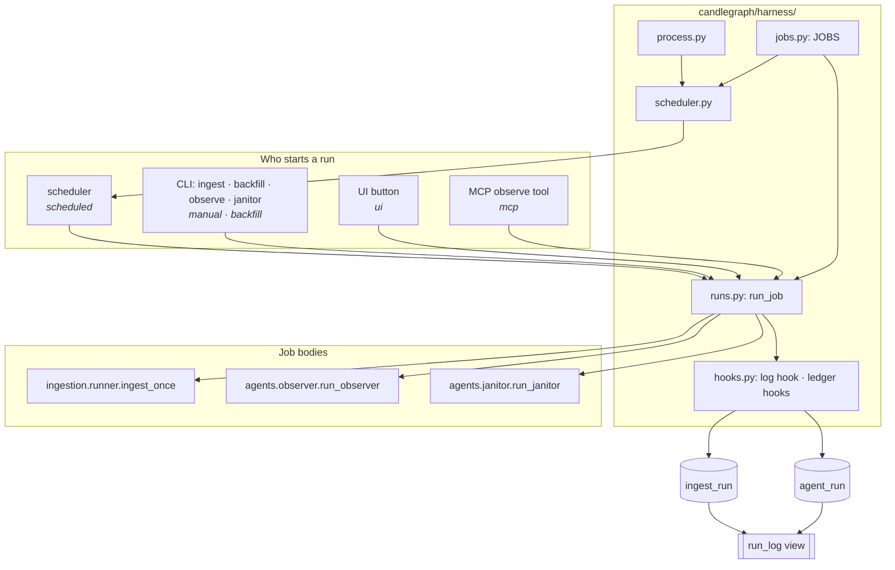
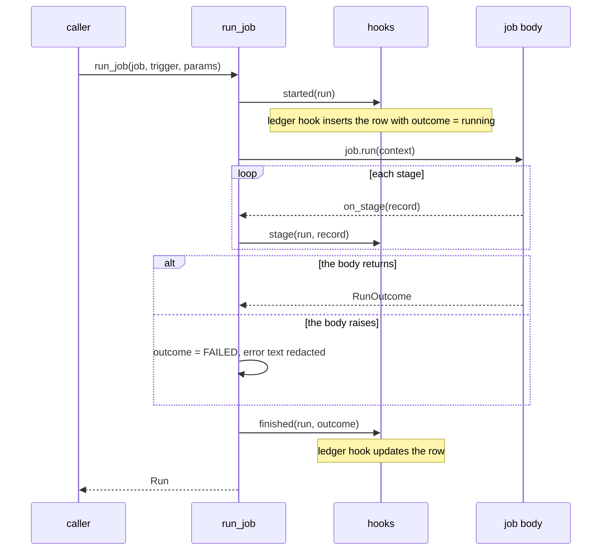

# The runner: one way to schedule, run and record a job

**Status:** partly implemented — 2026-11-13. Rollout steps 1 and 2 are
built (the registry, `run_job`, one scheduler, one process loop, ledger
rows opened before and closed after every run, the `run_log` view, stages
for ingest). Step 3 (the news-fetch job and the generic `run` table) is
not built. The steps are in [`../../rollout/ROLLOUT.md`](../../rollout/ROLLOUT.md).
This is groundwork for stage 2 (the harness), not stage 2 itself: no
pipeline specs, no event broker, no OpenTelemetry.
**Code:** `candlegraph/harness/`, plus its callers in `cli.py`,
`api/app.py`, `ui/viewmodels.py` and `mcp/tools.py`.
**Related:** [`../../agents/framework/DESIGN.md`](../../agents/framework/DESIGN.md)
(what an agent graph is; unchanged by this),
[`../../agents/usage/DESIGN.md`](../../agents/usage/DESIGN.md) (how the
agents are started and recorded),
[`../../storage/table-placement/DESIGN.md`](../../storage/table-placement/DESIGN.md)
(where the ledgers live), [`../../roadmap/DESIGN.md`](../../roadmap/DESIGN.md) §2.

## The problem this solves

Three processes run work on a timer:

| Process | Command | Jobs | Interval setting | Ledger |
|---|---|---|---|---|
| worker | `candlegraph worker` | ingest | `DATA_POLL_INTERVAL` | `ingest_run` |
| agents | `candlegraph agents` | observer, janitor | `OBSERVER_INTERVAL`, `JANITOR_INTERVAL` (0 disables) | `agent_run` |
| API | `candlegraph serve` with `INGEST_ENABLED=true` | ingest | `DATA_POLL_INTERVAL` | `ingest_run` |

Before this work, the code around those jobs existed twice:

- **Two scheduler builders and two process loops** with the same options
  and the same start/stop sequence.
- **Two ledgers with different meanings for `status`.** `ingest_run.status`
  says whether the run completed (`running`, `succeeded`, `partial`,
  `failed`). `agent_run.status` says what the agent found (`ok`, `info`,
  `warning`, `critical`, or `error` if the graph crashed). The same column
  name means two different things, so "which runs failed last night" was
  a different query per table.
- **No record of why a run happened.** An observer run from the schedule,
  the CLI, the UI or the MCP tool wrote the same row.
- **Agent rows were written only at the end.** A hung or killed observer
  left no trace.
- **Stages only for agents.** An agent run recorded the time and output
  of each graph node; an ingest run did not.

None of this was a bug. It becomes expensive in stage 2, where one
pipeline run owns an ingest run, a validation run and a signal run, and
everything must be traced. Each of those features would otherwise be
written twice.

## The decision

One package, `candlegraph/harness/`, with these parts:

1. **A job registry (`jobs.py`).** A `Job` has a name, a function to run,
   the setting its interval is read from, the process that runs it by
   default (`worker` or `agents`), and what it writes. `ingest`,
   `observer` and `janitor` are registered. The CLI, the scheduler, the
   docs and the tests all read this registry.
2. **One function that runs a job (`runs.py::run_job`).** It creates a
   `Run`, tells the hooks the run started, calls the job, tells the hooks
   it finished, and returns the `Run`. It never raises. Every caller uses
   it: the scheduler (trigger `scheduled`), the CLI (`manual` or
   `backfill`), the UI button (`ui`) and the MCP tool (`mcp`).
3. **One scheduler builder and one process loop (`scheduler.py`,
   `process.py`).** `candlegraph worker` and `candlegraph agents` are the
   same loop with different jobs. The API's in-process ingest uses the
   same builder.
4. **Hooks (`hooks.py`).** Code that reacts to a run starting, finishing
   or completing a stage. The ledger rows are written by hooks, not by the
   jobs. This is also where stage 2 will attach an event bus and tracing.
5. **One shape of a run.** Both ledgers have `trigger`, an outcome, and
   `parent_run_id`, and are read together through the `run_log` view.



Two rules follow from the diagram: **every run goes through `run_job`**,
and **every ledger row is written by a hook**.

### What stays the same: three processes

The worker, the agents process and the API stay separate processes. The
worker is separate so a long backfill does not slow down API requests.
The agents container has no git checkout, which is why the janitor runs
in GitHub Actions. The API must start even when the subgraph is down
(invariant 7). Compose is not changed.

The `agents` service name will become slightly wrong once it also runs
jobs that are not agents (the news fetch). Renaming a compose service is
not free for every worktree with a running stack, so that waits for
stage 2.

## The vocabulary

### `Job`

```python
@dataclass(frozen=True)
class Job:
    name: str  # "ingest", "observer", "janitor"
    run: Callable[[JobContext], RunOutcome]  # the job body
    schedule: Every  # which setting holds the interval; 0 disables
    role: Literal["worker", "agents"]  # which process runs it by default
    writes: frozenset[str]  # "market_data", "ledger", "knowledge", "cache", "reports"
    description: str  # one line, printed by `candlegraph jobs`
    ledger: LedgerFactory  # builds the hook that writes this job's ledger row
```

- **Interval settings keep their existing names** (`DATA_POLL_INTERVAL`,
  `OBSERVER_INTERVAL`, `JANITOR_INTERVAL`). Renaming them would touch
  every `.env`, compose and the docs for no benefit.
- **`writes` is checked by a test.** Only `ingest` may declare
  `market_data` (invariant 21).
- **`role` is a default.** `--jobs` on `worker` or `agents` picks an
  explicit list; the API uses that to run `ingest` only.

### `JobContext` and `RunOutcome`

```python
@dataclass(frozen=True)
class JobContext:
    settings: Settings
    db: DatabaseManager
    run: Run  # run_id, trigger, started_at, parent_run_id
    now: datetime
    on_stage: StageHook  # called after each stage
    params: Mapping[str, Any]  # job-specific inputs: lookback_days, sinks, open_pr, ...


@dataclass(frozen=True)
class RunOutcome:
    outcome: Outcome  # SUCCEEDED | PARTIAL | FAILED
    counts: Mapping[str, int] = {}
    errors: Mapping[str, str] = {}
    verdict: str | None = None  # agents only: the worst finding
    detail: Mapping[str, Any] = {}
    payload: Any = None  # IngestResult or AgentReport, for the caller
```

The context is what a job receives and the outcome is what it returns.
Stage 2's pipeline steps will use the same two types. `payload` is
untyped on purpose: the CLI still prints an `IngestResult` or an
`AgentReport`, and the harness only passes it through.

### `Run`, and the two kinds of status

A run has two separate questions:

- **Outcome — did it complete?** `running`, `succeeded`, `partial`,
  `failed`. Every job has one.
- **Verdict — what did it find?** `ok`, `info`, `warning`, `critical`.
  Only agents have one, and only if the run completed.

| Field | `ingest_run` | `agent_run` |
|---|---|---|
| id | `run_id` | `run_id` |
| job | always `ingest` | `agent` |
| why it ran | `trigger` | `trigger` (added; `NULL` on rows written before the migration) |
| did it complete | `status` | `outcome` (added) |
| what it found | — | `status` (unchanged meaning; `NULL` while running) |
| when | `started_at`, `finished_at` | `started_at`, `finished_at` (now nullable) |
| stages | `detail.stages` (added) | `detail.stages` |
| owner | `parent_run_id` (added) | `parent_run_id` (added) |

**Decision: keep both tables and add a view.** `agent_run.status` keeps
meaning the verdict and `ingest_run.status` keeps meaning the outcome,
because `/status`, the observer, the dashboard, three MCP tools and the
e2e tests read them that way. The `run_log` view puts both in one
vocabulary:

```sql
CREATE VIEW candlegraph.run_log AS
SELECT run_id, 'ingest' AS job, trigger, status AS outcome, NULL::text AS verdict,
       started_at, finished_at, duration_seconds, parent_run_id, detail
  FROM candlegraph.ingest_run
UNION ALL
SELECT run_id, agent AS job, trigger, outcome,
       CASE WHEN outcome = 'failed' THEN NULL ELSE status END AS verdict,
       started_at, finished_at, duration_seconds, parent_run_id, detail
  FROM candlegraph.agent_run;
```

`candlegraph runs --job observer` and `runs --all` read the view. Plain
`candlegraph runs` still prints ingest runs as before.

**Why not one `run` table replacing both?** Too many readers use the two
tables by name and column, and `ingest_run`'s count columns are what
`make runs` prints. Rewriting every reader would cost the whole budget and
give the harness nothing a view does not. A generic `run` table is still
planned, for jobs that have no ledger of their own; it arrives with the
first such job (rollout step 3), and the view gets a third branch then.

### `run_job`: what happens in order



Three rules:

- **`run_job` never raises.** An exception that escapes a scheduler job
  stops APScheduler from running it again, so exceptions are caught here,
  once. The CLI turns `FAILED` into a non-zero exit code. Direct callers
  that need the exception (the old `run_ingest` API) can re-raise
  `run.exception`.
- **A failing hook never fails the run.** It is logged and the other
  hooks still run. This is the same rule the ingest ledger and the report
  sinks already followed (invariant 12). A database that is down produces
  a warning, not a failed job.
- **Jobs keep their own error handling.** `run_observer` still catches a
  crashing graph and publishes an error report (invariant 21). `run_job`
  sees the report with `error` set and records `outcome = failed`.

### Who writes the ledger rows

Each job's `ledger` field builds a hook:

- **`IngestLedgerHook`** calls `ingestion.ledger.start_run` when the run
  starts and `finish_run` when it ends. `run_ingest` no longer writes
  rows itself.
- **`AgentLedgerHook`** inserts an `agent_run` row with `outcome =
  running` when the run starts, and updates it with the status, findings,
  summary, report and detail from the `AgentReport` when it ends. The
  `publish` node of each graph still builds the report, but no longer
  writes the row.

The `ledger` value in `AGENT_REPORT_SINKS` keeps its meaning: "record
this run in `agent_run`". The harness reads it to decide whether to
write the row, and the `LedgerSink` itself now does nothing. **This
differs from the first draft of this design**, which said the row would
always be written. The janitor in GitHub Actions has no database and runs
with `AGENT_REPORT_SINKS=log,file`; trying to connect on every run would
only produce a warning, but it could also wait on a connection timeout.
Keeping the switch costs nothing and keeps CI fast.

Readers of `agent_run` that existed before this change (`make
agent-runs`, the dashboard, the MCP tools) only see finished rows, so
they see the same data as before. Unfinished rows are visible in
`run_log`.

### Stages for every job

An ingest run now records four stages: `token_metadata`, `token_hours`
(with rows per token as detail), `pool_discovery` and `pool_hours`. They
are stored in `ingest_run.detail.stages` and printed by `candlegraph
ingest --progress` in the same format as `observe --progress`.
`StageRecord` and its helpers moved from `agents/stages.py` to
`harness/stages.py`; the old path still works.

### Hooks

```python
class RunHook(Protocol):
    def started(self, run: Run) -> None: ...
    def stage(self, run: Run, record: StageRecord) -> None: ...
    def finished(self, run: Run, outcome: RunOutcome) -> None: ...
```

Today there are three: the log hook and the two ledger hooks. Stage 2
can add an event-bus hook (for example, start the observer when ingest
finishes) and a tracing hook without changing this design.

### `run=` in the log

While a run is in progress its `run_id` is stored in a context variable,
and a logging filter adds `run=<first 8 characters>` to every line. That
connects a log line such as "Ingested 40 hourly rows for WETH" to its
ledger row.

## What stage 2 gets from this

| Stage 2 needs | This provides | Still to build |
|---|---|---|
| a pipeline that runs ingest → validate → analyse → signal | `Job`, `run_job(parent_run_id=…)`, `JobContext.params` | the YAML spec, the pipeline graph, the new jobs, a pipeline row in the generic `run` table |
| the observer reacting to "ingest finished" | `RunHook.finished` | an event-bus hook and an `event` trigger |
| stop downstream steps when validation fails | `Outcome` on every run | the condition in the pipeline graph |
| tracing across ingest, analytics and agents | a hook per run and per stage; `run=` in the log | the exporter hook |
| a pipelines dashboard | `run_log`; stages on every run | the page |
| a second ingestion source (stage 3) | one job type, one ledger shape, one scheduler | the adapter and its job |

## Invariants

Unchanged and protected: 1 (importing the harness connects to nothing and
loads no job body), 7 (the first run is scheduled immediately, never run
at start-up), 12 (a ledger failure never fails the run), 21 and 22 (the
harness writes only ledger rows), 24 (the ledgers stay plain tables),
25 and 26 (compose untouched).

To be added as invariant 27 when the rollout closes: **Every run is a
`Run`.** Anything scheduled is a registered `Job`; one scheduler builder
creates every job with the same overlap and misfire policy; every run
goes through `run_job`, has a ledger row before it starts and after it
ends, and records why it ran.

## Configuration

No new setting in steps 1 and 2. Selecting jobs is a CLI flag
(`--jobs`), not an environment variable, so compose does not change.
`AGENT_REPORT_SINKS` keeps its values. Step 3 will add
`FETCH_NEWS_INTERVAL` (default `0`).

## Tests

| Tier | What it proves |
|---|---|
| unit, registry | every job's interval setting exists and is in `.env.example`; only `ingest` writes `market_data`; importing the harness loads no job body |
| unit, scheduler | job ids, interval, immediate first run, `max_instances=1`, `coalesce=True`; jobs with interval 0 are skipped; a job can be overridden |
| unit, process | start, shutdown with and without waiting, database closed; an empty selection is a warning |
| unit, `run_job` | hooks are called in order; a raising body gives a `FAILED` run; a raising hook is logged and the others still run; the ledger hooks write open then close with the trigger and parent id |
| unit, agents | the graphs no longer insert a row in `publish`; the harness does |
| integration | the migration round-trips on tables with rows; `run_log` returns both jobs; a run opened and never closed shows as `running` |

## Rejected alternatives

- **One process for everything.** The separate processes isolate
  backfills from API traffic and keep the agents container free of a
  checkout. Only the code is merged, not the processes.
- **A workflow engine (Prefect, Dagster, Temporal, Airflow) or a queue
  (Celery, RQ).** Each brings a server, a UI and its own run schema, and
  none of them is LangGraph, which the roadmap chose for pipelines.
  Revisit if workers run on more than one host.
- **LangGraph as the scheduler.** A graph runner is not a clock. Job
  bodies are graphs; the timer stays APScheduler.
- **One `run` table replacing both ledgers now.** See above: it would
  rewrite every reader for no gain.
- **An event broker now** (Redis streams, NATS, Postgres `LISTEN/NOTIFY`).
  There is nothing to subscribe yet. `LISTEN/NOTIFY` is the likely first
  choice later because it needs no new service.
- **Renaming the interval settings.** Every `.env`, compose file, the
  README and the skills would change, for symmetry only.

## Exit criterion for the rollout

`grep -rn BackgroundScheduler candlegraph/` finds one module; `make up`
behaves as before; `candlegraph ingest --progress` and `candlegraph
observe --progress` print the same stage format; `make runs ARGS='--job
observer'` lists observer runs with `trigger` and `outcome`; an observer
run interrupted before it finishes is visible as `running`; and
`candlegraph jobs` lists three jobs (four once the news fetch is added).
