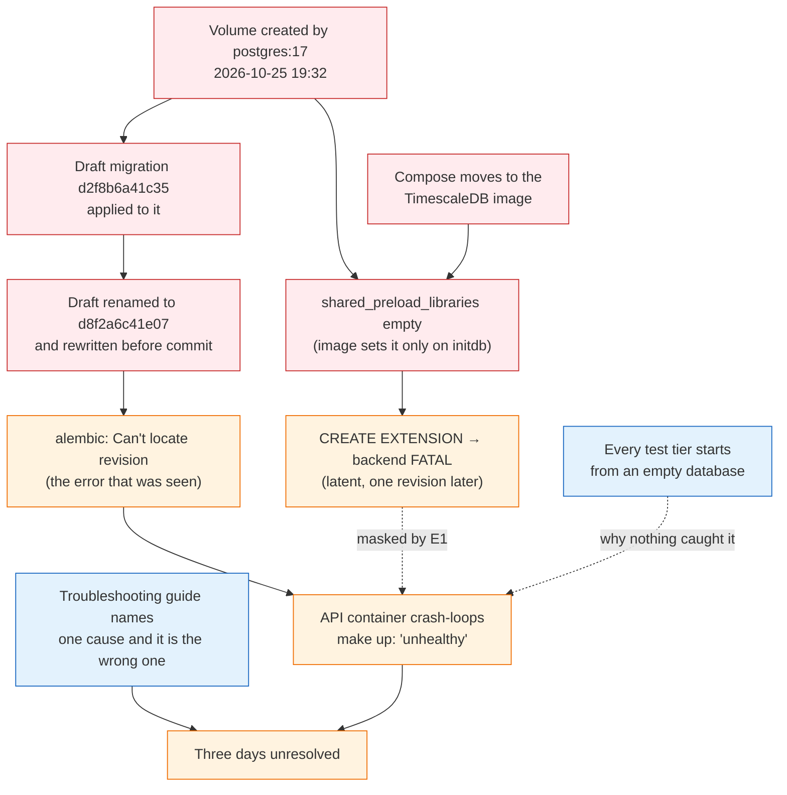

# Post-mortem: the stack would not start after the TimescaleDB move

**Status:** closed — 2026-10-29. Remediated, root causes fixed and tested;
three follow-ups are listed at the end with owners to be assigned.
**Severity:** local development outage, three days. Nothing is deployed, so
there was no customer or data-loss impact; the loss was engineering time and
a commit landing on top of a stack nobody could run.
**Author:** engineering, prepared for the VP of Engineering review.

## Executive summary

On 2026-10-25 we moved the database from plain PostgreSQL 17 to TimescaleDB.
The change was correct on every fresh database — CI, the integration tests
and a clean `make up` all passed — and wrong on every database that already
existed. The developer volume in the `elm` worktree had been created under
the old image, had been migrated with a draft revision that was renamed
before it was committed, and on 2026-10-28 the API container refused to
start against it. The error it printed, `Can't locate revision identified by
'd2f8b6a41c35'`, named neither cause, and our own troubleshooting guide
attributed it to the wrong one.

There were **two independent faults in the same volume**, and the first one
masked the second:

1. **An orphaned migration id.** The volume's `alembic_version` pointed at
   `d2f8b6a41c35`, a draft of the `agent_run` migration that was applied
   locally and then rewritten and renamed to `d8f2a6c41e07` before commit.
   No committed revision can reach that schema. This is the error that was
   actually seen.
2. **TimescaleDB not preloaded.** The volume's `postgresql.conf` had
   `shared_preload_libraries` empty because `initdb` had run under
   `postgres:17`. The TimescaleDB image only writes that setting when *it*
   runs `initdb`. Had the revision chain resolved, the next revision's
   `CREATE EXTENSION timescaledb` would have been a backend `FATAL` that
   drops the connection — confirmed by running it by hand on the old volume.
   Our pre-check in that migration tested whether the extension was
   *available*, which it was, and not whether it was *preloaded*.

The stack is running again on a rebuilt volume. The fixes make the preload a
property of the service rather than of the volume's history, add a migration
preflight that refuses both conditions with a message naming the cause, and
add tests that reproduce each fault. The deeper learning is that **every
test tier we had started from an empty database**, so the one path that
every real deployment takes — upgrading a database that already exists — was
the one path with no test.

## Impact

| | |
|---|---|
| Who | Anyone running the stack from an existing developer volume. Confirmed on the `elm` worktree; the `main` checkout's volume had been recreated under the new image and was unaffected. |
| What | `make up` fails; the API, worker, UI and agents never start. The database itself was healthy and serving. |
| Duration | 2026-10-25 22:09 UTC (the change landed) to 2026-10-29 04:52 UTC (stack healthy on the rebuilt volume). First observed 2026-10-28. |
| Data | One day of sample ingest data (1,599 token-hours, 4,766 pool-hours, 27 runs) on the affected volume. Dumped to a local file before the rebuild; reproducible with `make backfill`. |
| Production | None. The project is not deployed. |

## Timeline (UTC)

| When | What |
|---|---|
| 2026-10-25 19:32 | `elm_pgdata` volume created by `postgres:17` (Debian, glibc). `shared_preload_libraries` left at its commented-out default. |
| 2026-10-25 19:32–21:43 | Agent-layer work in progress. A draft `agent_run` migration with id `d2f8b6a41c35` is applied to this volume; the observer runs against it (9 `agent_run` rows), 27 ingest runs complete, the last at 21:43. |
| 2026-10-25 22:09 | Commit `a90b867` lands: the `agent_run` migration is committed as `d8f2a6c41e07` with different columns, the TimescaleDB migration `e4b9c7a05f13` is added, and compose, CI and the testcontainer move to `timescale/timescaledb:2.31.0-pg17`. The design document states "an existing `pgdata` volume keeps working." CI passes: its databases are always new. |
| 2026-10-28 ~06:09 | The stack is brought up on the `elm` volume. Postgres reuses the data directory ("Skipping initialization"), logs a collation-version warning, and the API container crash-loops on `Can't locate revision identified by 'd2f8b6a41c35'`. The run-stack skill says this means another worktree's database; `CLAUDE.md` says not to `make down` in that case. The database is shut down at 06:09. |
| 2026-10-28 08:07 | Commit `7b53515`, "Pairwise comparisons added but database has an error", is pushed on top of the unrunnable stack. |
| 2026-10-29 04:44 | Investigation reproduces the failure, reads the volume directly, and finds both faults. `git log --all -S d2f8b6a41c35` returns nothing: the id never existed in git. |
| 2026-10-29 04:46 | `CREATE EXTENSION timescaledb` run by hand on the old volume: `FATAL: extension "timescaledb" must be preloaded`, connection lost. Fault 2 confirmed as latent behind fault 1. |
| 2026-10-29 04:47 | Database dumped to a local file; `make down` removes the volume. |
| 2026-10-29 04:52 | Rebuilt image and fresh volume: `/status` reports `ok`, three hypertables, one succeeded ingest run, all ten tokens with rows, end-to-end tests pass. |

## Root causes

### Root cause 1 — a migration id changed after it had been applied

A revision id is a promise to every database that has recorded it. The
draft `agent_run` migration was run against a persistent volume, then its
id and its columns were changed before the commit. From that moment the
volume described a schema that no file in the repository could reach, and
Alembic — correctly — refused to guess. The columns in the old table
(`severity`, `trigger`) versus the committed one (`findings_total`,
`summary`, `report`) show this was a rewrite, not a rename; even a manual
re-stamp would have left a wrong schema behind.

This is a process fault, not a tooling fault. Nothing in the tree was
inconsistent, which is why no test could see it: the inconsistency lived in
a Docker volume on one machine.

### Root cause 2 — the preload was a property of the volume, not of the service

The TimescaleDB image's init script writes
`shared_preload_libraries = 'timescaledb'` into `postgresql.conf` and runs
`CREATE EXTENSION` — but only inside `initdb`, which only runs on an empty
data directory. Our compose file relied on that script. Every volume created
before the image switch therefore came up under the new binary with the
library on disk, "available" to the catalogue, and not loaded. The
extension's own guard against that state is a `FATAL` that terminates the
backend, which no transaction can roll back and no Python `except` can
catch.

The migration had a pre-check for exactly this family of problem, and it
checked the wrong thing: `pg_available_extensions` answers "is the `.so` on
disk", not "is it preloaded". It passed on the broken volume.

### Contributing factors

- **The design document asserted the opposite of what happened.** "The data
  directory layout is unchanged, so an existing `pgdata` volume keeps
  working" was reasoned from the on-disk format and not tested against a
  volume from the previous image. The one manual check recorded
  ("verified against a real local volume") was of `migrate_data => true` on
  a volume that already had the extension.
- **The runbook named one cause, and it was the wrong one.** The run-stack
  skill mapped `Can't locate revision` to "another worktree shares your
  Compose project" and `CLAUDE.md` warned against `make down` in that case.
  Both were right for the case they described and wrong here, and the
  operator was left between a guide that said "don't delete" and a README
  that said "delete". Diagnostics that point at a single cause with
  confidence are worse than none when there are two.
- **Nothing surfaced the cause at the point of failure.** The entrypoint
  runs `alembic upgrade head` under `restart: unless-stopped`, so the
  container re-ran the same failing command every few seconds and `make up`
  reported only `dependency failed to start: container is unhealthy`. The
  actual error was five layers down in `docker compose logs`.
- **The image switch also changed the C library.** `postgres:17` is
  Debian/glibc; the TimescaleDB image is Alpine/musl. The database recorded
  glibc collation 2.41 and the new server could report none. Text indexes
  built under one libc are not guaranteed valid under another. This did not
  cause the outage, but it means "fix the preload and keep the volume" would
  have been the wrong remediation, and nobody had checked.
- **Work continued on a broken stack.** The follow-on commit's message
  recorded the breakage and moved on. A stack that does not start should be
  a stop-the-line event for the person who owns it, not a note.

## Why detection failed

Every automated check we have starts from nothing:

| Tier | Database it runs against | Could it see this? |
|---|---|---|
| `make test-unit` | none | no, by design |
| `make test-integration` | a new testcontainer, migrated from empty | no: the volume is always fresh |
| CI `test` job | a new service container, migrated from empty | no |
| CI `stack` job | `make up` on a runner with no volumes | no |
| `make up` on a developer machine | **whatever volume is there** | **yes — and only here** |

The first four rows are also why the change looked safe. The only
environment that exercised the upgrade path was the one with no test in it.

## What was done

### Remediation (this incident)

- The old database was dumped to a file outside the repository and the
  `elm_pgdata` volume was removed. The volume could not be migrated: no
  committed revision reaches its schema, and its collation history makes it
  unsafe under the Alpine image regardless.
- The stack was rebuilt on a fresh volume. Verified: `/status` ok and
  `data_fresh: true`; `token_hours_data`, `pool_hours_data` and `signal` are
  hypertables; `alembic_version` at head; all ten tokens ingesting; `make
  e2e` 11 passed; the strict quality report flags only GNO's coverage, which
  is the documented thin-token case.

### Fixes, all landed with this post-mortem

| # | Change | Addresses | Proven by |
|---|---|---|---|
| F1 | Compose starts Postgres with `-c shared_preload_libraries=timescaledb`. The service decides the preload; the volume's history no longer does. | RC2 | `test_compose_forces_the_timescale_preload_on_every_volume` |
| F2 | A migration **preflight** in `alembic/env.py`, before any revision runs: refuses a server that does not preload the extension, and refuses a version table stamped with a revision the checkout lacks. Each error names the cause and the action; the unknown-revision message lists *both* causes. The rules are pure functions in `candlegraph/storage/preflight.py`. | RC1, RC2, runbook | 17 unit tests; `test_a_server_that_does_not_preload_timescaledb_is_refused_before_any_ddl`; `test_a_version_table_stamped_with_an_unknown_revision_is_refused_with_a_cause` |
| F3 | The TimescaleDB revision's own check now tests "preloaded" as well as "available", so it is correct even when run outside the preflight. | RC2 | same integration test |
| F4 | Tests that the migration chain is linear with one head and that every revision file is named after its id — the tree-side half of RC1. | RC1 | `test_the_migration_chain_is_linear_with_one_head`, `test_every_revision_file_is_named_after_its_id` |
| F5 | A faithful reproduction in the integration tier: a TimescaleDB server whose data directory was initialised with the image's init scripts hidden, i.e. the exact state of a pre-switch volume. | detection gap | the same preload test; it runs in under two seconds |
| F6 | Documents corrected: the design document's false claim replaced with what actually happens; README and the run-stack skill now list both causes of an unknown revision and the right action for each; the add-migration skill states the rule that a revision id is permanent once applied anywhere. | contributing factors | reviewed |

### Follow-ups, not yet done

| # | Proposal | Why | Owner |
|---|---|---|---|
| A1 | A CI job that migrates a **populated database at the previous release's schema** to head, not only an empty one. Snapshot the schema at each tag; the job restores it, loads a few rows, upgrades, and runs the integration suite. This is the test tier the table above is missing. | Every real deployment takes the upgrade path; today no tier does. | TBD |
| A2 | Fail fast on a preflight error: `restart: on-failure` with a bounded retry for the API container, and `make up` printing the API container's last log lines when `--wait` fails. | The cause should be in the terminal that ran the command, not five layers down. | TBD |
| A3 | Extend the preflight with a collation check (`pg_database.datcollversion` against the server's actual version) that warns when the volume was built under a different C library. | The Debian-to-Alpine switch was silent; next time it may matter. | TBD |
| A4 | A CI check that a pull request never modifies an existing file under `alembic/versions/` on `main`; new revisions are added, old ones are immutable. | Encodes the rule from F6 in the only place that can enforce it for committed revisions. | TBD |

## Learnings

1. **Test the upgrade, not just the install.** A storage change that passes
   on every fresh database and fails on every existing one is not
   "verified". The fresh-database bias was in every tier we had, and in the
   design document's reasoning.
2. **"Available" is not "enabled".** Guard checks have to test the condition
   that actually fails, not a proxy for it. The pre-check that existed gave
   confidence precisely where it should have given an error.
3. **A migration id is applied-once, immutable forever.** That includes a
   laptop volume. If a draft must change, downgrade it everywhere it ran
   first. Tooling cannot see the volume-side half of this; the rule can.
4. **Diagnostics must list every cause they know, not the most likely one.**
   A runbook row that confidently names one cause turns a ten-minute problem
   into a three-day one when the cause is the other.
5. **An image swap can change more than the software.** The libc changed
   with it, and the only warning was a line in the Postgres log nobody reads.
   Base-image changes under persistent data deserve the same review as a
   schema change.
6. **Put the error where the operator is.** A crash loop behind a
   `--wait` is the worst of both: it never stops and it never explains.
7. **A broken stack is a stop-the-line event**, even for one developer.
   Committing on top of it converted a local problem into a shared one.
