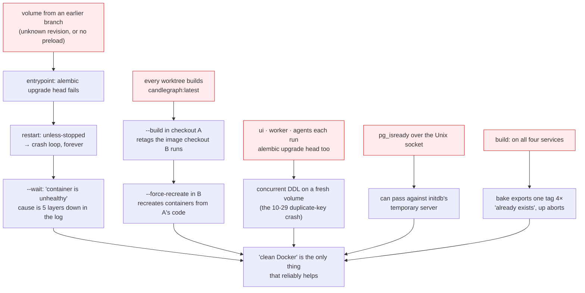

# Post-mortem: the API container sometimes would not start until Docker was cleaned by hand

**Status:** closed — 2026-10-29. Fixed and tested before the stage 1 image
switch, deliberately, so the switch lands on a stack that starts the same
way from any state.
**Severity:** low. Development friction, no data impact. Recorded because
the workaround ("clean Docker") was destroying state that did not need
destroying, and because the same causes would have bitten the image switch.

## What was happening

Two reports from the same person: the `candlegraph` container sometimes
stayed down after `make up` until Docker was cleaned, and
`docker compose up -d --build --force-recreate` did not fix it. Both are
true, and neither was one bug.

## Root causes

1. **A deterministic failure was retried forever.** `restart:
   unless-stopped` is right for a process that may crash at 3 a.m.; it is
   wrong for an entrypoint that fails the same way every time because the
   volume is at a revision this checkout does not have. The loop never
   ends, `--wait` reports only "unhealthy", and recreating the container
   cannot help because the fault is in the volume. Only deleting the
   volume — "cleaning Docker" — fixes it, which is why that became the
   habit.
2. **One image tag for every checkout.** All four app services built into
   `candlegraph:latest`. With several worktrees on one machine, a `--build`
   in one retags the image the others run; a later `--force-recreate`
   elsewhere faithfully recreates containers from someone else's code and
   migrations. "Force-recreate does not work" was sometimes "force-recreate
   ran the wrong image".
3. **Four migrators.** Every app container ran `alembic upgrade head`. The
   worker and agents waited for the API, the UI did not (fixed on 10-29),
   and even the waiting ones re-ran a no-op upgrade concurrently. Four
   chances to race on DDL for one piece of work.
4. **The Postgres probe could pass against the wrong server.** `pg_isready`
   with no host uses the Unix socket, which the image's temporary initdb
   server also listens on. A probe landing in that window reports healthy,
   the API starts, and the server it connected to shuts down under it. The
   window is short, which is exactly what makes it an intermittent fault.

5. **Four services built the same image.** `build:` sat in the shared
   anchor, so every app service was a buildx bake target exporting the
   same tag. Bake runs them concurrently; when two finish close together
   the second fails with `image "candlegraph:<project>": already exists`
   and `up` aborts before a container starts. It passed most of the time,
   which is the worst kind of bug. Found while verifying the fixes above.

Contributing: `make up` swallowed the useful part of the output, and there
was no target for "start over" short of knowing the compose flags.

## Fixes

| # | Change | Proven by |
|---|---|---|
| F1 | `restart: on-failure:5` on app containers. A broken start stays exited after five tries; a container that ran ten seconds resets the count, so a crash later in life is still restarted. | `test_app_restarts_are_bounded_so_a_broken_start_becomes_visible` |
| F2 | `image: candlegraph:${COMPOSE_PROJECT_NAME}` — one image per project; `make reset` removes it with `--rmi local`. | `test_the_app_image_is_tagged_per_compose_project` |
| F3 | `RUN_MIGRATIONS` in the entrypoint, default true; compose sets it true for the API only. Everything else waits for the API to be healthy. | `test_exactly_one_container_applies_migrations`, the entrypoint tests against a fake `alembic` |
| F4 | `pg_isready -h 127.0.0.1`: TCP, which only the real server listens on. | `test_the_postgres_probe_uses_tcp_…` |
| F6 | `build:` on the `candlegraph` service only; the other three reference the image with `pull_policy: never`, so a missing image says so instead of asking Docker Hub. | `test_exactly_one_service_builds_the_image_and_the_rest_reuse_it` |
| F5 | `make up` prints the API container's last 40 log lines when `--wait` fails and names `make reset`; `make reset` is `down -v --rmi local` then `up`. | run by hand below; `run-stack` skill updated |

## Verified

On the current image, before the switch: fresh `make up` healthy; the
volume stamped with a bogus revision; `docker compose up -d --build
--force-recreate --wait` fails fast with the container exited (not
restarting) after five attempts; `make up` prints the preflight's message
naming the unknown revision and the remedy; `make reset` recovers. Timings
are in the rollout document's step 1 notes.

## Learnings

- **Match the restart policy to the failure mode.** Retry what might
  succeed next time; stop and show what will not.
- **Anything shared across checkouts needs the project name in it.**
  Volumes already had it; the image did not.
- **One owner per side effect.** Four containers applying one schema is
  three too many, whatever the ordering.
- **"Clean Docker and retry" is a symptom to record, not a fix to teach.**
  It worked because it deleted the volume; `make reset` does the same on
  purpose and says so.
