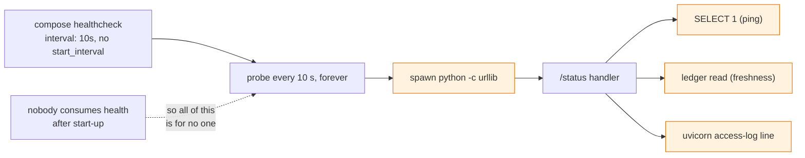

# Post-mortem: the API log was nothing but health probes

**Status:** closed — 2026-10-29. Not an outage; a cost and observability
finding raised while reading the start-up log after the previous incident.
**Severity:** low. No request was slowed and no data was affected. The cost
was wasted work on every running stack and a log that hid real traffic.

## Executive summary

`make logs` on a freshly started stack showed a `GET /status` line roughly
every ten seconds and little else. The question was whether something was
polling the API by mistake. It was not: every hit came from `127.0.0.1`,
which is the container's own Docker health probe, configured in compose at
`interval: 10s`. **This was by design, and the design was wasteful.**

Three things compounded:

1. **The probe ran at start-up cadence forever.** Compose and `depends_on`
   only act on health while a stack is starting, and Docker never restarts
   an unhealthy container on its own, so after the first success a probe
   every ten seconds had no consumer. The Postgres probe was worse, at three
   seconds.
2. **Each probe was expensive for what it proved.** The API probe spawned a
   Python interpreter to make the request, and the handler then ran two
   queries: a `SELECT 1` ping and then the ledger read for freshness, where
   the second alone proves the database is up.
3. **Each probe wrote an access-log line.** At one line per ten seconds the
   probe produced about 8,600 lines a day per stack, and the operator reading
   the log for ingest errors or the previous incident's migration error had
   to find them between probes.

The fix keeps the fast start-up and removes the steady-state cost: probes
run every three seconds only during the start period and then every three
minutes; the status handler makes one round trip instead of two; and a
successful probe is no longer written to the access log while a failing one
still is.

## Before and after, per stack per day

| | Before | After |
|---|---:|---:|
| API probes (`python -c` processes) | 8,640 | 480 |
| Queries from API probes | 17,280 | 480 |
| UI probes | 8,640 | 480 |
| Postgres `pg_isready` processes | 28,800 | 480 |
| Access-log lines from healthy probes | 8,640 | 0 |
| Time for `make up` to report healthy | ~30 s | unchanged (measured: see verification) |

## Timeline (UTC)

| When | What |
|---|---|
| 2026-10-25 | The health checks were written for the agent-layer compose file with `interval: 10s` on the API and UI and `3s` on Postgres, with `start_period` but no `start_interval`. The intervals were chosen for a fast `make up`; nothing distinguished start-up from steady state. |
| 2026-10-29 04:52 | The stack is rebuilt after the migration incident. The API log is read closely for the first time in days: 46 `GET /status` lines in eight minutes, all from `127.0.0.1`. |
| 2026-10-29 06:30 | Root cause confirmed from `docker inspect`: the probe history matches the log line for line, every ten seconds. No other caller exists in the code, the skills, CI or the tests. |
| 2026-10-29 06:45 | Cadence, handler and log filter changed; tests added; stack rebuilt and re-verified. |

## Root cause

**Why by design and not a bug.** Docker health checks are the mechanism
`make up --wait` and the worker's `depends_on: condition: service_healthy`
rely on, so the probe has to exist and has to run often *while the stack is
coming up*. The error was treating that start-up requirement as a permanent
one. Docker has had a separate `start_interval` for exactly this since Engine
25; the compose file predated anyone here knowing it existed.

**Why two queries.** The handler was written as "ping, then if up, read
freshness" because that reads naturally. The ledger read is a real round
trip on a real connection; if it succeeds the database is up, and if the
database is down it raises. The ping was a second connection checkout and
round trip that answered a question already being answered.

## What was done

| # | Change | Proven by |
|---|---|---|
| F1 | Every compose probe: `start_interval: 3s` inside a `start_period` long enough for a cold start, then `interval: 180s`, `retries: 3`. | `test_every_compose_probe_is_fast_at_start_and_slow_afterwards` |
| F2 | `/status` makes one database round trip. The freshness read is the liveness check; a `psycopg2.Error` from it is "database down" and a 503. | `test_status_costs_one_database_round_trip`, `test_status_is_503_when_the_database_is_unreachable` |
| F3 | A filter on uvicorn's access logger drops a 2xx `GET /status` and keeps everything else, including a 503 from the same path. `LOG_HEALTH_PROBES=true` turns it off. | `tests/unit/test_health_probes.py` |
| F4 | Documents: README, the run-stack skill, `.env.example`, and invariant 25 in `AGENTS.md`. | reviewed |

**Not changed, deliberately.** The probe still runs the full `/status`, not
a trimmed liveness endpoint. At one call every three minutes the difference
is nothing, and a probe that also reports freshness is the one an operator
actually reads. The Python-interpreter probe stays too: the runtime image
has no `curl` or `wget`, and adding a binary to save one process spawn every
three minutes is not worth a larger image.

## Found while verifying: two containers migrating at once

Re-creating the stack on a fresh volume to measure the new cadence, the API
container died once before coming up, with
`duplicate key value violates unique constraint "pg_type_typname_nsp_index"`
on `alembic_version`. The shared entrypoint runs `alembic upgrade head` in
every app container. The compose file already made the worker and the
agents wait for the API to be *healthy* so that only one process runs the
DDL, and said so in a comment. The UI was not on that list, so on an empty
schema the UI and the API each tried to create the version table in the
same instant. Which one lost was timing luck, which is why it had not been
seen before.

| # | Change | Proven by |
|---|---|---|
| F5 | `ui` now depends on `candlegraph: service_healthy`, like the worker and the agents. Exactly one container migrates a fresh volume. | `test_only_the_api_container_migrates_a_fresh_volume` |

The preflight from the previous incident also fired during this
verification, on a different machine-local volume stamped at a revision
this checkout does not have, and its message pointed at the right action
(run under an explicit `COMPOSE_PROJECT_NAME`; do not `make down` another
worktree's data). That is the first time the new error has been read by an
operator, and it worked.

## Learnings

1. **Separate start-up cadence from steady-state cadence.** Anything that
   polls should be asked who consumes the answer after the first one. Here
   the answer was nobody.
2. **The most frequent request deserves the most scrutiny.** `/status` was
   the only request the API answered for hours at a time, and it was written
   as if it ran once.
3. **A log that is mostly noise is a log that is not read.** The migration
   error in the previous incident sat in this same log. A probe line every
   ten seconds is one reason it took effort to find.
4. **"By design" is not the end of a question.** The design was correct
   for one phase of the container's life and was never revisited for the
   other.
5. **A rule stated in a comment is only as complete as its list.** "Only
   the API migrates" was written down and enforced for two of the three
   containers it applied to. The test now derives the list from the compose
   file instead of naming the services.
