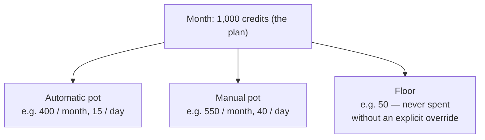
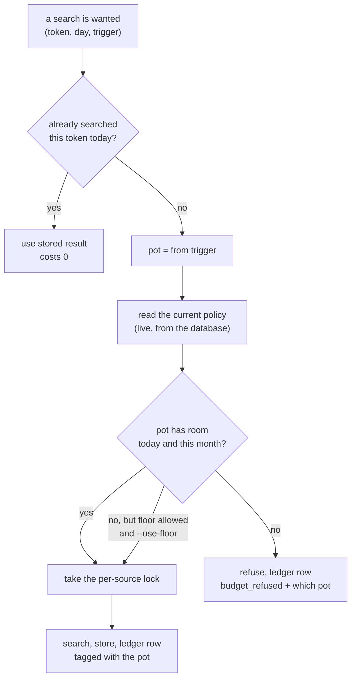
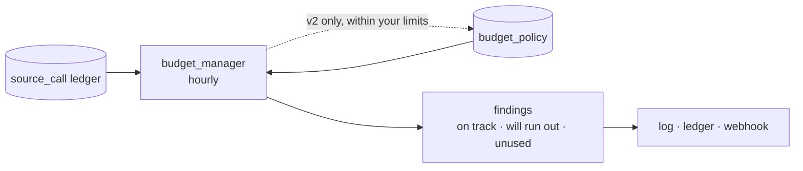

# The budget manager: sharing news-search credits between automatic and manual fetches

**Status:** proposed — 2026-11-15. Nothing here is built. It changes how
`knowledge/budget.py` decides, and adds one agent and one small table.
**Related:** [`../tavily/DESIGN.md`](../tavily/DESIGN.md) (the current
guard, cache and ledger — all kept), [`../../harness/runner/DESIGN.md`](../../harness/runner/DESIGN.md)
(jobs and `trigger`, which this design relies on).

## In one paragraph

Tavily gives us a fixed number of search credits a month (1,000 on the
free plan). Two kinds of work spend them: **automatic** fetches (the
daily news job, later pipelines and the research loop) and **manual**
fetches (you, from the CLI, the UI button, an MCP tool, or `--explain`).
Today both draw from one pot, so a busy automatic month can leave you
nothing to search with. The budget manager splits the month into two
pots with their own limits, lets you change the split at any time
without a restart, and runs a small agent that watches spending and
tells you — early — when a pot will run out.

## What is wrong today

| Problem | Effect |
|---|---|
| **The "manual reserve" cannot be spent by anyone.** `TAVILY_RESERVE_CREDITS` (50) is described as kept for manual searches, but the guard never knows who is asking, so it refuses manual searches at the same line as automatic ones. | The 50 credits are dead weight every month. **This is a bug**; this design is the fix. |
| One daily cap for everything (`TAVILY_DAILY_CREDITS`, 40) | A heavy manual day blocks the automatic job, or the other way round. |
| Limits are set in `.env` | Changing them means editing a file and restarting containers. |
| Nobody watches the rate of spending | You learn the month is gone when searches start being refused. |
| Two processes can pass the check at the same moment | The cap can be overshot by a credit or two. Small, but real today. |

## Requirements (from the brief)

1. Keep an eye on how many credits are used.
2. Allocate some credits to automatic fetches.
3. Keep a quota for manual fetches.
4. Start from a baseline set in configuration.
5. Allow the baseline to be changed in real time.

## The design

### Two pots, and a floor



- **Automatic pot** — scheduled jobs and pipelines.
- **Manual pot** — anything a person started.
- **Floor** — a last safety margin. Not spent by either pot; a person can
  spend it with an explicit `--use-floor` flag (for the "I must check
  this one thing on the 30th" case). This replaces today's reserve, and
  unlike it, can actually be used.

The three numbers must add up to at most the monthly plan. Each pot also
has a daily limit, so one bad day cannot drain a pot.

### Who pays: the trigger decides

Every run already records why it started (`trigger`, from the harness
pre-work). That is exactly the information the guard was missing:

| Trigger | Pot |
|---|---|
| `scheduled`, `event` | automatic |
| `manual`, `ui`, `mcp` | manual |
| `backfill` | manual (a person asked for it) |

No caller has to remember to say which pot it uses; the run already
knows. The trigger reaches the guard because every search already runs
inside a `run_job`.

### One search, step by step



What is new compared with today: the pot, the live policy read, and the
lock. The cache and the ledger work exactly as now.

### Baseline, and changing it live

**Baseline** stays in `.env`, so a fresh stack works with no setup:

```
TAVILY_MONTHLY_CREDITS=1000
TAVILY_AUTO_MONTHLY=400
TAVILY_AUTO_DAILY=15
TAVILY_MANUAL_MONTHLY=550
TAVILY_MANUAL_DAILY=40
TAVILY_FLOOR=50
```

**Live changes** go into a small `budget_policy` table. The guard reads
the newest row for the source on every decision, so a change takes
effect on the next search, with no restart. If the table has no row,
the `.env` baseline is used.

You change it from:

- the CLI: `candlegraph budget set --auto-monthly 300 --manual-monthly 650`
- the News dashboard: a small form, behind a confirm button (UI rule)
- `candlegraph budget show` prints the current policy and where each
  number came from (baseline or a change, by whom, when)

Every change is a new row, never an edit, so the history of who changed
what is kept. A change that does not add up (pots + floor > plan) is
refused with the reason.

### The budget manager agent

A small scheduled job, `budget_manager`, in the `agents` process. It is
built like the observer: it reads, computes findings with plain code,
and reports. It does **not** search, and in version 1 it changes nothing.

Every hour it works out, per pot:

| It computes | From |
|---|---|
| spent this month, spent today | the `source_call` ledger, by pot |
| average daily spend over the last 7 days | the ledger |
| the day the pot will run out at that rate | spent, limit, days left |
| refusals today | the ledger |

And reports findings in the usual way:

| Finding | Severity | Example message |
|---|---|---|
| on track | OK | "Automatic: 120 of 400 used, at this rate 310 by month end." |
| will run out early | WARNING | "Manual pot will run out on the 24th at the current rate (22/day)." |
| ran out | CRITICAL | "Automatic pot empty since the 27th; 14 scheduled searches refused." |
| unused | INFO | "Manual pot 6% used with 5 days left; 480 credits will go unspent." |
| policy changed | INFO | "Auto monthly 400 → 300, set by `ui` at 14:02." |

It posts to the same sinks as the observer (log, ledger, webhook…).

**Version 2 (optional, later): it may move credits.** Only if you turn it
on, and only within limits you set:

- it may move unused credits from one pot to the other in the last N days
  of the month (e.g. lend idle manual credits to automatic in the last 5
  days);
- never more than a set amount per move, never below a minimum you set
  for each pot, never touching the floor, never above the plan;
- every move is a new `budget_policy` row with the reason, and a finding.

The decision about *whether* to move is plain code (a pure function with
tests), not a model. A model may write the message; it may not pick the
numbers. Same rule as everywhere else in this repo.



## Changes to the data

Both recorded in `docs/storage/table-placement/DESIGN.md` before any
migration (they are plain tables; neither is a time series).

| Change | Why |
|---|---|
| `source_call.pot` — `auto`, `manual`, `floor`, or NULL for old rows | so spending can be summed per pot. Old rows stay NULL, not guessed (invariant 11); for the current month they count against the automatic pot, which is what made them |
| new table `budget_policy` — source, the six numbers, `changed_by`, `reason`, `created_at` | the live, versioned policy |

## Changes to the code

| File | Change |
|---|---|
| `knowledge/budget.py` | `Budget` gains the two pots and the floor; `decide(spent_by_pot, today_by_pot, cost, pot, policy)`. Still pure. Today's tests are kept and re-expressed per pot |
| `knowledge/news.py` | gets the pot from the run's trigger; tags the ledger row; takes a Postgres advisory lock per source around check-and-spend (fixes the double-spend race) |
| `harness/jobs.py` | `budget_manager` job, role `agents`, writes `{ledger, reports}` (v1) |
| `cli.py` | `budget show`, `budget set` |
| `ui/viewmodels.py` + News page | pot bars, the change form, the policy history |
| observer | its `source_budget` finding reads pots instead of one total |

## Worked example

Plan 1,000. Five active tokens, one automatic search each per day = 5 a
day, ~150 a month. You search by hand on busy days.

| | Auto | Manual | Floor |
|---|---|---|---|
| Baseline | 300 / month, 10 / day | 650 / month, 40 / day | 50 |
| Day 18, manual at 590 | 92 used | 590 used — **WARNING: runs out on the 20th** | — |
| You move 100 from auto to manual (CLI) | 200 | 750 | 50 |
| Day 30 | 148 used | 731 used | 0 used |

Nothing was refused that should not have been, and you were told on day
18, not day 21.

## What could go wrong

| Risk | Answer |
|---|---|
| A wrong live change starves the automatic job | refused if it does not add up; the agent reports the effect within an hour; the history shows who changed it |
| The policy table is unreachable | the guard falls back to the `.env` baseline and logs it; it never treats "unknown" as "unlimited" |
| Month boundary | UTC, as today. Pots reset on the 1st; the policy carries over |
| Plan changes (free → paid) | change `TAVILY_MONTHLY_CREDITS` or set it live; the pots are re-checked against it |
| More metered sources later (a paid news API, a model API) | the pot idea is per source. Each source gets its own policy row; nothing here is Tavily-specific except the defaults |

## Build order

| # | Change | Size |
|---|---|---|
| 1 | Pots in `budget.py` (pure, tested) and the pot from the trigger in `news.py`; `.env` baseline only. **This alone fixes the reserve bug** | S |
| 2 | `source_call.pot` and the advisory lock | S (migration) |
| 3 | `budget_policy` table, `budget show/set`, the UI form | M (migration) |
| 4 | `budget_manager` agent, advise-only | S |
| 5 | Optional: automatic moves within limits | S |

Step 1 is worth doing soon, independent of the rest: it makes the
documented reserve real with no schema change.
