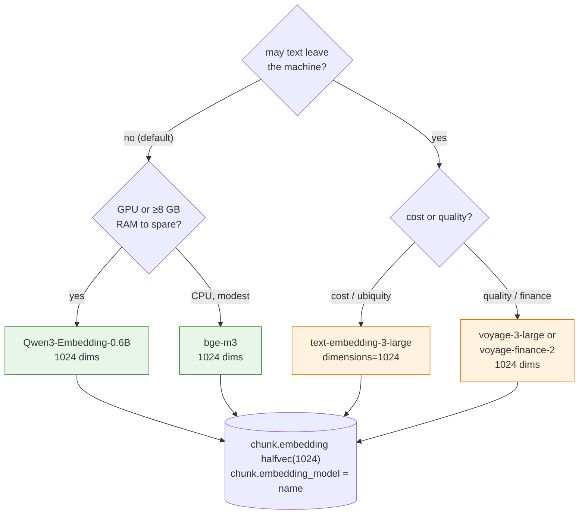

# Embedding models: what to compare, what to pick, and reuse in the harness

**Status:** implemented — 2026-11-01 (rollout step 5): `candlegraph/knowledge/embed.py`
holds the Protocol, the Ollama provider (`bge-m3`, the default), the OpenAI
provider, the deterministic fake, and the resumable `embed_pending` loop;
the `ollama` compose service runs behind the `knowledge` profile. The
evaluation set in the last section is still to be built.
**Decision:** an `Embedder` Protocol with pluggable providers; **1024
dimensions fixed**; default provider is local and free (`BAAI/bge-m3`, with
`Qwen3-Embedding-0.6B` as the quality step up); OpenAI
`text-embedding-3-large` truncated to 1024 as the hosted option. One active
model per deployment, recorded on every row.
**Companion:** [`../graph/DESIGN.md`](../graph/DESIGN.md),
[`../vector-store/DESIGN.md`](../vector-store/DESIGN.md).

## What the model has to do here

Three jobs, in order of how soon they matter:

1. **Retrieve news and analysis text about an asset around a bar** for
   `signals --explain`. English-dominant, short-to-medium passages, queries
   built from aliases and a time window. Retrieval quality matters more
   than throughput: thousands of chunks a month, not millions.
2. **Match a failing check against past incidents** for the janitor's
   prose-only "this looks like" finding. Small corpus, technical English.
3. **Later, in the harness and the alerting agent:** deduplicate and cool
   down alerts by semantic similarity of report text, and embed pipeline
   events for "what happened the last time this step was slow". Same kind
   of text as (2).

All three are English technical/financial prose. None needs multimodal
input or 100-language coverage, though multilingual is a cheap bonus
because crypto news is not only in English.

## Candidates

Figures are approximate, from the model cards and the MTEB retrieval
leaderboard at the time of writing. They move every quarter; the
*ordering* and the *cost structure* are the durable part. Re-check before
quoting.

| Model | Access | Dims (fixed / MRL) | Context | MTEB retrieval (approx.) | Cost | Notes |
|---|---|---|---|---|---|---|
| **OpenAI `text-embedding-3-large`** | API | 3072, MRL to 256–3072 | 8k | ~55–59 (BEIR nDCG@10) | ~$0.13 / 1M tokens | the "industry standard" the question asked about; strong, cheap, English and multilingual; data leaves the machine |
| OpenAI `text-embedding-3-small` | API | 1536, MRL | 8k | ~51–55 | ~$0.02 / 1M | cheapest hosted; noticeably weaker on retrieval than large |
| **Voyage `voyage-3-large` / `voyage-3.5`** | API | 1024 (MRL 256–2048) | 32k | top tier, typically above OpenAI large by several points | ~$0.06–0.18 / 1M | Anthropic's recommended embedding partner; `voyage-finance-2` exists for financial text; `voyage-3-lite` is the cheap tier |
| Cohere `embed-v4` / `embed-english-v3` | API | 1024 (v4 MRL) | 128k (v4) | top tier | ~$0.10–0.12 / 1M | int8/binary outputs built in; strong reranker in the same family |
| Google `gemini-embedding-001` | API | 3072, MRL | 8k | top of MTEB multilingual at release | ~$0.15 / 1M | strong; another vendor to depend on |
| **`BAAI/bge-m3`** | local, MIT | 1024 fixed | 8k | ~54–57 | free; 568 M params; ~1–2 GB RAM on CPU | dense + sparse + multi-vector from one model; multilingual; the default pick for "local and free" |
| **`Qwen/Qwen3-Embedding-0.6B`** | local, Apache-2 | 1024, MRL 32–1024 | 32k | highest among small open models at release (above bge-m3 and close to hosted) | free; 0.6 B params; CPU-usable, GPU-happy | the quality step up at the same dimension; 4B/8B siblings if a GPU appears |
| `nomic-embed-text-v1.5` | local, Apache-2 | 768, MRL 64–768 | 8k | ~52–55 | free; 137 M params; fast on CPU | excellent speed/quality on CPU; 768 dims means a different column, see below |
| `intfloat/e5-large-v2` / `multilingual-e5-large` | local, MIT | 1024 | 512 | ~50–52 | free; 335 M | solid, older; short context hurts on long articles |
| `Snowflake/snowflake-arctic-embed-l-v2.0` | local, Apache-2 | 1024, MRL | 8k | ~55–57 | free; 568 M | comparable to bge-m3; English-first |
| `sentence-transformers/all-MiniLM-L6-v2` | local, Apache-2 | 384 | 256 | ~41–43 | free; 22 M; very fast | fine for tests and the incident corpus; too weak for news retrieval |

## How to read that

- **The hosted frontier is a few points apart, and all of it beats most
  local models by a few more.** Voyage and Cohere lead; OpenAI large is
  close behind and the cheapest of the three to integrate because every
  tool supports it. If the data may leave the machine, OpenAI large is a
  reasonable default and Voyage is the upgrade.
- **The local gap has closed enough for this workload.** `Qwen3-Embedding-0.6B`
  and `bge-m3` retrieve well on English news at a corpus of thousands;
  the difference between them and OpenAI large is smaller than the
  difference a reranker makes. For "local free first" they are not a
  compromise that shows.
- **1024 is where the candidates meet.** bge-m3, Qwen3-0.6B, Voyage,
  Cohere, arctic and e5 are 1024 natively; OpenAI large, Gemini and
  nomic can be truncated (Matryoshka) to or below it. Fixing the column at
  1024 means switching providers is a re-embed, not a migration.
- **Context length matters more than it looks.** Articles run past 512
  tokens; models with 512-token windows force small chunks and lose
  cross-paragraph meaning. Everything recommended here handles 8k.

## The decision



- **Default: local, `BAAI/bge-m3`**, served either in-process via
  `sentence-transformers` or from an Ollama container in compose (which
  keeps the model weights out of the app image). Ollama is the better
  operational shape: the app stays small, the model is a service with its
  own health check, and the same endpoint serves the harness later.
- **Hosted option: OpenAI `text-embedding-3-large` with `dimensions=1024`.**
  Not `-small`: the retrieval gap is real and the cost difference is cents
  at this volume.
- **Upgrade paths:** `Qwen3-Embedding-0.6B` locally, `voyage-3-large` or
  `voyage-finance-2` hosted. Both are a config change and a re-embed.
- **The `Embedder` Protocol:**

  ```python
  class Embedder(Protocol):
      name: str  # stored on every chunk row
      dimensions: int  # must equal the column's

      def embed(self, texts: Sequence[str], *, kind: Literal["document", "query"]) -> list[list[float]]: ...
  ```

  `kind` matters: bge, e5, nomic and Qwen use different instructions or
  prefixes for queries versus documents, and forgetting it costs several
  points of recall silently. The Protocol makes the caller say which.

- **One active model per deployment.** `chunk.embedding_model` is on the
  row; the HNSW index is only meaningful over one model's vectors. A model
  change is `candlegraph knowledge reembed`, which re-encodes in batches
  and is resumable (it skips rows already stamped with the new name).
  The observer reports rows whose model is not the configured one.

## As built

| Piece | Where | Notes |
|---|---|---|
| `Embedder` Protocol | `knowledge/embed.py` | `name`, `dimensions`, `embed(texts, kind=document\|query)` exactly as above |
| `OllamaEmbedder` | same | `POST {OLLAMA_URL}/api/embed`; model-family prefixes applied by `prefixes_for` (nomic, e5, mxbai; **none for bge-m3 and Qwen3**); a vector of the wrong width is refused unless `EMBEDDING_TRUNCATE=true` (Matryoshka models only), and then truncated and renormalised |
| `OpenAIEmbedder` | same | `POST /v1/embeddings` with `dimensions=1024`; results re-ordered by `index`; the key never appears in an error |
| `HashEmbedder` | same | sha256-seeded unit vectors; `EMBEDDING_PROVIDER=fake`; the unit tier and the integration tier run on it so no test downloads a model |
| `embed_pending` | same | batches of `EMBEDDING_BATCH_SIZE`; the query selects `embedding IS NULL OR embedding_model IS DISTINCT FROM <model>`, so a run is resumable and a model change is a re-embed; a batch that writes zero rows raises instead of looping |
| `embedding_backlog` | same | `missing` (never embedded, or text changed) and `stale` (another model) — what the observer's `embedding_backlog` finding will read in step 9 |
| `similar_chunks` | `knowledge/statements.py` | cosine `<=>` over the active model's rows, `ORDER BY … LIMIT`, the shape the HNSW index answers; proven with `EXPLAIN` in the integration tier |
| CLI | `candlegraph knowledge embed` / `reembed` | print the backlog, embed, print what remains; `make embed` / `make reembed` inside the stack |
| Service | `docker-compose.yaml` → `ollama` | `ollama/ollama:0.40.13`, profile `knowledge`, pulls `${EMBEDDING_MODEL}` once into the `ollama` volume, healthy only when `ollama show <model>` succeeds; `make up-knowledge` |

Two consequences for operators: the default stack (`make up`) does not
start Ollama and `make embed` will fail with a message naming
`OLLAMA_URL` and `make up-knowledge`; and the first `make up-knowledge`
downloads about 1.2 GB of weights, which the 15-minute `start_period`
on the health check is sized for.

## Chunking

Chunking is a pure function in `documents.py` and is tested as one.
Target 300–500 tokens with a 50-token overlap, split on paragraph then
sentence boundaries, never mid-sentence. Token counts are words plus
punctuation marks (`documents.count_tokens`), a model-free proxy chosen so
the unit tier needs no tokenizer download; it runs a little under the
subword count, which errs on the side of smaller chunks. Each chunk stores its `ordinal`, so a
citation can quote the chunk and link to the document at that position.

## Reuse in the harness (stage 2) and the agents (stage 5)

The same `Embedder` serves the later stages, which is the reason to make
it a Protocol in a shared module rather than a detail of `explain`:

| Later use | What is embedded | Why the same model is right |
|---|---|---|
| alert deduplication and cooldown (stage 5) | the rendered text of an agent report or alert | similarity of short English technical prose; the retrieval model is already good at it, and one index to operate |
| "this failure looks like" for the janitor | `docs/incidents/*` and past `agent_run.report` | tiny corpus, local model, no network in CI |
| pipeline event search in the harness | step names plus the error tail | same shape as the janitor case |
| future document retrieval for strategy features (stage 4/5) | feed documents, as-of each bar | identical to stage 1, with the as-of bound |

What the harness should **not** reuse it for: time-series similarity
("bars that look like this bar"). That is a shape-matching problem for
stage 4's models, not a text-embedding one.

## Evaluation before committing

A small, versioned evaluation set lives in `tests/data/knowledge/eval.jsonl`
once the layer exists: ~50 queries about the active tokens with
hand-labelled relevant chunks from a frozen corpus. `candlegraph knowledge
eval --model <name>` reports recall@5 and MRR. The default model is the one
that wins on that set under the local-and-free constraint, and the number
is recorded here when it is measured. Until then the ordering above is
from public benchmarks and should be treated as a prior, not a result.

## Rejected

- **Letting each provider choose its native dimension.** Then OpenAI rows
  are 3072 and bge rows are 1024 and the column type is wrong for one of
  them. Fixing 1024 costs OpenAI large a small, measured amount of recall
  and buys provider portability.
- **`text-embedding-3-small` as the hosted default.** Cheaper by a factor of
  six on a bill that is cents; weaker on exactly the retrieval task that
  matters.
- **Fine-tuning.** No labelled data yet. The evaluation set above is the
  first step toward knowing whether it would help.
- **In-process `sentence-transformers` as the default** (considered again
  when building). It would put PyTorch and the weights into the app image
  — gigabytes on every container, including the API and the UI that never
  embed anything. Ollama keeps the model a service with its own volume and
  health check. The Protocol leaves room for an in-process provider if a
  deployment ever needs one without Docker.
