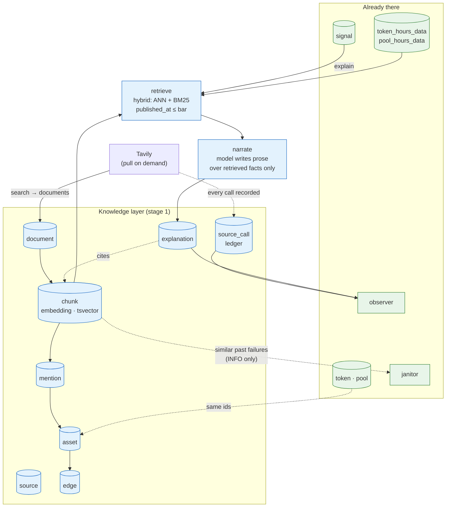
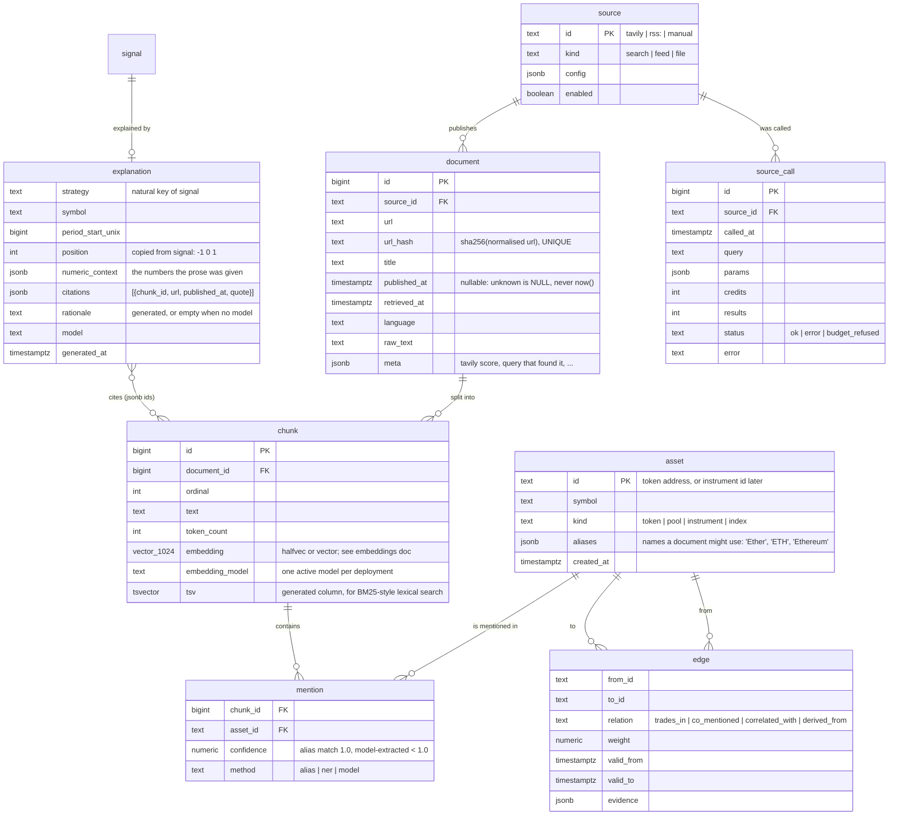

# Knowledge graph: schema, retrieval, and how it attaches to what exists

**Status:** in progress — 2026-10-31. The schema (all eight tables, pgvector
installed, revision `f399ca0770a0`), the asset sync
(`candlegraph knowledge sync-assets`, aliases in `config/tokens.yaml`) and
the document pipeline (`knowledge/documents.py`: URL normalisation,
`url_hash`, chunking, the upserts), embeddings (`knowledge/embed.py`,
`bge-m3` via the `ollama` service) and the Tavily source with its budget
guard and `source_call` ledger (`knowledge/sources/`, `budget.py`,
`news.py`) are implemented — rollout steps 2–6. Retrieval and `--explain`
are still design only.
**Area (when built):** `candlegraph/knowledge/`, `alembic/versions/`,
`candlegraph/cli.py` (`signals --explain`, `knowledge *`),
`candlegraph/agents/observer/` (one new collect node)
**Companions:** [`../vector-store/`](../vector-store/DESIGN.md) (which store),
[`../embeddings/`](../embeddings/DESIGN.md) (which model),
[`../tavily/`](../tavily/DESIGN.md) (the web source under a rate limit),
[`../mcp/`](../mcp/DESIGN.md) (exposing it as tools).

## What this stage is for

Today a signal is a number: `bollinger` says `-1` on WETH at 14:00 UTC with a
z-score of 2.3. The exit criterion for stage 1 is that the same command, with
`--explain`, prints *what else was true* at that bar and cites it:

```
candlegraph signals WETH --strategy bollinger --explain
  2026-10-24 14:00  short  z=+2.31
  WETH closed 2.3σ above its 24h mean after a 6% move in three hours. Two
  documents published in the preceding 24h discuss an unlock and a large
  transfer to an exchange [1][2]; WBTC moved +0.4% over the same window,
  so the move is idiosyncratic rather than market-wide.
  [1] https://…   2026-10-24 09:12 UTC   (tavily, retrieved 2026-10-24 14:03)
  [2] https://…   2026-10-24 11:40 UTC   (tavily, retrieved 2026-10-24 14:03)
```

Everything numeric in that paragraph comes from tables that already exist.
What is new is the text, the links between text and assets, and the rule
that the prose cannot say anything the retrieved facts do not support.

## The shape of it



Three rules carry over from the layers below and are the design:

1. **Numbers are computed; prose is optional** (invariant 22). The
   explanation's citations are a set chosen by retrieval. The model writes a
   paragraph over them and a validator rejects any citation id that is not
   in that set. Remove the model and the command still prints the signal,
   the retrieved documents, and the numeric context.
2. **Nothing looks ahead** (invariant 17). A document can only support an
   explanation of a bar if `published_at <= bar time`. The retrieval query
   has that bound; a test appends a later document and asserts the
   explanation of the earlier bar does not change.
3. **One database.** The knowledge tables live in the same PostgreSQL as the
   prices, so a citation is a foreign key and an explanation joins to the
   bar it explains inside one transaction. The vector-store document has the
   comparison that led here.

## Schema

All in schema `candlegraph`. Placement follows the four-question rule in
`docs/storage/table-placement/DESIGN.md`; the answers are recorded there and
summarised here.



Decisions inside that schema:

- **`asset` is a thin supertype, not a copy of `token`.** Its `id` is the
  token address today so that joins are free, and it exists so that stage 3's
  equities have somewhere to go without touching `token`. The `aliases`
  array is the entity-linking dictionary: a document mentions "Ether" and
  the mention links to `0xc02a…` because the alias list says so. Aliases
  are config, maintained in `config/tokens.yaml` next to the symbol, and
  loaded into `asset` by a `knowledge sync-assets` command.
- **`document.url_hash` is the idempotency key.** Searching twice for the
  same window must not store the same article twice. Normalise the URL and
  hash it; upsert on the hash. Invariant 4's shape, applied to text. What
  the normaliser folds (implemented, step 4): `http`→`https`, scheme and
  host case, a leading `www.`, default ports, credentials, repeated and
  trailing slashes, tracking parameters (`utm_*`, click and campaign ids,
  `ref`), the fragment, and query-parameter order. What it keeps, because
  on many sites they select different documents: path case and every
  non-tracking parameter with its value. A re-stored document keeps a
  known `published_at` when the new copy has none, and a chunk whose text
  changed loses its embedding so a stale vector never describes new text.
- **`published_at` is nullable and never defaulted.** Search results often
  lack a date. An unknown date must not become "now", because the
  no-look-ahead rule depends on this column; a chunk with a NULL
  `published_at` is **excluded** from anything a strategy consumes and
  shown with a "date unknown" flag in display.
- **`chunk.embedding_model` is on the row and there is one active model.**
  Vectors from two models are not comparable; the HNSW index is only valid
  over one model's output. Changing models is a re-embed command, not a
  flag, and the observer reports chunks whose model differs from the
  configured one as a backlog.
- **`mention` carries its method and confidence.** Alias matching is exact
  and cheap and has confidence 1.0; anything a model extracted is below
  1.0 and can be filtered out. Start with aliases only. Named-entity
  extraction is a later addition that this column leaves room for.
- **`edge` is typed and time-bounded.** The first edges are mechanical and
  derived from data already stored: `trades_in` from the `pool` table,
  `correlated_with` from `analytics/pairwise.py` over a rolling window
  (`valid_from`/`valid_to` are the window), `co_mentioned` from mention
  counts per document. No edge is asserted by a model.
- **`explanation` is keyed by the signal's natural key**, not a surrogate,
  so re-explaining is an upsert and the citation set for a bar is one row.
  The `numeric_context` column stores what the narrator was shown: the
  z-score, the move, the pairwise figures. That is what makes the paragraph
  auditable later, when the rolling statistics have moved on.
- **`source_call` is a ledger in the `ingest_run` mould.** Every external
  call, its cost in credits, and its outcome. This is what the budget guard
  reads and what the observer reports on. The Tavily document explains why
  this table is the heart of the rate-limit design.

## Time-series or relational, table by table

| Table | Grows without bound? | Time in the key? | Read by window? | Updated by id? | Placement |
|---|---|---|---|---|---|
| `asset` | no | no | no | yes | plain |
| `source` | no | no | no | yes | plain |
| `document` | yes | no (`published_at` is an attribute, often NULL) | sometimes | yes, on `url_hash` | **plain** |
| `chunk` | yes | no | no: read by similarity | re-embedded by id | **plain** — the ANN index must be global |
| `mention` | yes | no | no | no | plain |
| `edge` | slowly | validity window | yes | yes | plain, b-tree on `(relation, valid_from)` |
| `explanation` | with explained signals | yes, `period_start_unix` | yes | upsert on natural key | plain for now; see below |
| `source_call` | yes | `called_at` | yes, recent window | no | plain, like `ingest_run` |

Two of those deserve the argument written out.

**`chunk` and `document` stay plain even though they grow forever.** An
approximate-nearest-neighbour index gives good recall because it is one
graph over all vectors. A hypertable would give every monthly chunk its own
HNSW index, and a search would become a union of partial searches, each
with its own recall loss and each paying the index's entry cost. Time
partitioning and ANN indexing pull in opposite directions, and recall wins.
If the vector table ever gets large enough to care (millions of chunks),
the answer is pgvectorscale's disk index or a dedicated store, not
hypertable chunking.

**`explanation` looks like a series and is not treated as one yet.** It has
the hypertable profile: time in the natural key, read by window, never
deleted. It is left plain because, at this stage, it is written on demand
(one row per explained signal, not per bar) and the volume is thousands,
not millions. The decision is recorded as "revisit when explanations are
generated for every bar", which is the stage 2 harness.

## Retrieval: how one explanation is built

```mermaid
sequenceDiagram
  participant U as CLI / MCP tool
  participant E as explain()
  participant C as cache (document, source_call)
  participant T as Tavily client
  participant R as retriever (pgvector + tsvector)
  participant P as prices / pairwise
  participant N as narrator
  participant V as citation validator
  participant X as explanation table

  U->>E: (strategy, symbol, bar)
  E->>C: documents for (asset, bar day) already stored?
  alt window already covered
    C-->>E: yes, skip the network
  else not covered
    E->>T: search(asset aliases, window = [bar-24h, bar], budget check)
    T-->>E: results → upsert document/chunk/mention, record source_call
  end
  E->>R: hybrid query: ANN(query embedding) ∪ BM25(aliases), published_at ≤ bar
  R-->>E: top-k chunks with scores (reciprocal rank fusion)
  E->>P: z-score, move, pairwise vs the reference asset over the window
  P-->>E: numeric_context
  E->>N: numeric_context + chunks (ids, quotes); nothing else
  N-->>E: rationale with [n] markers
  E->>V: every [n] ∈ retrieved ids?
  V-->>E: accept, or strip the offending sentence and flag
  E->>X: upsert (strategy, symbol, bar)
  E-->>U: signal + rationale + citations
```

Decisions:

- **The cache key is `(asset, UTC day)`, not the signal.** Ten signals on
  WETH on one day share one search. This is the single most important
  choice for the rate limit: five active tokens × one search per day is
  about 150 credits a month, inside a free tier with room for retries.
- **Hybrid retrieval from day one.** Dense similarity finds "a large
  transfer to an exchange" for a query about selling pressure; lexical
  search finds the exact ticker and the exact pool address. PostgreSQL has
  both: pgvector for the first, a generated `tsvector` column with a GIN
  index for the second. Reciprocal rank fusion merges the two ranked lists
  with no tuning constant worth arguing about.
- **A reranker is optional and local.** If the top-k is noisy, a
  cross-encoder (`bge-reranker-v2-m3`, runs on CPU) re-scores the fused
  list. It is an `Reranker` Protocol with a no-op default, so the pipeline
  is correct without it.
- **The narrator sees numbers and quotes, not the database.** The same
  boundary as the agent narrator: the model is handed a dict and returns a
  paragraph. The validator is what makes "cannot invent a citation" a
  property of the system rather than a hope about the model.
- **No model configured is a supported mode.** The explanation is then the
  numeric context plus the citation list, rendered by a template. The exit
  criterion is met without an LLM key; the key improves the prose.

## What a strategy may consume

Stage 0's fill policy made the distinction between *display* and *what a
strategy consumes*. The same line is drawn here:

| Use | May read | Rule |
|---|---|---|
| `signals --explain`, the UI | chunks with `published_at <= bar`, plus later ones flagged "published after the bar" | display may show hindsight if it says so |
| a strategy input (stage 4, sentiment or event features) | only chunks with `published_at <= bar - ingestion lag`, and `retrieved_at <= bar` | a backtest may not use text that was not retrievable at the bar |
| the observer | `source_call`, counts, and embedding backlog | numbers only |

The `retrieved_at <= bar` clause is the subtle one. A document published
yesterday that we only retrieved today was not available to a strategy
running yesterday. For backtests over history this means the knowledge base
has to be built *as of* each bar, which is why continuous feeds (stage 5)
and not on-demand search are the source for strategy features. On-demand
search is for explanation.

## Integration with the agents

**The run observer** gains one collect node, `collect_knowledge`, and four
findings. All numbers; the same severity discipline as the rest.

| kind | severity | means |
|---|---|---|
| `source_budget` | OK / WARNING at 80% / CRITICAL at 100% | credits used this month against `TAVILY_MONTHLY_CREDITS` |
| `source_errors` | WARNING | failure streak on a source, same rule as `failed_runs` |
| `embedding_backlog` | INFO / WARNING | chunks with no embedding, or embedded with a model other than the configured one |
| `uncited_explanations` | WARNING | explanations generated with zero citations in the last window; retrieval is returning nothing |

**The CI janitor** does not change what it fixes (invariant 23). It gains
one optional, prose-only addition: when a check fails, retrieve the three
most similar past incidents from the embedded `docs/incidents/` corpus and
attach their titles as an `INFO` finding. That is retrieval over a corpus
that is in the repository and needs no network, so it can run in the
Actions workflow. It never changes the janitor's status.

**Agents still never write market data** (invariant 21). The knowledge
writer is not an agent; it is a pipeline step invoked by `explain` and, in
stage 5, by the feed observer's ingestion half. The observer only reads
the knowledge tables.

**Sinks are reused.** An explanation can be posted through the existing
`webhook` or `github` sinks when a signal fires, which is most of stage 5's
alerting agent already.

## Package layout (when built)

```
candlegraph/knowledge/
  assets.py        tokens.yaml aliases -> asset rows. Pure transform + one upsert.
  sources/
    base.py        Source Protocol: search(query, window, budget) -> [RawDocument]
    tavily.py      The typed client. httpx, explicit timeout, retry budget, MockTransport in tests.
  budget.py        Pure: credits used + caps -> allow/refuse. Reads source_call; never calls the network.
  documents.py     URL normalisation, url_hash, chunking (pure), upserts.
  embed.py         Embedder Protocol + providers (local sentence-transformers / Ollama, OpenAI, Voyage).
  retrieve.py      Hybrid query, RRF, optional reranker. Read-only.
  explain.py       The sequence above. Owns the no-look-ahead bound.
  validate.py      Pure: rationale + retrieved ids -> accepted rationale, stripped citations.
  statements.py    Every SQL statement for the knowledge tables (same pattern as storage/statements.py).
```

Tests mirror it under `tests/unit/knowledge/`. The budget guard, chunker,
URL normaliser, validator and RRF are pure and tested exhaustively offline.
The Tavily client is tested against `httpx.MockTransport` with recorded
responses. Retrieval has an integration test on a seeded database with a
small fixed embedding model so similarity is deterministic.

## Configuration

| Setting | Default | Meaning |
|---|---|---|
| `TAVILY_API_KEY` | empty | the only secret; `.env` only |
| `TAVILY_MONTHLY_CREDITS` | `1000` | hard cap the budget guard enforces |
| `TAVILY_DAILY_CREDITS` | `40` | smooths the month; refused calls are recorded |
| `KNOWLEDGE_SEARCH_WINDOW_HOURS` | `24` | how far before the bar a search looks |
| `EMBEDDING_PROVIDER` | `local` | `local` / `openai` / `voyage` |
| `EMBEDDING_MODEL` | `BAAI/bge-m3` | must produce 1024 dimensions, or support truncation to 1024 |
| `EMBEDDING_DIMENSIONS` | `1024` | fixed by the column type; a migration to change |
| `RERANKER_MODEL` | empty | off by default |
| `KNOWLEDGE_LLM_MODEL` | empty | the narrator; `AGENT_LLM_MODEL` is reused if unset |

## Exit criterion, restated as tests

- `candlegraph signals WETH --strategy bollinger --explain` prints at least
  one citation with a URL and a timestamp, and `explanation` has the row.
- Appending a document published after the bar does not change the
  explanation of that bar (no look-ahead).
- A rationale containing a citation id outside the retrieved set is
  rejected by the validator.
- With the budget exhausted, `explain` returns the cached documents and a
  `budget_refused` row in `source_call`, and does not call the network.
- Searching the same `(asset, day)` twice makes one network call.
- The observer reports `source_budget` at the right severity at 79%, 80%
  and 100%.

## Rejected alternatives

- **A separate graph database for the entity graph.** The graph here is two
  hops deep and its edges are derived from tables we already have. The
  vector-store document has the comparison; the short version is that a
  second store would cost consistency and operations for traversals we do
  not run.
- **Embedding the price series.** "Find bars that look like this one" is a
  real question, but it is a time-series similarity question (DTW, shape
  features), not a text-embedding one, and it belongs with stage 4's
  models.
- **Letting the model choose what to search.** An agentic search loop
  spends credits nondeterministically against a budget that is the scarce
  resource. Queries are built from the asset's aliases and the window, and
  the model never sees the search API.
- **Crawling continuously from day one.** Pull-on-demand is what makes the
  stage finishable and the budget predictable. Feeds are stage 5, where the
  knowledge base is built as-of each bar for strategy use.
