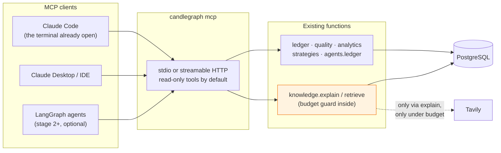

# MCP: exposing candlegraph as tools, now and later

**Status:** proposed — 2026-10-29
**Decision:** a read-only MCP **server** over the functions the CLI already
calls, worth building early because it is cheap and it would have
shortened both incidents in `docs/incidents/`. Not an MCP **client** for
Tavily: the pipeline keeps a typed REST client with a budget guard. No
tool in the server writes market data or spends credits by default.
**Companion:** [`../graph/DESIGN.md`](../graph/DESIGN.md),
[`../tavily/DESIGN.md`](../tavily/DESIGN.md),
`docs/agents/framework/DESIGN.md`.

## What MCP is, in one paragraph

The Model Context Protocol is a standard way for a model-driven client
(Claude Code, Claude Desktop, an IDE, or our own LangGraph agents) to
discover and call tools, read resources, and use prompts served by a
process. A server declares tools with JSON schemas; the client calls them.
It is the plumbing between "a model that can reason" and "a system that
has facts". candlegraph has facts.

## Is there a use case now?

Yes, a modest and concrete one: **operating the stack from Claude Code**.
Both post-mortems describe an operator reading logs, running `make runs`,
`make report`, `make observe`, and `psql` by hand to answer "what state is
this thing in". Every one of those is already a Python function behind a
CLI subcommand. Exposing them as MCP tools means the assistant that is
already open in the terminal can call `data_quality_report()` or
`recent_ingest_runs(limit=5)` and reason over structured output instead of
scraping a log. That is the same work the `run-stack` and `run-agents`
skills describe, with the tool results typed.

What it is **not** for now: the knowledge pipeline. `explain` is a
deterministic sequence with a budget; it is exposed as a tool so a client
can *ask* for an explanation, but the retrieval and the Tavily call happen
inside `explain`, under the same guard, regardless of who called it.

## Tools, by stage

All tools are thin wrappers around functions that exist or are designed;
the server adds no logic. Read-only tools are the default; the two that
write are marked and gated.

| Tool | Wraps | Stage | Writes? |
|---|---|---|---|
| `status()` | `GET /status` body | now | no |
| `recent_ingest_runs(limit)` | `ledger.recent_runs` | now | no |
| `data_quality_report(days)` | `quality.build_report` | now | no |
| `candles(symbol, hours, start, end)` | `api.schema` resolver / `formatting` | now | no |
| `stats(symbol, window)`, `compare(a, b, window)` | `analytics.rolling`, `analytics.pairwise` | now | no |
| `signals(symbol, strategy)` | `strategies` | now | no |
| `backtest(symbol, strategy, …)` | `strategies.backtest` | now | no |
| `agent_runs(agent, limit)`, `latest_agent_report(agent)` | `agents.ledger` | now | no |
| `observe()` | `run_observer` | now | ledger row only (it is an agent run) |
| `explain_signal(symbol, strategy, bar)` | `knowledge.explain` | stage 1 | `explanation`, `document` rows; **may spend credits under the budget guard** |
| `search_knowledge(query, asset, before)` | `knowledge.retrieve` | stage 1 | no (database only; never calls Tavily) |
| `knowledge_budget()` | `source_call` sums | stage 1 | no |
| `run_pipeline(spec)` | the harness | stage 2 | yes; gated by a setting, off by default |

Resources (read-only, URI-addressed) suit the design documents and the
incident post-mortems: `candlegraph://docs/roadmap`,
`candlegraph://incidents/2026-10-28-stack-would-not-start`. A client can
pull the relevant document into context instead of the operator pasting
it. Prompts can package the reading order the skills describe ("to judge a
coverage finding, call `data_quality_report`, then check average hourly
volume for the token, then…").

## Where it runs

- **A sixth compose service is not needed for the local case.** Claude
  Code launches `candlegraph mcp` over stdio with `DB_HOST=localhost` and
  the published port. For the stack-internal case (agents calling tools in
  stage 2) the same command runs with `--transport http` inside the
  `agents` container.
- **The server imports the same modules the CLI does**, so there is one
  implementation of each capability. If a function exists only as an MCP
  tool and not as a CLI subcommand, that is a smell: the Makefile is the
  single source of commands, and a tool should have a target behind it
  (`make mcp`).
- **Python SDK:** the official `mcp` package (FastMCP style decorators) is
  enough; tools are functions with type hints and docstrings, which is
  what the schema is generated from. It becomes an optional extra
  (`uv sync --extra mcp`), like `ui` and `llm`.

## Rules the server inherits

- **It cannot write market data.** There is no tool that upserts hourly
  rows or signals; the only writes are the ones the wrapped functions
  already make (`agent_run`, `explanation`, `document`, `source_call`).
  Invariant 21's spirit applies to tools as it does to agents.
- **A tool that costs money says so in its description and is off unless
  configured.** `explain_signal` can spend a credit; its description says
  "may perform one metered web search per asset per day". The budget
  guard is inside `explain`, so even a client calling it in a loop spends
  at most the daily cap.
- **Output is redacted** with the same function the agent reports use
  before anything crosses the protocol boundary.
- **Unit tests call the tool functions directly** with `FakeDatabase`; a
  single integration test starts the server over stdio and lists tools, so
  the schema generation is exercised.

## Later: agents as MCP clients

In stage 2 the harness runs pipelines as LangGraph graphs. Whether those
graphs call candlegraph functions directly (as the observer does today) or
through MCP is an open question, and the honest answer is that direct
calls stay the default: they are typed, in-process, and testable with
fakes. MCP becomes worth it for agents when a tool lives in **another
process** — a second service, a remote data source, a sandbox. The alerting
agent (stage 5) posting to a channel that already speaks MCP is the first
plausible case. Until then, the server is for people and their assistants,
not for our own graphs.

## Not an MCP client for Tavily

Tavily publishes an MCP server, and the temptation is to let an agent call
it as a tool. The Tavily document explains why the pipeline does not:
every call has to pass the budget guard, be recorded in `source_call`, be
cached on `(asset, day)`, and be upserted on `url_hash`. Those wrap the
call; a tool a model invokes freely bypasses all four. If an operator
wants to search by hand from Claude Code, they can add Tavily's own MCP
server to their client under their own key; the pipeline's budget is not
touched.

## Exit criterion (when built)

`candlegraph mcp` starts over stdio; a client lists at least the
"now" tools; `data_quality_report()` returns the same structure
`candlegraph report --json` prints; and no tool in the listing can write
market data.
