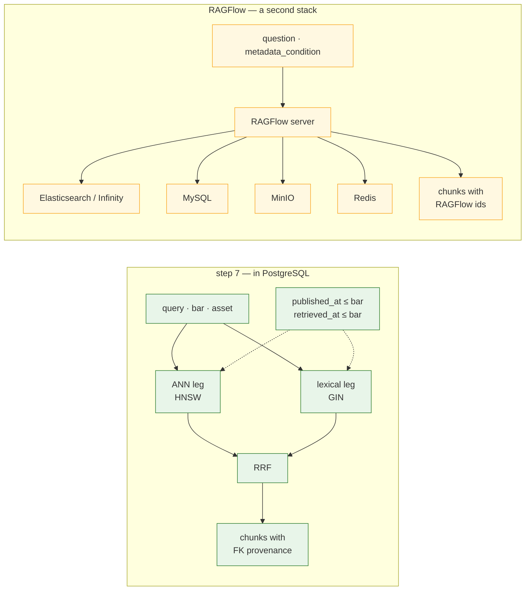

# RAGFlow as a retrieval backend: evaluated, not adopted

**Status:** evaluated — 2026-11-01. A comparison against the step-7 hybrid
retrieval in `knowledge/retrieve.py`, with the conditions under which this
would change. No RAGFlow code exists; `RETRIEVAL_BACKEND=ragflow` is refused
with a pointer here. Facts below are from RAGFlow's repository and HTTP API
reference as read on 2026-11-01 (release `v1.0.0-rc3`); re-check before
relying on them.
**Companions:** [`../graph/DESIGN.md`](../graph/DESIGN.md) (what retrieval
has to guarantee), [`../vector-store/DESIGN.md`](../vector-store/DESIGN.md)
(why the corpus lives in PostgreSQL at all),
[`../sources/DESIGN.md`](../sources/DESIGN.md) (where documents come from).

## What RAGFlow is

[RAGFlow](https://github.com/infiniflow/ragflow) is InfiniFlow's open-source
RAG engine: document parsing ("DeepDoc" — layout analysis, OCR, table
recognition), chunking with several templates, hybrid retrieval, optional
reranking, a GraphRAG knowledge-graph extractor, agent workflows, a chat
UI, and a REST API with a Python SDK. One clarification worth making
because it comes up: RAGFlow is not part of an "Ollama ecosystem". It is an
independent project that can *use* Ollama as a model provider for the LLM,
the embedder and the reranker — the same way our `embed.py` does.

| Fact | Value (2026-11-01) |
|---|---|
| Licence / cost | Apache-2.0; free to self-host. Model calls are whatever provider you configure (Ollama: free). |
| Maturity | ~93k GitHub stars, pushed daily; `v1.0.0-rc3` at the time of reading. |
| Deployment | Docker Compose: the RAGFlow server **plus MySQL, MinIO, Redis, and a document engine — Elasticsearch (default, 8 GB memory limit in their `.env`) or InfiniFlow's Infinity**. |
| Recommended hardware | 4 CPU cores, **16 GB RAM**, 50 GB disk as a starting point; DeepDoc runs on CPU. |
| Retrieval model | hybrid keyword + vector, combined as a **weighted sum** (`keywords_similarity_weight`, default 0.7; vector weight is the remainder), `similarity_threshold` (0.2), `knn_top_k`, optional `rerank_id`, optional `use_kg` (GraphRAG). |
| Filtering | `metadata_condition` on document metadata with operators `is`, `contains`, `in`, `start with`, `>`, `<`, `≥`, `≤`, `empty`, … — so a time bound *is* expressible, as a comparison on a metadata field we would have to populate. |
| Integration surface | `POST /api/v1/retrieval` (question, dataset/document ids, filters) and dataset/document/chunk management endpoints; `ragflow-sdk` on PyPI. |

## What step 7 gives us

`knowledge/retrieve.py` runs two legs inside PostgreSQL — pgvector cosine
over `chunk.embedding` (HNSW) and `tsvector` match over `chunk.tsv`
(GIN) — each as an index-shaped `ORDER BY … LIMIT`, fused by **reciprocal
rank fusion** (`1/(60 + rank)` per leg, summed). Every leg carries the
same predicate: `document.published_at <= bar`, undated documents excluded
unless display mode asks and then flagged, `retrieved_at <= bar` in strategy
mode, and an asset filter over alias `mention` rows. The whole thing is one
SQL statement in `statements.py`, read-only, with the lexical leg able to
run alone when no embedder is reachable.

## Head to head, for this corpus

| | Step 7 (PostgreSQL) | RAGFlow |
|---|---|---|
| Fit to the data | thousands of short, dated news chunks already in the database that holds the prices and signals | built for large heterogeneous document sets: PDFs, scans, tables, slides |
| The no-look-ahead bound | a SQL predicate on columns we own, tested by appending a later document and asserting the bar is unchanged | expressible via `metadata_condition` (`≤` on a date-shaped metadata field) — provided every document is uploaded with `published_at` as metadata; an undated document has no field to compare and needs a separate rule |
| `retrieved_at ≤ bar` (strategy mode) | same predicate on `document.retrieved_at` | a second metadata field, set at upload |
| Citations | `explanation.citations` holds `chunk_id`s that are **foreign keys** in the same transaction as the signal | RAGFlow chunk ids; a join back to our `document`/`chunk` needs an id mapping stored in `meta` |
| Fusion | RRF, no tuning constant worth arguing about, auditable from the two ranks the result carries | weighted sum with a 0.7 keyword weight and a similarity threshold — tunable, less inspectable |
| Reranking | `Reranker` Protocol, no-op default, cross-encoder optional | built in (`rerank_id`), model of your choice |
| Operations | nothing new: same database, same backups, same Alembic | four to five additional services, ~8–16 GB RAM, a second place documents live (MinIO + the index) |
| Determinism and tests | every piece unit-tested offline; integration on a seeded corpus with the fake embedder | an external service in the integration tier, or a mocked API |
| What we would gain | — | DeepDoc for PDFs/scans, GraphRAG extraction, a chat UI, multi-tenant dataset management, more chunking templates |

## Why it would be overkill today

1. **The hard requirement is temporal, not textual.** Our retrieval's
   correctness is the time bound. In PostgreSQL that is a `WHERE` clause we
   wrote and tested; in RAGFlow it is metadata discipline on upload plus a
   filter expression, with undated documents needing special handling.
   Nothing is gained and a failure mode is added.
2. **The corpus is small and already here.** At one search per asset per day
   the corpus grows by tens of documents a day. An HNSW index over a few
   hundred thousand `halfvec` rows is well inside what one Postgres does;
   RAGFlow's strengths (DeepDoc, Elasticsearch scale) address problems we
   do not have.
3. **Citations are foreign keys.** The stage's exit criterion is an
   explanation stored *with the signal*, citing chunks by id. A second store
   turns that into an id mapping and a consistency problem — exactly the
   argument the vector-store document made against Qdrant and Neo4j.
4. **Footprint.** The default stack is five containers under 2 GB; RAGFlow
   recommends 16 GB for itself. "Local free deployment first" is a cost
   constraint on the laptop as much as on the bill.
5. **Churn.** A `1.0.0-rc` API whose parameter names are still changing
   (`top_k` deprecated for `knn_top_k`, `vector_similarity_weight` a legacy
   fallback) is a moving dependency for a boundary we would have to test
   against a live service.

So: RAGFlow is free, but for this workload it is not more optimal than
step 7 — it is a larger system solving adjacent problems. The honest
reading of "free and more optimal" is *free, yes; more optimal, no*.

## When this changes

| Trigger | Then |
|---|---|
| stage 3 ingests filings as **PDFs or scans** that need layout analysis (EDGAR's text and XBRL make this unlikely) | adopt DeepDoc for parsing, possibly without adopting its retrieval |
| the corpus passes **~1M chunks** or p95 retrieval latency fails the UI after pgvectorscale | revisit a dedicated engine; RAGFlow-on-Infinity is one candidate, Qdrant another |
| a **GraphRAG**-style entity graph extracted from text becomes a requirement (our edges are derived from stored data by design) | evaluate RAGFlow's extractor against our own `mention`/`edge` tables |
| several teams need **dataset management and a chat UI** over the same corpus | RAGFlow's product surface is the point, not its retrieval |

## How it would plug in, if adopted

The seam already exists and costs nothing to keep: `RETRIEVAL_BACKEND`
names the engine, `retrieve.check_backend` validates it, and every caller
goes through `retrieve.retrieve()`. A `RagflowRetriever` would:

- on `store_document`, also upload the text to a RAGFlow dataset with
  metadata `{published_at, retrieved_at, asset_ids, url_hash}` and record
  the RAGFlow document id in `document.meta`;
- on retrieval, call `POST /api/v1/retrieval` with the question and a
  `metadata_condition` of `published_at ≤ bar` (and `retrieved_at ≤ bar`
  in strategy mode), map returned chunk ids back through `document.meta`
  to our `chunk` rows, and return the same `RetrievedChunk`s the SQL path
  does — so the explanation layer and its citation validator never know
  which backend ran;
- keep the ledger and the budget untouched: RAGFlow is a retriever, not a
  source.

Until one of the triggers above fires, that is a design, not a task.

## Rejected now

- **Running RAGFlow as the only retrieval.** Loses the foreign-key
  citations and the SQL time bound for nothing the corpus needs.
- **Using RAGFlow's Tavily/web-search integration instead of our source
  pipeline.** The budget guard, the `(asset, day)` cache and the
  `source_call` ledger are the design; a tool a workflow invokes freely is
  the demand-driven call pattern the Tavily document exists to prevent.
