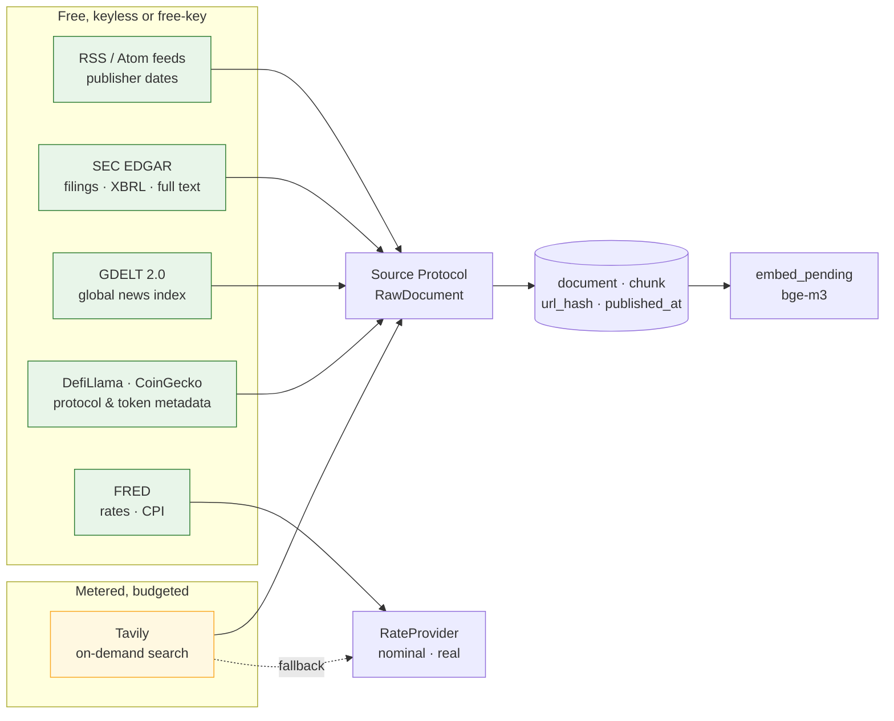

# Text and fundamentals sources: where the documents would come from

**Status:** exploration — 2026-11-01. A survey, not a decision and not code.
It exists so that when stage 1's Tavily step, stage 3's equities and stage
5's feed observer each need a source, the comparison has already been done
and the free options are known. Prices and facts quoted here are what the
providers published at the time of writing and move often; re-check before
relying on one.
**Companions:** [`../graph/DESIGN.md`](../graph/DESIGN.md) (what a document
is and how it is stored), [`../tavily/DESIGN.md`](../tavily/DESIGN.md) (the
one metered source already designed),
[`../../analytics/risk/DESIGN.md`](../../analytics/risk/DESIGN.md) (the
risk-free-rate seam that wants a live number).

## What the system will ask for, stage by stage

| When | Question the text has to answer | Shape |
|---|---|---|
| stage 1, `signals --explain` | what was being said about WETH in the 24 hours before this bar? | news and analysis, English, dated to the hour |
| risk report, now | what is the risk-free rate and inflation today, and as of a past bar? | two numbers with a publication date |
| stage 3, equities | what did AAPL report last quarter, and when did the market learn it? | quarterly statements, 8-K press releases, filing timestamps |
| stage 5, feed observer | what just happened that mentions a tracked asset? | a stream, polled, deduplicated |
| stage 5, alerting | is this event new or the same one we alerted on an hour ago? | the same stream, embedded |

Every one of those is served through the same door: a `Source` returns
`RawDocument`s, `documents.store_document` upserts them on `url_hash`, and
`embed_pending` vectorises the chunks. Nothing below needs a new table; a
new source is a row in `source` and a module under `knowledge/sources/`.

## What a source has to satisfy

Five tests, applied to every candidate below. The first two are the ones
that disqualify.

1. **A real `published_at`.** The no-look-ahead rule reads that column. A
   source that gives only "when we crawled it" can be stored (the date
   stays `NULL`) but can never support an explanation or a strategy input.
   Filings and feeds pass outright; search APIs pass sometimes.
2. **Terms that allow storing the text.** We keep `raw_text`. Several
   "free" news APIs allow display only, forbid storage, or return a
   headline and 200 characters. Those are URL-and-snippet sources: store
   what is allowed, fetch the page ourselves if the publisher permits it.
3. **A free tier that is honest at our volume.** Five to ten assets, one
   search per asset per day for explanations, a poll every few minutes for
   feeds. Hundreds of calls a day, not thousands. A 25-calls-a-day tier is
   not free; it is a demo.
4. **A key that is free to get, or none.** Secrets follow the
   `GRAPH_API_KEY` rules; one more is fine, five more is operations.
5. **Metering we can ledger.** Every call lands in `source_call` with a
   cost, so the budget guard (`knowledge/budget.py`, step 6) can refuse
   before the provider does.

## A. Filings and financial statements (equities, stage 3)

| Source | Cost | Key | Gives | `published_at` | Storage terms | Verdict |
|---|---|---|---|---|---|---|
| **SEC EDGAR** — full-text search (`efts.sec.gov/LATEST/search-index`), submissions JSON, **XBRL `companyfacts` and `frames`** (`data.sec.gov/api/xbrl/...`) | free | none; a descriptive `User-Agent` is required | every 10-K/10-Q/8-K; every tagged financial fact (revenue, EPS, assets) per filing with the period and the filing date; press releases as 8-K Exhibit 99.1 | **exact**: `acceptanceDateTime` to the second | public domain | **first choice.** Primary source, structured and free. ~10 requests/s fair-use limit, more than enough. |
| Financial Modeling Prep | free tier ~250 requests/day; paid from ~$20/mo | key | income/balance/cash-flow statements as JSON, ratios, some transcripts | filing date | free tier non-commercial | good shortcut for clean statements; a derivative of EDGAR, so EDGAR wins for provenance |
| Alpha Vantage | free 25 requests/**day** | key | statements, earnings, overview | filing date | ok | too thin a tier to build on |
| Finnhub | free 60 requests/min | key | basic financials, earnings calendar, company news | yes | display-oriented | decent companion for the earnings calendar; statements behind paid plans |
| Polygon.io | free 5 requests/min | key | financials (sourced from EDGAR XBRL), tickers, news | yes | ok | fine, but the free tier is slow and the data is EDGAR's |
| EODHD, Twelve Data | small free tiers (hundreds/day) | key | fundamentals, limited free depth | yes | ok | interchangeable with FMP; no reason to prefer |
| `yfinance` (Yahoo, unofficial) | free | none | statements, prices | approximate | scraping, no terms to rely on | not for a stored corpus |
| Earnings call transcripts (Seeking Alpha, Motley Fool, FMP transcripts) | paid or scraped | — | the richest text of the quarter | yes | restrictive | **substitute:** the 8-K earnings release on EDGAR carries the prepared remarks' substance for free |

**How EDGAR would attach to what exists.** Stage 3 adds an `instrument`
supertype above `token`; the EDGAR source maps a ticker to a CIK once
(`company_tickers.json`), then: `companyfacts` becomes a `document` per
filing whose text is the statement rendered as prose ("Revenue for the
quarter ended 2026-06-27 was $94.0B, up 4% year on year"), so it is
retrievable and citable like any article; the 8-K press release is a
document of its own; `published_at` is the acceptance timestamp, which is
also exactly when the market could have known it. The XBRL facts themselves
belong in a numeric table, not in chunks — a later design.

## B. News and analysis

| Source | Cost | Key | Gives | `published_at` | Storage terms | Verdict |
|---|---|---|---|---|---|---|
| **Publisher RSS/Atom feeds** (CoinDesk, Cointelegraph, The Block, Decrypt, DL News, protocol blogs and Mirror publications, Google News RSS per query) | free | none | title, link, summary, sometimes full body | **yes**, publisher-stamped | feed content is offered for syndication; full articles need a fetch of the page | **first choice for stage 5.** Zero cost, dated, polled. This is what the feed observer was designed around. |
| **GDELT 2.0** — DOC API (`api.gdeltproject.org/api/v2/doc/doc`) and the 15-minute event/GKG files | free | none | URL, title, source, language, tone, themes for essentially all online news, searchable by keyword and date range back years | yes (to 15 minutes) | GDELT data is open; the article text is the publisher's | **first choice for breadth and backfill.** Finds the URLs and dates; we fetch what we are allowed to. Rate-limit yourself to a request every few seconds. |
| **Tavily** | 1,000 credits/month free, then paid | key | search results with extracted content and a date when the page states one | often, not always | result content is returned for our use | the designed on-demand source (step 6); the budget guard exists because of it |
| CryptoPanic | free developer tier | key | aggregated crypto headlines with votes and currency tags, filterable by token | yes | metadata and link; text is the publisher's | strong **crypto-specific** companion: pre-tagged by asset, which is half of entity linking |
| NewsAPI.org | free developer tier: 100 requests/day, 24-hour delay, no article body, localhost only | key | headlines and 200-character descriptions | yes | **no storage, non-commercial** | fails tests 2 and 3 |
| Marketaux, Finnhub news, Alpha Vantage News & Sentiment | small free tiers | key | financial headlines, some sentiment | yes | display-oriented | useful for equities later; none beats GDELT plus feeds for free |
| Reddit JSON (`/r/ethfinance.json`), Hacker News (Algolia) | free | none (Reddit needs a UA, rate-limited) | discussion threads | yes | user content, terms vary | sentiment colour, not citation material; stage 5 at the earliest |
| Common Crawl News (CC-NEWS) | free | none | monthly WARC archives of news pages | yes | research use | a bulk backfill path if a historical corpus is ever needed; heavy |

**The honest trade-off.** The free path is *index then fetch*: GDELT or a
feed tells us a dated URL exists; our own fetch (respecting `robots.txt`
and the publisher's terms) gets the body; `documents.py` chunks it.
Tavily short-cuts the fetch and returns content, which is what the credits
pay for. For five assets a day the credits suffice; for a feed polled every
five minutes they never would, which is why the two are different steps.

## C. Macro: the risk-free rate and inflation

| Source | Cost | Key | Series we would read | `published_at` | Verdict |
|---|---|---|---|---|---|
| **FRED** (St. Louis Fed) | free | free key | `DTB3` / `DGS3MO` (3-month bill), `DGS10`, `FEDFUNDS`, `CPIAUCSL` (CPI), `T10YIE` (breakeven inflation); `observations` endpoint with `observation_start/end` and **`realtime_start/end`** | yes, and FRED's real-time (ALFRED) view gives the value *as it was known on a date* — exactly the as-of semantics a backtest needs | **the right source for the number.** Clean, dated, vintage-aware. |
| Treasury FiscalData | free | none | average interest rates, auction results | yes | fine for bills; fewer series than FRED |
| BLS API | free (registration raises the limit) | optional | CPI-U directly | yes, monthly | FRED mirrors it; use FRED unless BLS detail is needed |
| ECB Data Portal, BoE, World Bank, IMF | free | none / free | non-USD rates | yes | when a non-dollar book exists |
| Tavily | credits | key | a page that states today's yield | sometimes | **fallback**, not primary: parsing a number out of prose is fragile and spends credits on a figure FRED gives for free |

**Recommendation that changes a prior decision.** The risk document
planned a Tavily-backed `RateProvider` and set FRED aside as "another
credential". Having compared them: a FRED key is free and instant, the
series are the canonical ones, and FRED's real-time API answers "what was
the 3-month yield as the market knew it at this bar" directly — which
Tavily cannot. The better order is **FRED primary, Tavily fallback,
constant last**. The risk document's status line should carry this when
the provider is built; the seam (`RateProvider`) does not change.

## D. Crypto-native context (stage 1 explanations, stage 5 feeds)

| Source | Cost | Key | Gives | Verdict |
|---|---|---|---|---|
| **DefiLlama** (`api.llama.fi`, `stablecoins.llama.fi`) | free | none | protocol TVL history, chain TVL, stablecoin supplies, yields, hacks list, token unlock/emission schedules | **yes.** Facts with dates (a hack, an unlock, a TVL cliff) rendered to prose make excellent dated documents; the emissions schedule is the "unlock next week" an explanation wants to cite |
| **CoinGecko** | free demo key, ~30 requests/min | key | token descriptions, categories, links (homepage, blog, GitHub, Twitter), market data, exchange listings | metadata that seeds `asset.aliases` and the feed list per token; descriptions as one static document per asset |
| Etherscan | free, 5 requests/s | key | contract metadata, token transfers, large-transfer detection | the "large transfer to an exchange" fact in the stage-1 example; numeric, dated by block |
| Snapshot / Tally (governance) | free GraphQL | none | proposals with bodies, start/end times, outcomes | dated, substantive text about a token's own future — a strong citation source, and a feed |
| GitHub releases/commits for protocol repos | free, rate-limited | optional | release notes | dated; upgrade announcements |
| Messari, Dune, Nansen, Token Terminal | free tiers thin or paid | key | research, dashboards, on-chain metrics | later; the free versions do not cover the need |
| CryptoCompare, CoinMarketCap | free tiers | key | prices and news aggregation | redundant with what we store and with CryptoPanic |

## Adoption order

What to build, in what order, and why — this is the input to the next
rollout once stage 1 closes.

| # | Source | Enables | Why this position |
|---|---|---|---|
| 1 | **Tavily** (rollout step 6, already designed) | `signals --explain` | the stage-1 exit criterion depends on it; the budget guard it brings is reused by every metered source after it |
| 2 | **RSS/Atom feed source** | stage 5 feed observer; richer stage-1 corpus at zero cost | dated, free, keyless; the chunker and upsert path already exist; the per-token feed list can live beside `aliases` in `tokens.yaml` |
| 3 | **FRED rate provider** | the real risk-free rate in every Sharpe ratio, vintage-aware for backtests | small, high value; replaces the planned Tavily rate provider as primary |
| 4 | **GDELT** | historical news backfill around past bars; breadth beyond our feed list | free and dated; turns "explain this bar last month" from impossible into a fetch |
| 5 | **DefiLlama + CoinGecko metadata** | unlock/hack/TVL facts as citable documents; alias and feed discovery | free, keyless or demo-key; facts rendered to prose slot into the same corpus |
| 6 | **SEC EDGAR** | stage 3 equities: statements and 8-Ks with exact timestamps | waits for the `instrument` supertype; the clear first choice when it comes |
| 7 | CryptoPanic, Snapshot, Etherscan | asset-tagged headlines, governance text, transfer facts | useful, each small; after the above have proven the pipeline |

## Rules every source will follow

- **`published_at` comes from the source or stays `NULL`.** A feed's
  `pubDate`, a filing's `acceptanceDateTime`, GDELT's `seendate`, a page's
  `article:published_time`. Never the crawl time.
- **Store only what the terms allow.** Where that is a headline and a URL,
  that is the document; the body is fetched separately and only where
  permitted, and the `meta` column records which.
- **Every call is a `source_call` row** with its cost (credits for Tavily,
  requests for everyone else), so the observer's `source_budget` and
  `source_errors` findings cover free sources too — a free API with a rate
  limit is still a budget.
- **Entity linking stays alias-based** (`mention.method = 'alias'`,
  confidence 1.0). CryptoPanic's and GDELT's own tags are evidence for a
  mention, recorded in `meta`, not a replacement for the alias match.
- **Respect `robots.txt` and rate limits** on our own fetches; a polite
  crawler identifies itself in its `User-Agent`, as EDGAR requires anyway.

## Open questions

- **Full-article fetching.** Index-then-fetch needs an HTML-to-text step
  (`trafilatura` is the usual free choice). Is it a dependency we want in
  the app image, or a separate `fetcher` service like Ollama?
- **Licensing of stored text.** For publisher articles, is storing the body
  for internal retrieval acceptable, or do we store chunks only as quotes
  under a length cap? A length cap on `chunk.text` for third-party bodies
  would be a cheap, defensible default.
- **Equities text beyond filings.** Transcripts are the best text of the
  quarter and are not free. Is the 8-K release enough for stage 3's first
  version?
- **Non-English.** bge-m3 is multilingual and GDELT is global; do we want
  non-English documents in the corpus at all, given the narrator writes
  English?

## Rejected for now

- **Paid news APIs** (Bloomberg, Refinitiv, Benzinga, Seeking Alpha):
  conflict with "local free deployment first"; revisit if the project ever
  has a budget line.
- **NewsAPI.org as a source:** the free tier forbids storage and delays by
  a day; it fails the two tests that matter.
- **Scraping sites without feeds or terms:** fragile and legally murky;
  everything above has a documented API or a feed.
- **Social media firehoses** (X/Twitter API): paid at any useful volume
  since 2023; Reddit and governance forums cover the "what are people
  saying" need for free.
