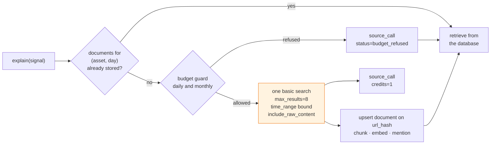

# Tavily: web search as a metered source

**Status:** implemented — 2026-11-01 (rollout step 6): the client
(`knowledge/sources/tavily.py`), the pure guard (`knowledge/budget.py`),
the pipeline that wraps cache, budget and ledger around every call
(`knowledge/news.py`), `candlegraph knowledge fetch-news`, and the News
dashboard. The `explain()` wiring in the diagram below is step 8; until
then the pipeline is driven by the CLI, the UI, and later the scheduler.
Pricing re-checked 2026-11-01: the free tier is still 1,000 credits a
month; the per-search costs (basic 1, advanced 2) are pinned in
`sources/tavily.py::SEARCH_COST` and were not contradicted by the page.
**Decision:** a typed REST client in `candlegraph/knowledge/sources/tavily.py`
behind a `Source` Protocol, a pure budget guard over a `source_call` ledger,
and a cache keyed on `(asset, UTC day)` so that the number of network calls
is a function of the token list and the calendar, not of how often anyone
asks for an explanation.
**Companion:** [`../graph/DESIGN.md`](../graph/DESIGN.md).

## The constraint

Tavily is metered in **credits**, not requests: at the time of writing a
basic search costs 1 credit, an advanced search 2, an extract call 1 per
five URLs, and the free tier is in the order of **1,000 credits a month**
with a per-minute request ceiling on top. Those numbers should be re-read
from the pricing page before anything depends on them; the design assumes
only that credits are scarce and that the cap is monthly.

The failure mode to design against is not "we run out on day 30". It is
"an explanation is cheap to ask for, so a UI page, a scheduled agent, or a
loop in a notebook asks for it a thousand times, and the month is gone by
Tuesday". Every decision below is about making the call count independent
of demand.

## Where credits go



- **One search per `(asset, UTC day)`.** Every signal on WETH on
  2026-10-24 — all three strategies, every bar — shares one search for
  WETH over that day. The cache check is a query on `source_call` and
  `document`, not an in-memory dict, so it survives restarts and is shared
  by every process. At five active tokens that is **~150 credits a
  month** at one search a day each, leaving most of the free tier for
  retries, a second query form, and manual exploration.
- **`include_raw_content=true` on the search**, so the article body comes
  back with the result and no separate extract call is needed. Extract is
  reserved for the case where a result's content is empty and the URL is
  worth it (a documented allowlist of domains, off by default).
- **Basic search, not advanced.** Advanced costs double and is better for
  broad research questions; our query is narrow ("WETH Ethereum news"
  bounded to a day) and basic is adequate. Make it a setting so the claim
  can be tested rather than believed.
- **`topic="news"` with a time bound.** Tavily's news topic accepts a
  `days`/`time_range` parameter; the window is `[bar - 24h, bar]` rounded
  out to the day. Results without a `published_date` are stored with
  `published_at = NULL` and excluded from anything a strategy reads.
- **`max_results=8`.** More results are more chunks to embed and store
  per credit, up to the point where they are off-topic. Eight is a prior
  to be tuned from the evaluation set, not a constant.

## The budget guard

A pure function. It reads nothing and calls nothing; the caller hands it
the counts.

```python
@dataclass(frozen=True)
class Budget:
    monthly_credits: int  # TAVILY_MONTHLY_CREDITS
    daily_credits: int  # TAVILY_DAILY_CREDITS
    reserve: int = 50  # kept back for operator use; the pipeline never spends it


def decide(
    spent_this_month: int, spent_today: int, cost: int, budget: Budget
) -> Decision: ...  # ALLOW, or REFUSE with the reason: "daily", "monthly", "reserve"
```

- **Daily cap smooths the month.** 1,000 a month is ~33 a day; a daily
  cap of 40 lets a busy day borrow a little and stops a runaway loop from
  spending the month in an hour.
- **A reserve** is held back so that an operator can run a search by hand
  on the last day of the month. The pipeline treats the reserve as
  already spent.
- **Refusals are recorded**, as `source_call` rows with
  `status = budget_refused` and zero credits. The observer counts them;
  a day with many refusals is a finding (`source_budget`), and the
  explanation that was served from cache says so in its output.
- **The counts come from `source_call`**, summed over the calendar month
  in UTC. Tavily's own dashboard is the truth and the ledger is our
  estimate; the monthly cap is set below the real cap (default 1,000 on
  a 1,000 plan with the 50 reserve) so that drift between the two never
  overruns.

## The client

Shaped like `ingestion/subgraph.py`, which has survived three stages:

- `httpx.Client` with an explicit `timeout` and a `max_tries` retry budget
  on connection errors and 5xx; **no retry on 429 or 432** (rate limit,
  plan limit): those are recorded and surfaced, because retrying them is
  how a budget gets spent on failures.
- Requests and responses are typed (`pydantic` models for the fields we
  use; unknown fields ignored).
- Unit tests inject `httpx.MockTransport` with recorded fixture responses
  (invariant 2). A fixture is a real response with its content truncated,
  so field names cannot drift from the live API without a test noticing.
- The key is `TAVILY_API_KEY` in `.env` only, typed `SecretStr`, redacted
  by `agents/shell.py`'s existing redaction before anything reaches a
  report (invariant 20, 21).
- **A paging loop that cannot advance raises** (invariant 8) — Tavily does
  not page, but if a result set is ever iterated through `extract`, the
  same rule holds.

### REST, not Tavily's MCP server

Tavily ships an MCP server, and an agent could call it as a tool. For the
pipeline that is the wrong shape: the budget guard, the cache, the ledger
row and the `url_hash` upsert all have to happen around every call, and a
tool a model invokes freely is precisely the demand-driven call pattern
this document exists to prevent. The REST client is deterministic,
testable offline, and the only path that spends credits. The MCP document
explains where MCP does fit.

## Recording and observing

`source_call` is the ledger, in the `ingest_run` mould:

| column | why |
|---|---|
| `source_id`, `called_at` | which source, when; the monthly sum is over `called_at` in UTC |
| `query`, `params` | reproducibility, and so the cache key can be recomputed from the row |
| `credits` | the cost as we understand it; corrected if the response reports usage |
| `results` | zero results on a liquid token is a finding in itself |
| `status`, `error` | `ok`, `error`, `budget_refused`, `rate_limited` |

The observer's `collect_knowledge` node reads this table and reports
`source_budget` (OK / WARNING at 80% / CRITICAL at 100%) and
`source_errors` (a failure streak, same threshold as ingest runs). Nothing
else in the system reads Tavily's state; the ledger is the one place.

## As built (2026-11-01)

| Piece | Where | Notes |
|---|---|---|
| `Source` Protocol | `knowledge/sources/base.py` | `id`, `kind`, `cost`, `search(query, start, end, max_results) -> SearchResult`; a source never writes and never decides |
| `TavilySource` | `knowledge/sources/tavily.py` | Bearer auth; `topic=news`, `start_date`/`end_date`, `include_raw_content=true`; backoff on transport errors and 5xx up to `TAVILY_MAX_TRIES`; **429/432 raise `TavilyRateLimitError` after zero retries**; empty-content results skipped and counted; `published_date` parsed from both its shapes, unknown stays `NULL` |
| `Budget` / `decide` | `knowledge/budget.py` | pure, exactly the dataclass above; the most absolute refusal names itself (`monthly` > `reserve` > `daily`); `usage_level` holds the 80%/100% grading the observer and the UI share |
| the pipeline | `knowledge/news.py` | per token: ledger-backed `(asset, UTC day)` cache → guard → search → `store_document` → `source_call` row. Refusals are rows with 0 credits; an error continues to the next token; a **rate limit halts the run** (the next call would spend budget on the same failure). The query is derived from the symbol and aliases so phrasing cannot cost a second credit |
| the ledger | `source_call` + statements | `insert_source_call`, `source_spend` (UTC month/day sums), `cached_search_exists`, `source_call_daily_stats`, per-source corpus counts; status gained `rate_limited` (migration `35826afa331a`, downgrade folds rows into `error`) |
| operator surface | `candlegraph knowledge fetch-news [--symbol S]`, `make fetch-news`; the UI's **News** dashboard (budget runway, burn, outcomes, ledger, fresh documents, a confirmed fetch button) and a news strip on the Agents dashboard | the CLI exits non-zero when a call errored or rate-limited; refusals and cache hits are expected behaviour, exit 0 |

## Growth path

| When | Change |
|---|---|
| a second asset class (stage 3) doubles the token list | the daily cap doubles or the plan does; the design does not change |
| continuous feeds (stage 5) | RSS and feeds become `Source` implementations with zero credit cost; Tavily drops to filling gaps feeds missed |
| a paid plan | raise `TAVILY_MONTHLY_CREDITS`; consider `search_depth=advanced` once the evaluation set can measure whether it helps |

## Rejected

- **Caching by query string.** Two slightly different phrasings of "WETH
  news on the 24th" would both spend a credit. The cache key is the
  *intent* — asset and day — and the query string is derived from it.
- **Searching per signal, with a short TTL.** Simple, and it spends the
  month on a busy UI.
- **An agent that decides when to search.** Nondeterministic spend against
  the scarce resource; see the knowledge graph document's rejected
  alternatives.
- **Scraping sources directly instead of Tavily.** Possible later behind
  the same `Source` Protocol, and it is what feeds are in stage 5. For
  stage 1, one metered API with a budget guard is simpler to operate than
  a crawler with a politeness policy.
