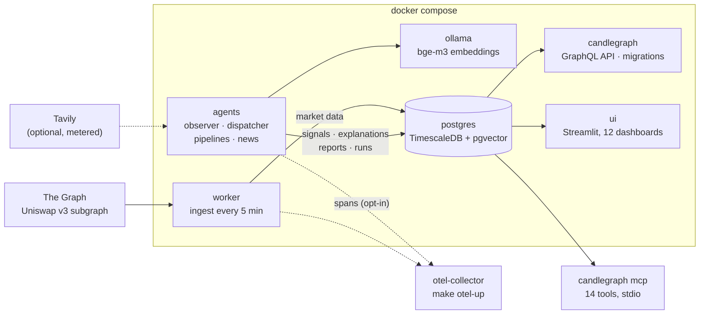
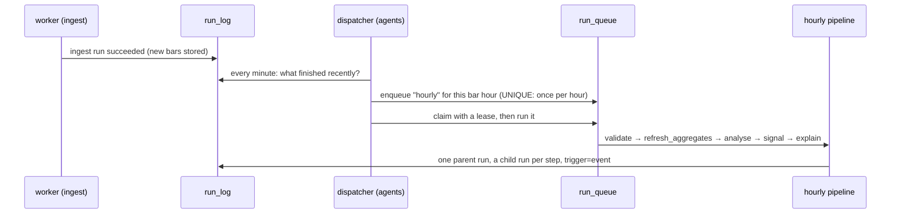
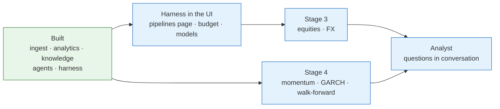

# How candlegraph works, on one page

**Status:** living — 2026-11-19, written at the close of stage 2 (the
harness). It describes the code as it is; update it when a process, a
writer or a layer is added. Every claim here has a longer home, linked
inline — this page is the map, not the territory.
**Read next:** [`../../AGENTS.md`](../../AGENTS.md) (commands, layout, the
invariants), [`../roadmap/DESIGN.md`](../roadmap/DESIGN.md) (what is
built and what comes next), [`../README.md`](../README.md) (every design
document).

## What it is for

candlegraph turns raw on-chain trading into something a person can reason
about, and **can be held to account for**. It stores hourly Uniswap v3
prices, computes statistics, signals and backtests from that stored
history, attaches the news that was public at each bar, and records every
piece of work it does.

Three commitments shape everything else:

1. **Deterministic first, generative second.** Every number comes from
   tested code. A model may phrase findings and choose which tool to call;
   it never produces a figure, and a sentence citing a document retrieval
   did not return is stripped.
2. **Nothing looks ahead.** A signal on bar *t* earns bar *t+1*'s return;
   retrieval never returns text published after the bar; a gap estimate
   that reads the future is refused by the loader strategies use.
3. **Everything that runs leaves a row.** Scheduled, manual, from the UI,
   from an assistant, or inside a pipeline: one ledger row opened before
   and closed after, with why it ran.

It is **paper trading only** — no order goes anywhere — and the whole
stack runs on a laptop with no paid service. A news-search key (Tavily)
and a model key (Anthropic) are optional; without them the system still
answers, with a template where prose would be.

## The stack

Six containers from `make up`, plus an optional trace collector:

| Container | Runs | May write | Port |
|---|---|---|---|
| `postgres` | TimescaleDB with pgvector; the only state | — | 5432 |
| `candlegraph` | the GraphQL API; applies migrations before anything else starts | an explanation, only when asked | 8000 |
| `worker` | `ingest` on a timer — **the only writer of market data** | `token_hours_data`, `pool_hours_data`, `ingest_run` | — |
| `agents` | the observer, the dispatcher, and every pipeline it starts | reports, signals, explanations, documents, ledgers — never market data | — |
| `ui` | Streamlit; reads everything, writes only behind a button | what the button says | 8501 |
| `ollama` | the local embedding model | — | 11434 |

The worker and the agents are the same program started with two
selections of one job registry (`make jobs` lists all eleven jobs, their
schedule and what each writes).

## An hour, end to end

What happens after a new hour of trading, with nobody at the keyboard:

1. **Ingest** pulls the new hours from The Graph and upserts them on
   `(token, hour)`. Re-ingesting is harmless; nothing is ever deleted.
2. **The dispatcher** reads the ledger, not a message bus. It enqueues one
   `hourly` run per bar hour — ingest polls twelve times an hour, the
   queue's unique key turns that into one run. A crashed dispatcher's
   claim expires and the work is picked up again.
3. **The hourly pipeline** (`pipelines/hourly.yaml`) runs five steps under
   a 15-minute deadline. `validate` is the gate: missing or impossible
   data stops the hour before a signal is written. `signal` reads prices
   only through the causal loader. `explain` cites stored news and cannot
   spend a search credit.
4. **Reading it back**: the API serves candles (daily ones from the
   `token_daily` continuous aggregate), the UI draws the run's steps as a
   strip, and `make runs ARGS='--job hourly'` lists the run with its steps
   indented under it. With `make otel-up` the same run is one trace.

A two-hour **schedule** on the same pipeline is the safety net for an
hour when ingest failed or the dispatcher was down.

Once a day, **`pipelines/daily.yaml`** fetches news (one budgeted search
per active token) and embeds it. It spends money, so nothing starts it
automatically yet — see "Honest limits".

## The layers, and who may write what

| Layer | Package | Does | Writes |
|---|---|---|---|
| Storage | `storage/` | connection pool, every SQL statement, migration preflight | — |
| Ingestion | `ingestion/` | subgraph client, transform, the run, the quality report, gap-estimate cache | market data; the fill cache (display only) |
| Analytics | `analytics/` | rolling stats, pairwise, portfolios, ARIMA, risk, simulators, MCMC — **pure** | nothing; only `prices.py` reads |
| Strategies | `strategies/` | Bollinger, crossover, ARIMA signals; the lagged, costed backtester; Monte Carlo | `signal` |
| Knowledge | `knowledge/` | documents, embeddings, Tavily under a budget, hybrid retrieval, `explain` | the corpus tables, `explanation` |
| Harness | `harness/` | jobs, `run_job`, scheduler, pipelines, queue, dispatcher, tracing | the ledgers, `run_queue` |
| Agents | `agents/` | observer (is the data healthy?), janitor (do the checks pass?) | `agent_run`, report sinks |
| Surfaces | `api/`, `ui/`, `mcp/`, `cli.py` | GraphQL, Streamlit, MCP, the CLI — over the functions above, never beside them | only through a job or an explicit button |

The rule that makes this table checkable: every job **declares** its write
surface, the pipeline loader refuses a step that writes market data or is
not proven idempotent, and the MCP registry declares which tools write. A
test reads each declaration.

## Where to look

| Question | Look at |
|---|---|
| Is the data fresh and complete? | `make report`, then `make runs` — a gap on a thin token is not a fault |
| Did the hourly pipeline run? | `make runs ARGS='--job hourly'`; if absent, `make queue` |
| Why is a signal what it is? | `make explain ARGS='WETH --strategy bollinger'`; the Strategy dashboard |
| Does a strategy actually work? | `make backtest ARGS='WETH --strategy all'` — read `excess` and costs first; `make simulate` for luck |
| What is every process doing? | `make jobs`, `make runs ARGS='--all'`, `make logs-worker` / `make logs-agents` |
| Is a pipeline spec valid? | `make check-pipelines` |
| The stack will not start | `make up` prints why; the fix is almost always `make reset` |
| From an assistant | `make mcp` — fourteen tools, and every design document as a resource |

## Honest limits

- **Laptop-grade, single box.** No authentication on the API or UI, ports
  on every interface, no backups (audit findings 8 and 9). Fine locally;
  required before anything is reachable from a network.
- **Operated from a terminal.** The UI shows runs and can start an
  observer run, a backfill or a news fetch, but not a pipeline, the
  queue, or a schedule.
- **`daily.yaml` has no trigger**, so new news is embedded only when
  someone runs it; and nothing prunes old `run` rows yet.
- **Traces, not metrics.** Every run is a span; there is no metrics
  backend, and therefore no circuit breaker. Step timeouts are
  cooperative.
- **Crypto only, three strategies, one forecasting model.** Equities,
  momentum and GARCH are stages 3 and 4.

## Where it is going

The aim is **the harness in the UI**: a person sees what ran and why,
starts what is allowed, and changes what a person is meant to change —
a pipeline, a schedule, a credit budget, the model a step uses — without
a terminal, with every action still a recorded run behind a confirmation.
Stage 2 built the parts that page reads; the next plan
([`../rollout/ROLLOUT.md`](../rollout/ROLLOUT.md)) puts them on screen.

Past that, the **analyst** ([`../harness/analyst/DESIGN.md`](../harness/analyst/DESIGN.md))
answers questions in conversation — "is my WETH rule still working, net of
costs?" — by calling the same tools and jobs, under the same rule: the
model picks the tool, the code produces the number, and every claim cites
a stored document. That needs equities and FX (stage 3), a chat-model
seam ([`../harness/models/DESIGN.md`](../harness/models/DESIGN.md)), and
a spend guard ([`../knowledge/budget-manager/DESIGN.md`](../knowledge/budget-manager/DESIGN.md)).

