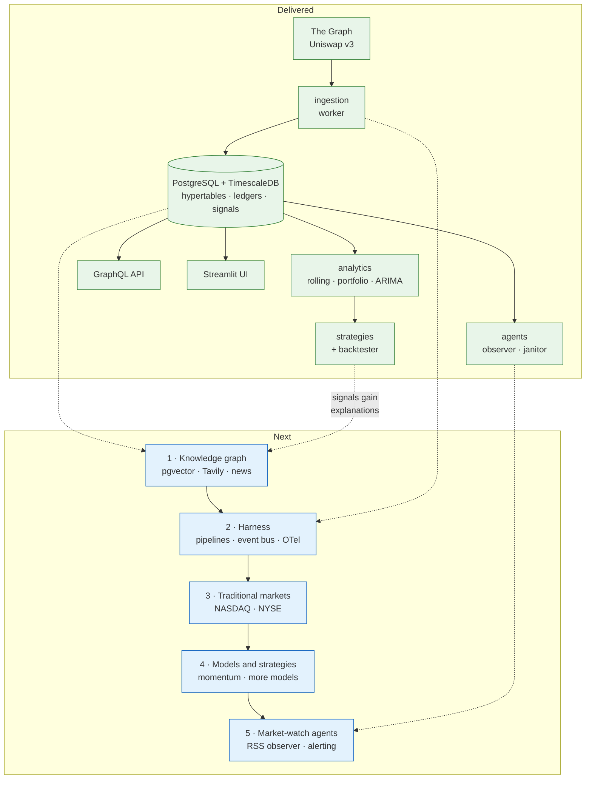

# Roadmap

**Status:** living document — last revised 2026-10-25
**Scope:** what candlegraph is, what has been built, and what comes next.

`AGENTS.md` carries a condensed copy of the stage list; this is the
authoritative version and the only place the reasoning lives. Each stage
names an **exit criterion** — a command or an observable behaviour, not a
feeling — because "the agent layer is done" is otherwise unfalsifiable.

## Where this stands

candlegraph is a market-data service with an analytics layer and an agent
layer on top. Five pieces of work are delivered and in the test suite:

| Delivered | What it added | Proven by |
|---|---|---|
| **Stabilisation** | A clean clone that builds, lints, type-checks, and comes up under compose. uv as the toolchain; the `Makefile` as the single source of truth for commands. | `make check`, `make up` |
| **Data model and ingestion** | Hourly token and pool data from The Graph, idempotent upserts on a natural key, the `ingest_run` ledger, and the data-quality report. Pools matter because the subgraph carries no transaction count on the token entity at all. | `make backfill days=90 && make report` |
| **Deterministic analytics** | Rolling statistics, mean-variance optimisation, Bollinger and crossover and walk-forward ARIMA signals, the `signal` table, a cost- and lag-aware backtester, and a Streamlit UI. | `candlegraph signals WETH --store && candlegraph backtest WETH --strategy all` |
| **Agent layer** | Two LangGraph graphs — a run observer (stale data, gaps on liquid tokens, metric drift) and a CI janitor (checks, mechanical fixes, draft PRs) — plus the `agent_run` ledger and report sinks. | `make observe && make agent-runs`, and the janitor's daily workflow |
| **Time-series storage** | The three series tables are TimescaleDB hypertables chunked on `period_start_unix`; the state and ledger tables deliberately are not. | `make test-integration` (`test_timescale.py`) |

What that adds up to, and where the next stages attach:

The ordering is not arbitrary. The knowledge graph comes first because it is
the only remaining piece of the *original* design and because the harness in
stage 2 is much more useful once there is a second kind of pipeline to
orchestrate than when there is only ingestion. Everything from stage 3 on
widens the system rather than deepening it, and each of those stages is
cheaper once the harness exists to run it.

---

## 1. Knowledge graph and signaller

**Goal.** Signals stop being a number and start being an argument. A
`bollinger` short on WETH should be able to say *what else was true* at that
bar — which pools were draining, what was published, which assets move
together — and cite it.

**What it adds.**

- **Entities in Postgres**: `asset`, `venue`, `source`, `document`, `chunk`,
  `mention`, `edge`. Assets and pools already exist as rows; this gives them
  relationships and a place for text to attach.
- **pgvector** for embeddings on `chunk`, so "what was being said about WETH
  around 2026-10-24" is a similarity search joined to the same database that
  holds the prices. One database, for the reason recorded in
  `docs/storage/timescaledb/DESIGN.md`: the alternative is two stores to keep
  consistent for a dataset that fits in memory.
- **Tavily** as the web-search source, behind a typed client in
  `candlegraph/knowledge/` shaped like `ingestion/subgraph.py` — explicit
  timeouts, a retry budget, and a `TAVILY_API_KEY` that lives only in `.env`.
  Unit tests inject an `httpx.MockTransport`; invariant 2 does not bend.
- **Retrieval is pull-on-demand at this stage.** A signal being explained
  triggers a search over a bounded window. Continuous feeds are stage 5, and
  separating them is what keeps this stage finishable.
- **An `explanation` on a signal**: the retrieved context, its citations, and
  a short generated rationale. The same rule as the agent narrator applies —
  the model writes prose over retrieved facts and cannot invent a citation.

**Design decisions to make early.**

- **The vector-indexed tables stay plain, not hypertables.** `document` and
  `chunk` have a `published_at` and grow without bound, which looks like the
  hypertable profile — but an approximate-nearest-neighbour index has to be
  *global* to give good recall. Chunking the table would give each chunk its
  own HNSW index and turn one search into a union of partial searches.
  Time-partitioning and ANN indexing pull in opposite directions; recall
  wins. This belongs in `docs/storage/table-placement/DESIGN.md` when it
  lands.
- **Provenance is not optional.** Every `chunk` carries its `source`, its
  URL, and the time it was retrieved, or the explanation is unfalsifiable.
- **Paper trading only.** No order goes anywhere. That is a property of the
  project, not of this stage.

**Exit criterion.** `candlegraph signals WETH --strategy bollinger --explain`
prints a signal whose rationale cites at least one retrieved document with a
URL and a timestamp, and the citation is stored alongside the signal.

---

## 2. Harness

**Goal.** One orchestrated run instead of five commands and a scheduler
per concern.

**What it adds.**

- **YAML pipeline specs** — `ingest → validate → analyse → signal` declared
  as a graph of steps with explicit inputs and outputs, so adding a stage is
  configuration rather than a new `make` target and a new APScheduler job.
- **An event bus**, so the observer reacts to "ingest finished" instead of
  polling the ledger on a timer, and a failed validation can halt the
  downstream analysis rather than letting it run on bad data.
- **OpenTelemetry** metrics and traces across ingest, analytics, and the
  agents. `opentelemetry-api` is already resolved in the lockfile.
- **Continuous aggregates** for daily and weekly candles, deferred from the
  TimescaleDB migration precisely until this stage, which is the first
  consumer that benefits. `chart_query` already uses `time_bucket`, so
  defining one is a new object rather than a rewrite.

**Design decisions to make early.**

- The pipeline runner is a LangGraph graph like everything else in
  `agents/`, or it is a second orchestration idiom in one repo. Prefer the
  first; the framework document already covers state, retries and reporting.
- A spec that cannot be validated before it runs is a footgun. Parse specs
  into typed objects with pydantic, the way `settings.py` and `tokens.py`
  already do.

**Exit criterion.** A single `candlegraph run pipelines/hourly.yaml`
executes ingest, validation, analysis and signal generation as one
orchestrated run, emits traces, and records the run in a ledger.

---

## 3. Traditional markets

**Goal.** The same machinery over NASDAQ and NYSE equities, not only
on-chain crypto.

**What it adds.** A second ingestion adapter (The Graph is not a source of
equity data), an `instrument` abstraction above today's `token`, and venue
and calendar awareness.

**The decision this stage turns on.** Today the schema says `token` and
`token_hours_data`, and `tokens.yaml` is the deployment's universe. Equities
need a supertype — `instrument(id, symbol, asset_class, venue, …)` — with
the hourly bar table keyed by instrument rather than token. Prefer widening
the existing tables with a nullable `asset_class` and a migration over
building a parallel set of equity tables; two parallel schemas would fork
every analytics and strategy module downstream.

**The invariant that inverts.** Invariant 19 says a missing hour is not a
fault, because Uniswap emits no row for an hour with no swaps. For an
equity this is backwards: a missing hour *inside* a trading session is a
real fault, and every hour outside the session is expected to be absent. So
coverage has to be measured against a **venue calendar**, not against a
24/7 grid. The quality report and the run observer both need to learn this,
and `MIN_EXPECTED_COVERAGE` becomes per-asset-class. This is the single
largest piece of work in the stage and it is easy to underestimate.

**Exit criterion.** `candlegraph report` shows an NYSE-listed instrument at
full coverage across a week containing a market holiday, without flagging
the holiday as a gap.

---

## 4. Models and strategies

**Goal.** More than three strategies and one forecasting model, evaluated
honestly.

**What it adds.**

- **Momentum**, in both forms, because they behave differently: time-series
  momentum (an instrument against its own past) and cross-sectional momentum
  (ranking instruments against each other). The second is the first strategy
  that needs more than one symbol at a time, which the current
  `StrategyResult` shape assumes away — expect to generalise it.
- **More models**: GARCH for volatility clustering, which hourly crypto has
  in abundance and ARIMA does not capture; state-space or Kalman filters for
  a smoothed level; a gradient-boosted baseline for a fair comparison.
- **Walk-forward evaluation as a first-class command**, not something a
  person remembers to do, so a strategy is reported out of sample by
  default.

**The standing rule.** Invariants 15 to 17 do not relax for new strategies:
a position decided on bar *t* earns bar *t+1*'s return, rolling windows are
complete or absent, and nothing refits on data after the bar it scores. And
the house rule from `run-analytics`: a losing backtest is usually the honest
answer. The risk in this stage is not a bug, it is a strategy that looks
good because it was tuned until it did.

**Exit criterion.** `candlegraph backtest WETH --strategy all` includes
momentum, and a walk-forward report shows out-of-sample results for every
registered strategy with costs charged.

---

## 5. Market-watch agents

**Goal.** The system tells a person something useful without being asked.

**What it adds.**

- **An RSS and feed observer** — a continuous counterpart to stage 1's
  pull-on-demand retrieval. It polls configured feeds, writes documents and
  chunks into the knowledge graph, and links mentions to instruments. This
  is why it sits here and not in stage 1: it needs the knowledge graph to
  exist and the harness to schedule it.
- **An alerting agent** that decides what is worth interrupting someone for,
  and posts through the sinks that already exist.

**The design problem.** The run observer is allowed to say the same thing
every fifteen minutes, because nobody reads it unless they go looking. An
alerting agent is not: it needs deduplication, a cooldown per subject, and
escalation rather than repetition, or it trains its reader to ignore it.
"Drift is a warning, not an alarm" — the rule the observer already follows —
becomes load-bearing here, since the alerting agent is the component with
permission to actually alarm.

**Exit criterion.** A market event visible in the feeds produces exactly one
alert with a citation, and a second identical event within the cooldown
produces none.

---

## Working rules that outlive any stage

These are not stages; they constrain all of them, and they are enforced by
the invariants in `AGENTS.md`.

- **Stored history is never deleted.** It is the input to everything above.
- **Paper trading only.** No stage puts an order on a venue.
- **Deterministic first, generative second.** Numbers are computed; models
  write prose over computed numbers and cannot change them.
- **New configuration is typed and documented**, and every new command is a
  `Makefile` target.
- **A new design decision gets a document under `docs/<area>/<topic>/`**
  before the code, and its Status line is kept truthful afterwards.
