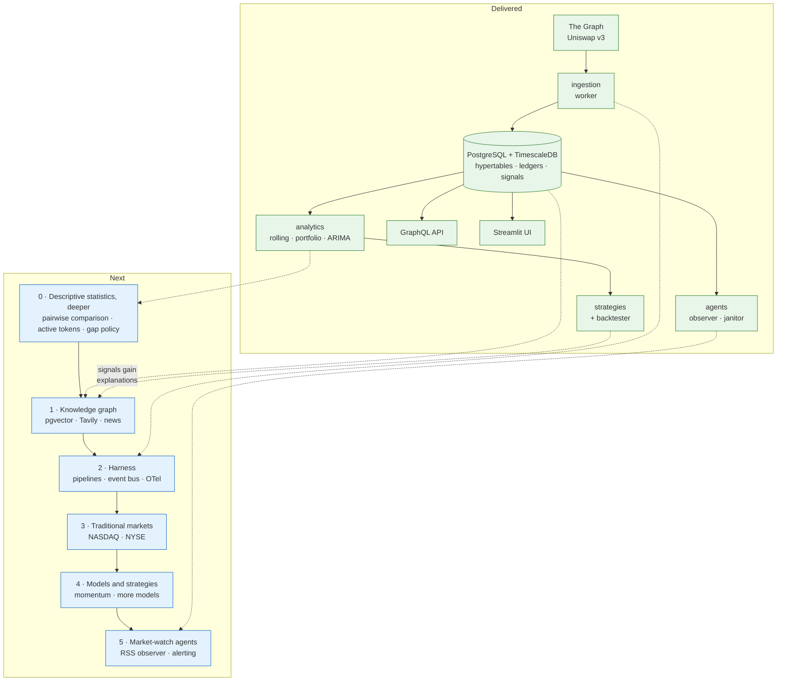

# Roadmap

**Status:** living document — last revised 2026-10-29
**Scope:** what candlegraph is, what has been built, and what comes next.

`AGENTS.md` carries a condensed copy of the stage list; this is the
authoritative version and the only place the reasoning lives. Each stage
names an **exit criterion** — a command or an observable behaviour, not a
feeling — because "the agent layer is done" is otherwise unfalsifiable.

## Where this stands

candlegraph is a market-data service with an analytics layer and an agent
layer on top. Five pieces of work are delivered and in the test suite:

| Delivered | What it added | Proven by |
|---|---|---|
| **Stabilisation** | A clean clone that builds, lints, type-checks, and comes up under compose. uv as the toolchain; the `Makefile` as the single source of truth for commands. | `make check`, `make up` |
| **Data model and ingestion** | Hourly token and pool data from The Graph, idempotent upserts on a natural key, the `ingest_run` ledger, and the data-quality report. Pools matter because the subgraph carries no transaction count on the token entity at all. | `make backfill days=90 && make report` |
| **Deterministic analytics** | Rolling statistics, mean-variance optimisation, Bollinger and crossover and walk-forward ARIMA signals, the `signal` table, a cost- and lag-aware backtester, and a Streamlit UI. | `candlegraph signals WETH --store && candlegraph backtest WETH --strategy all` |
| **Agent layer** | Two LangGraph graphs — a run observer (stale data, gaps on liquid tokens, metric drift) and a CI janitor (checks, mechanical fixes, draft PRs) — plus the `agent_run` ledger and report sinks. | `make observe && make agent-runs`, and the janitor's daily workflow |
| **Time-series storage** | The three series tables are TimescaleDB hypertables chunked on `period_start_unix`; the state and ledger tables deliberately are not. | `make test-integration` (`test_timescale.py`) |

What that adds up to, and where the next stages attach:

The ordering is not arbitrary. Stage 0 deepens the descriptive layer that
already exists and settles the gap-handling policy that every later stage
will inherit — cheaper to decide now than to retrofit under a knowledge
graph. After that, the knowledge graph comes first because it is
the only remaining piece of the *original* design and because the harness in
stage 2 is much more useful once there is a second kind of pipeline to
orchestrate than when there is only ingestion. Everything from stage 3 on
widens the system rather than deepening it, and each of those stages is
cheaper once the harness exists to run it.

---

## 0. Descriptive statistics, deeper

**Goal.** Before signals learn to cite documents (stage 1), the descriptive
layer should be able to say how two assets relate to each other, the test
run should ingest a deliberately chosen universe rather than everything, and
the project should have a written answer to "what do we do about gaps" —
because stages 1, 3 and 4 all inherit whatever answer is given here.

**What it adds.**

- **Pairwise comparison** *(delivered)*. `candlegraph compare WETH WBTC`
  reads both tokens' stored history and prints Pearson and Spearman return
  correlation, beta (first symbol regressed on the second), total and
  relative return, annualised volatilities and Sharpe ratios, annualised
  tracking error, and a rolling correlation over the configured window. The
  numerics live in `candlegraph/analytics/pairwise.py` and are pure, like
  the rest of the analytics layer (invariant 18). The alignment rule is the
  design decision: every statistic is computed **only over hours both
  tokens actually have**. Forward-filling or interpolating before
  correlating would manufacture correlation out of the fill policy, so a
  missing hour on either side drops out of the comparison and the report
  says how many bars survived.
- **A five-token active universe for the test run.** `config/tokens.yaml`
  keeps every token it lists — removing one would orphan stored history,
  and invariant 4 says history is never deleted — but gains an
  `active: true|false` flag, and ingestion only polls the active ones. The
  active five: **WBTC** (BTC exposure), **WETH** (ETH), **BNB** (the
  mainnet ERC-20, `0xb8c77482e45f1f44de1745f52c74426c631bdd52` — new to the
  registry, added via the `add-token` skill), and two tokens chosen
  *because* their history has gaps: **GNO** (routinely below 50% coverage;
  the canonical thin token in the quality report) and **SHIB** (liquid
  enough to matter, sparse enough to gap). The gappy pair is deliberate —
  they are the test fixtures for the gap-filling decision below and for
  pairwise comparison's alignment rule. The flag is a small schema change
  to `tokens.py` plus ingestion filtering, **not** part of the pairwise
  change; it lands separately with its own tests.
- **A recorded gap-filling policy** — the design decision below.

**Design decision: filling gaps for thin tokens — interpolation vs. an
estimator.**

First, where filling is allowed to happen at all. Never in
`token_hours_data`: invariant 6 says a bucket with no data produces no
candle, invariant 11 says a missing value is `NULL` and never a fabricated
number, and ingestion writing rows the subgraph never emitted would make
the quality report unfalsifiable — coverage would read 100% by
construction. Any filling is a **read-time policy in
`analytics/prices.py`** (where `ffill` with a 24-hour cap already lives as
one option of `FillPolicy`), and a filled value must stay distinguishable
from an observed one so downstream code can exclude synthetic bars.

The two candidates, and what each trades away:

| | Linear interpolation | Model-based estimator (Kalman / Brownian bridge) |
|---|---|---|
| Mechanics | Straight line between the last real bar before the gap and the first real bar after it. | A state-space model (local-level/random-walk Kalman smoother) or a Brownian bridge conditioned on the gap's endpoints, with variance scaled by the token's own recent volatility. |
| Determinism | Fully deterministic, no parameters. | Deterministic if the posterior mean is used; needs an estimated volatility parameter either way. |
| Look-ahead | **Uses the gap's right endpoint** — a future price. Fine for plots and descriptive tables; poisonous for anything a strategy consumes, because invariant 17 (no strategy looks ahead) would be violated one layer down where no test is watching. | The smoother also uses both endpoints; the *filter* variant is causal (past data only) and is the only form safe to feed a strategy. |
| Volatility | A straight line has zero local variance, so filled stretches **understate volatility** and shrink every rolling standard deviation that overlaps a gap — Bollinger bands tighten, z-scores inflate. | The bridge preserves the variance budget across the gap (or the Kalman model widens its interval), so risk statistics over filled stretches stay honest. |
| Correlation | Interpolated segments of two tokens are both smooth, so cross-correlations over gaps are biased upward. | Less biased, but still model output; a correlation computed mostly on filled bars is a statement about the model. |
| Uncertainty | A point with no error bar; the reader cannot tell a confident fill from a 22-hour guess. | Produces an interval that widens with gap length — "we don't know" is representable. |
| Cost and explainability | One line of pandas; trivially explainable. | More code, an estimated parameter per token, and a harder conversation when a filled value looks odd. |

**The decision.** Both, scoped by use:

1. **Pairwise comparison and the quality report fill nothing.** Alignment
   on observed bars *is* the honest statistic; this is already shipped.
2. **Descriptive display** (UI charts, `stats` tables) may use linear
   interpolation, capped like `ffill` is today (beyond ~24 hours the line
   is fiction), with filled bars flagged so the UI can render them
   differently. Look-ahead is acceptable here because nothing trades on it.
3. **Anything a strategy or backtest consumes** gets, at most, a **causal**
   estimate — the Kalman filter form, or the existing capped forward-fill —
   never interpolation, because the backtester cannot tell a real bar from
   one that embeds the future. Invariants 15–17 do not relax for synthetic
   bars.
4. The estimator work (bridge/Kalman, per-token volatility estimation, the
   `synthetic` flag plumbed through `to_wide`) is this stage's remaining
   build item, behind a new `FillPolicy` value so the default behaviour
   does not move.

**What was rejected.** Writing filled rows into the database (breaks the
`NULL`-means-not-collected contract and corrupts coverage); zero-filling
(a zero is a price, and a wrong one); filling without a cap (a 3-week gap
on a delisted pool should look like absence, not a confident line).

**Exit criterion.** `candlegraph compare WETH WBTC` prints correlation,
beta and relative performance over aligned bars only *(met)*; the compose
stack ingests exactly the five active tokens while `tokens.yaml` still
lists the full set; and the gap-filling policy above is implemented behind
a `FillPolicy` with a test proving a strategy's signals are unchanged by
data after the bar they score, even across filled gaps.

---

## 1. Knowledge graph and signaller

**Goal.** Signals stop being a number and start being an argument. A
`bollinger` short on WETH should be able to say *what else was true* at that
bar — which pools were draining, what was published, which assets move
together — and cite it.

**What it adds.**

- **Entities in Postgres**: `asset`, `venue`, `source`, `document`, `chunk`,
  `mention`, `edge`. Assets and pools already exist as rows; this gives them
  relationships and a place for text to attach.
- **pgvector** for embeddings on `chunk`, so "what was being said about WETH
  around 2026-10-24" is a similarity search joined to the same database that
  holds the prices. One database, for the reason recorded in
  `docs/storage/timescaledb/DESIGN.md`: the alternative is two stores to keep
  consistent for a dataset that fits in memory.
- **Tavily** as the web-search source, behind a typed client in
  `candlegraph/knowledge/` shaped like `ingestion/subgraph.py` — explicit
  timeouts, a retry budget, and a `TAVILY_API_KEY` that lives only in `.env`.
  Unit tests inject an `httpx.MockTransport`; invariant 2 does not bend.
- **Retrieval is pull-on-demand at this stage.** A signal being explained
  triggers a search over a bounded window. Continuous feeds are stage 5, and
  separating them is what keeps this stage finishable.
- **An `explanation` on a signal**: the retrieved context, its citations, and
  a short generated rationale. The same rule as the agent narrator applies —
  the model writes prose over retrieved facts and cannot invent a citation.

**Design decisions to make early.**

- **The vector-indexed tables stay plain, not hypertables.** `document` and
  `chunk` have a `published_at` and grow without bound, which looks like the
  hypertable profile — but an approximate-nearest-neighbour index has to be
  *global* to give good recall. Chunking the table would give each chunk its
  own HNSW index and turn one search into a union of partial searches.
  Time-partitioning and ANN indexing pull in opposite directions; recall
  wins. This belongs in `docs/storage/table-placement/DESIGN.md` when it
  lands.
- **Provenance is not optional.** Every `chunk` carries its `source`, its
  URL, and the time it was retrieved, or the explanation is unfalsifiable.
- **Paper trading only.** No order goes anywhere. That is a property of the
  project, not of this stage.

**Design (2026-10-29).** The stage is now designed in `docs/knowledge/`,
one document per decision: the schema, retrieval flow and agent
integration ([`graph/`](../knowledge/graph/DESIGN.md)); pgvector inside the
existing database versus Neo4j, Qdrant and others
([`vector-store/`](../knowledge/vector-store/DESIGN.md)); the embedding
model, fixed at 1024 dimensions with a local free default and OpenAI as the
hosted option ([`embeddings/`](../knowledge/embeddings/DESIGN.md)); Tavily
under a credit budget with a cache keyed on `(asset, day)`
([`tavily/`](../knowledge/tavily/DESIGN.md)); and where MCP fits
([`mcp/`](../knowledge/mcp/DESIGN.md)). Two consequences worth knowing
before the first line of code: pgvector is not in the Alpine TimescaleDB
image, so the stage begins with a pinned switch to `timescaledb-ha` and a
rebuilt volume, done with the lessons of
`docs/incidents/2026-10-28-stack-would-not-start/`; and the knowledge
tables' placement is already recorded in
`docs/storage/table-placement/DESIGN.md`.

**Exit criterion.** `candlegraph signals WETH --strategy bollinger --explain`
prints a signal whose rationale cites at least one retrieved document with a
URL and a timestamp, and the citation is stored alongside the signal.

---

## 2. Harness

**Goal.** One orchestrated run instead of five commands and a scheduler
per concern.

**What it adds.**

- **YAML pipeline specs** — `ingest → validate → analyse → signal` declared
  as a graph of steps with explicit inputs and outputs, so adding a stage is
  configuration rather than a new `make` target and a new APScheduler job.
- **An event bus**, so the observer reacts to "ingest finished" instead of
  polling the ledger on a timer, and a failed validation can halt the
  downstream analysis rather than letting it run on bad data.
- **OpenTelemetry** metrics and traces across ingest, analytics, and the
  agents. `opentelemetry-api` is already resolved in the lockfile.
- **Continuous aggregates** for daily and weekly candles, deferred from the
  TimescaleDB migration precisely until this stage, which is the first
  consumer that benefits. `chart_query` already uses `time_bucket`, so
  defining one is a new object rather than a rewrite.

**Design decisions to make early.**

- The pipeline runner is a LangGraph graph like everything else in
  `agents/`, or it is a second orchestration idiom in one repo. Prefer the
  first; the framework document already covers state, retries and reporting.
- A spec that cannot be validated before it runs is a footgun. Parse specs
  into typed objects with pydantic, the way `settings.py` and `tokens.py`
  already do.

**Exit criterion.** A single `candlegraph run pipelines/hourly.yaml`
executes ingest, validation, analysis and signal generation as one
orchestrated run, emits traces, and records the run in a ledger.

---

## 3. Traditional markets

**Goal.** The same machinery over NASDAQ and NYSE equities, not only
on-chain crypto.

**What it adds.** A second ingestion adapter (The Graph is not a source of
equity data), an `instrument` abstraction above today's `token`, and venue
and calendar awareness.

**The decision this stage turns on.** Today the schema says `token` and
`token_hours_data`, and `tokens.yaml` is the deployment's universe. Equities
need a supertype — `instrument(id, symbol, asset_class, venue, …)` — with
the hourly bar table keyed by instrument rather than token. Prefer widening
the existing tables with a nullable `asset_class` and a migration over
building a parallel set of equity tables; two parallel schemas would fork
every analytics and strategy module downstream.

**The invariant that inverts.** Invariant 19 says a missing hour is not a
fault, because Uniswap emits no row for an hour with no swaps. For an
equity this is backwards: a missing hour *inside* a trading session is a
real fault, and every hour outside the session is expected to be absent. So
coverage has to be measured against a **venue calendar**, not against a
24/7 grid. The quality report and the run observer both need to learn this,
and `MIN_EXPECTED_COVERAGE` becomes per-asset-class. This is the single
largest piece of work in the stage and it is easy to underestimate.

**Exit criterion.** `candlegraph report` shows an NYSE-listed instrument at
full coverage across a week containing a market holiday, without flagging
the holiday as a gap.

---

## 4. Models and strategies

**Goal.** More than three strategies and one forecasting model, evaluated
honestly.

**What it adds.**

- **Momentum**, in both forms, because they behave differently: time-series
  momentum (an instrument against its own past) and cross-sectional momentum
  (ranking instruments against each other). The second is the first strategy
  that needs more than one symbol at a time, which the current
  `StrategyResult` shape assumes away — expect to generalise it.
- **More models**: GARCH for volatility clustering, which hourly crypto has
  in abundance and ARIMA does not capture; state-space or Kalman filters for
  a smoothed level; a gradient-boosted baseline for a fair comparison.
- **Walk-forward evaluation as a first-class command**, not something a
  person remembers to do, so a strategy is reported out of sample by
  default.

**The standing rule.** Invariants 15 to 17 do not relax for new strategies:
a position decided on bar *t* earns bar *t+1*'s return, rolling windows are
complete or absent, and nothing refits on data after the bar it scores. And
the house rule from `run-analytics`: a losing backtest is usually the honest
answer. The risk in this stage is not a bug, it is a strategy that looks
good because it was tuned until it did.

**Exit criterion.** `candlegraph backtest WETH --strategy all` includes
momentum, and a walk-forward report shows out-of-sample results for every
registered strategy with costs charged.

---

## 5. Market-watch agents

**Goal.** The system tells a person something useful without being asked.

**What it adds.**

- **An RSS and feed observer** — a continuous counterpart to stage 1's
  pull-on-demand retrieval. It polls configured feeds, writes documents and
  chunks into the knowledge graph, and links mentions to instruments. This
  is why it sits here and not in stage 1: it needs the knowledge graph to
  exist and the harness to schedule it.
- **An alerting agent** that decides what is worth interrupting someone for,
  and posts through the sinks that already exist.

**The design problem.** The run observer is allowed to say the same thing
every fifteen minutes, because nobody reads it unless they go looking. An
alerting agent is not: it needs deduplication, a cooldown per subject, and
escalation rather than repetition, or it trains its reader to ignore it.
"Drift is a warning, not an alarm" — the rule the observer already follows —
becomes load-bearing here, since the alerting agent is the component with
permission to actually alarm.

**Exit criterion.** A market event visible in the feeds produces exactly one
alert with a citation, and a second identical event within the cooldown
produces none.

---

## Working rules that outlive any stage

These are not stages; they constrain all of them, and they are enforced by
the invariants in `AGENTS.md`.

- **Stored history is never deleted.** It is the input to everything above.
- **Paper trading only.** No stage puts an order on a venue.
- **Deterministic first, generative second.** Numbers are computed; models
  write prose over computed numbers and cannot change them.
- **New configuration is typed and documented**, and every new command is a
  `Makefile` target.
- **A new design decision gets a document under `docs/<area>/<topic>/`**
  before the code, and its Status line is kept truthful afterwards.
