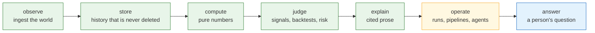
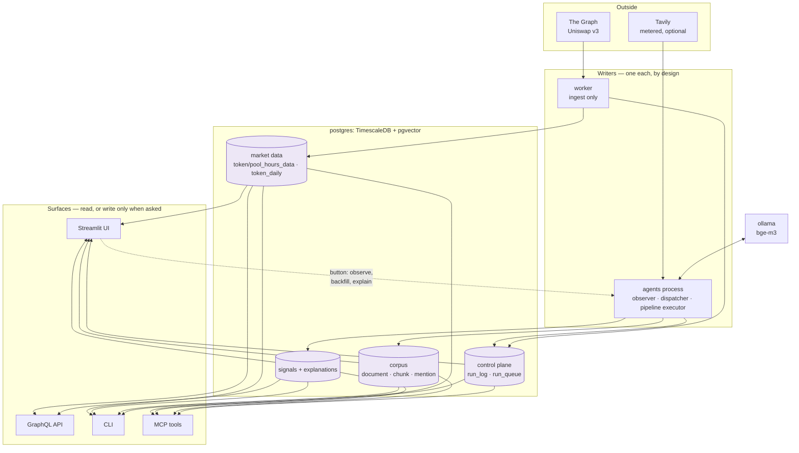
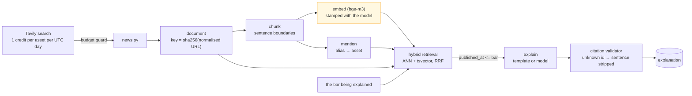
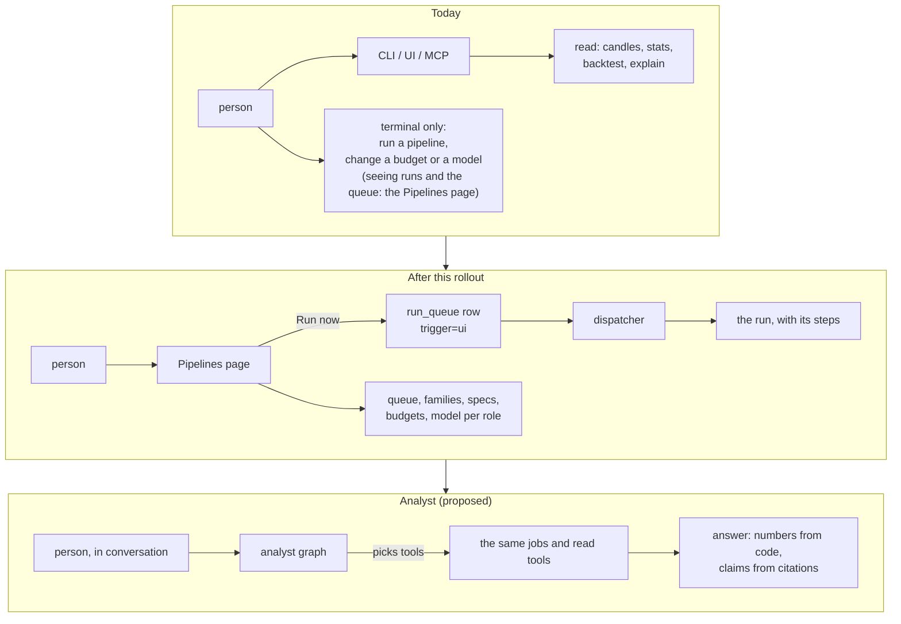
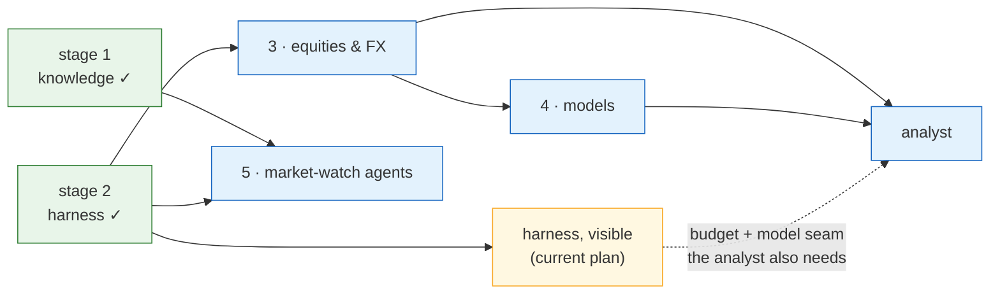

# Rollout overview: how the stages come together

**Status:** living — 2026-11-19, written as stage 2 closed and the
"harness, visible" plan opened. It describes delivered code and names
plainly which boxes are not built yet.
**What this is for.** [`../../roadmap/DESIGN.md`](../../roadmap/DESIGN.md)
says what each stage is and why it is next;
[`../../overview/DESIGN.md`](../../overview/DESIGN.md) says how the
system works today; [`../ROLLOUT.md`](../ROLLOUT.md) is the plan being
executed now. This page is the join between them: how the stages stack
into one system, drawn rather than listed, so a reader can see what a
new stage attaches to.

## The spine

Every stage so far has thickened one segment of the same line. Nothing
has replaced anything.



| Segment | Delivered by | State |
|---|---|---|
| observe | ingestion (The Graph), Tavily news | done for crypto; equities and FX are stage 3 |
| store | TimescaleDB hypertables, pgvector corpus, `token_daily` | done |
| compute | `analytics/` — pure, no I/O but reads | done |
| judge | `strategies/`, the backtester, the three simulators | done; more models are stage 4 |
| explain | retrieval bounded by the bar, the citation validator | done |
| operate | the harness: jobs, runs, pipelines, the queue, traces | **built; visible since step 2, not yet operable from the UI** — the Pipelines page shows runs, steps, queue and specs read-only; starting a run is step 3 |
| answer | the analyst | proposed only |

The two rules that make the line hold: **a number is computed, never
generated**, and **nothing reads data from after the bar it is about**.
Every stage inherits them; none has needed an exception.

## Architecture today



Two properties worth stating because they are what keep the picture
simple: **market data has exactly one writer** (the worker — the pipeline
loader refuses any step that would be a second), and **every box that
runs work writes a row to the control plane before it starts and after it
ends**, so `run_log` answers "what happened" for all of them in one
vocabulary.

## Data flow 1 — the hour (event-driven, no clock)

This is stage 2's shape, and the exit criterion verified on a real stack
on 2026-11-19.

```mermaid
sequenceDiagram
  autonumber
  participant G as The Graph
  participant W as worker
  participant DB as postgres
  participant D as dispatcher
  participant P as hourly pipeline
  W->>G: poll (every 5 min)
  G-->>W: new hourly rows
  W->>DB: upsert on (token, hour); ingest_run closed `succeeded`
  D->>DB: read run_log over the lookback window
  D->>DB: enqueue hourly, dedup key = bar hour (UNIQUE)
  Note over D,DB: 12 polls an hour → 1 queued run, 11 counted duplicates
  D->>DB: claim with a lease, take the advisory lock
  D->>P: run
  P->>DB: validate (gate) → refresh_aggregates → analyse → signal → explain
  P->>DB: parent run + one child run per step, trigger=event
```

What each step is for, and what stops the hour:

| Step | Reads | Writes | On failure |
|---|---|---|---|
| `validate` | coverage, row sanity | the run | **stops the pipeline** — bad data must not reach signals |
| `refresh_aggregates` | the invalidation log | `token_daily` | continue |
| `analyse` | prices | the run's counts only | continue |
| `signal` | prices, **causal loader only** | `signal` | partial continues |
| `explain` | signals + stored news as of the bar | `explanation` | continue — prose is optional |

## Data flow 2 — the corpus (why a signal can cite something)



The amber box is the plan's step 6: `embed` exists and is a step of
`daily.yaml`, but nothing starts that pipeline yet, so vectors appear
only when a person asks. An unembedded corpus degrades retrieval to its
lexical leg — the failure in
[`../../incidents/2026-11-04-explain-ran-lexical-only/`](../../incidents/2026-11-04-explain-ran-lexical-only/POSTMORTEM.md).

## Data flow 3 — a person asking

Today every answer comes out of a terminal or a dashboard, and the
system is operated from the terminal alone. The current rollout moves the
operating half onto the page; the analyst, later, moves the asking half
into a conversation.



The important line in the middle picture is that **the button enqueues**.
A click is a row with `trigger=ui`, claimed by the same dispatcher as
every event and schedule (invariant 28), so one writer, one lock and one
ledger keep working, and the UI never becomes a second executor.

## How a stage attaches

Each stage so far has needed exactly one new seam, and reused everything
else. That is the test for whether a stage is shaped right.

| Stage | New seam it added | What it reused |
|---|---|---|
| Ingestion | the subgraph client and the cursor | — |
| Analytics | `FillPolicy`, `prices.py` as the only reader | the stored history |
| Agents | `Finding`, sinks, LangGraph graphs | the ledger and the quality report |
| Knowledge (1) | `Source`, `Embedder`, retrieval bounded by a bar | the same database, the same run shape |
| Simulation (6) | path generators, the event engine | **the existing backtester** — no second `position × returns` |
| Harness (2) | `Job`, `run_job`, the spec, the queue | every job that already existed |
| **Harness, visible** (now) | a page, and one new trigger value | the queue, the dispatcher, `run_log` |
| Equities (3) | an `instrument` supertype, a venue calendar | all of analytics and strategies |
| Models (4) | more strategies | the backtester, walk-forward, the simulators |
| Alerting (5) | dedup and cooldown | the agent framework, the corpus |
| Analyst | a session, a planner | the tools, the jobs, the ledger |

Dependencies, so an order can be argued rather than felt:



Two edges are worth noticing. The current plan is **not** on the path to
equities — stage 3 could start tomorrow instead. It is on the path to the
analyst, because the analyst needs the spend guard (step 5) and the
chat-model seam (step 7) whatever else it needs. And stage 5 (alerting)
needs the harness to schedule it and the corpus to read, which is why it
sits after both rather than beside stage 1.

## How a rollout is run here

The process is part of the design, not ceremony:

1. **A design document before the code**, with the rejected alternatives.
   A rollout step never changes a decision silently — it edits the design
   in the same change or follows it.
2. **One current plan** (`ROLLOUT.md`), an ordered progress table, and
   **one step per session** so a failing test points at one change.
3. **Every step records an Outcome**, including what it chose *not* to
   do and what it found. Five archived plans are the honest history; the
   deferrals in them are why nothing in this repository is quietly
   half-built.
4. **An exit criterion is a command**, not a feeling. Stage 2's was run
   against a real stack on 2026-11-19 and its output is in
   [`../ROLLOUT.md`](../ROLLOUT.md).
5. **A fault gets a post-mortem**, and the post-mortem's follow-ups gate
   its Status line closing. Four are closed; each one changed a default
   that had bitten twice.
