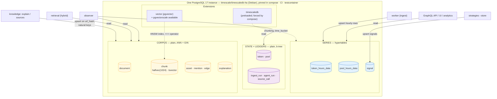
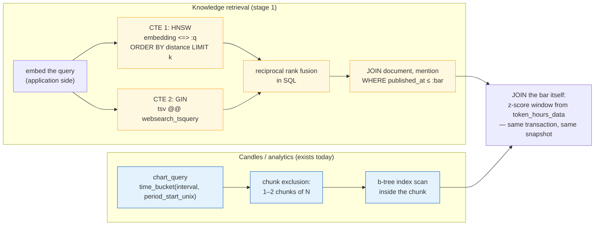

# One database, two extensions: how pgvector sits beside TimescaleDB

**Status:** proposed — 2026-10-29; the image switch (rollout step 1) is
**done**, so the instance below exists and pgvector is available but not yet
installed. The corpus tables land in step 2. The build sequence is
[`../../rollout/ROLLOUT.md`](../../rollout/ROLLOUT.md).
**Companions:** [`../timescaledb/DESIGN.md`](../timescaledb/DESIGN.md) (why
the extension at all), [`../table-placement/DESIGN.md`](../table-placement/DESIGN.md)
(which tables are chunked), [`../../knowledge/vector-store/DESIGN.md`](../../knowledge/vector-store/DESIGN.md)
(why pgvector beat the alternatives).

## The database as it stands

One PostgreSQL 17 instance, image `timescale/timescaledb-ha:pg17.11-ts2.31.0`
(Ubuntu; was the Alpine `timescale/timescaledb` image until rollout step 1),
one schema `candlegraph`, eight tables in three families:

- **Series** — `token_hours_data`, `pool_hours_data`, `signal`. TimescaleDB
  hypertables, chunked monthly on `period_start_unix`. Every read filters on
  a time window; chunk exclusion is the payoff.
- **State** — `token`, `pool`. Current metadata, upserted in place on `id`.
  No time coordinate.
- **Ledgers** — `ingest_run`, `agent_run`. Append-mostly run records,
  updated by `run_id`, read newest-first. Deliberately plain (invariant 24).

TimescaleDB is loaded through `shared_preload_libraries`, forced on the
server's command line by compose so the setting is a property of the
service, not of the volume's history (invariant 25's sibling lesson, from
`docs/incidents/2026-10-28-stack-would-not-start/`).

## What stage 1 adds, and where it lands

pgvector is **another extension in the same instance** — a column type
(`vector` / `halfvec`), two index methods (HNSW, IVFFlat), and distance
operators. It is not a second database, a second service, or a second
backup. The knowledge tables form a fourth family, **corpus**, that is
plain like state and ledgers but indexed for similarity instead of for
keys:

## Why the two extensions do not interfere

They touch different layers and different tables:

- **TimescaleDB changes how a table is stored** (chunking) and is applied
  per table by `create_hypertable`. The knowledge tables never call it, so
  they are ordinary heap tables as far as the planner is concerned.
- **pgvector changes what a column can hold and how it can be indexed.**
  Nothing about a `halfvec` column or an HNSW index cares whether other
  tables in the schema are chunked.
- The one rule that connects them is the placement decision already
  recorded in `table-placement`: a vector-indexed table must **not** be a
  hypertable, because an ANN index has to be global to keep its recall —
  chunking would give each month its own HNSW graph and turn one search
  into a union of partial searches. Time partitioning and ANN indexing
  pull in opposite directions; recall wins.

What they *share* is the instance: one WAL, one buffer cache, one
connection pool, one transaction. That sharing is the point.

## The query paths, side by side

The last box is the argument for one database, drawn: an explanation joins
*"what was said"* (corpus, ANN) to *"what the market did"* (hypertable,
chunk exclusion) in **one SQL statement under one MVCC snapshot**. A
citation is a foreign key. With a separate vector store, that join happens
in Python between two systems that can disagree, and provenance becomes a
promise instead of a constraint.

## What actually changes operationally

| Concern | Today | After stage 1, step 1 |
|---|---|---|
| Image | `timescale/timescaledb:2.31.0-pg17`, Alpine/musl | `timescale/timescaledb-ha:pg17.11-ts2.31.0` (**done**), Ubuntu 22.04/glibc, PostgreSQL 17.11, TimescaleDB 2.31.0, pgvector 0.8.7 and pgvectorscale 0.9.1 available — pgvector is not packaged for the Alpine image |
| Pinned where | compose, CI, testcontainer — `test_the_database_image_is_pinned_identically_everywhere` | same three places, same test |
| Volumes | mounted at `/var/lib/postgresql/data` | mounted at `/home/postgres/pgdata/data` (the `-ha` `PGDATA`); **rebuilt, not carried.** musl→glibc changes the collation version under text indexes, and the path differs anyway; `make reset` is the procedure. The `-ha` image initialises the database with `C.UTF-8`, which has no libc-version dependency going forward |
| Preload | `shared_preload_libraries=timescaledb` forced by compose | unchanged — pgvector does **not** need preloading; `CREATE EXTENSION vector` is an ordinary transactional statement, so the whole FATAL-on-create failure class from the incident does not exist for it |
| Migration preflight | refuses missing preload / unknown revision | plus: the knowledge migration refuses a server where `vector` is not in `pg_available_extensions`, with a message naming the image |
| Memory | timescaledb-tune sets the usual knobs | HNSW **build** respects `maintenance_work_mem`; at our corpus (thousands of chunks) defaults are fine. Searches use normal work memory. Revisit only if `reembed` on a large corpus gets slow |
| Backup / restore | `pg_dump` the one database | unchanged — vectors are column data; the HNSW index rebuilds on restore like any index |
| Connection pool | one `DatabaseManager`, `MAX_DB_CONNECTIONS=10` | shared by retrieval too; embedding happens application-side so no connection is held while a model runs |
| Failure modes | migration errors at start, caught by preflight | one new one: an ANN query without the index falls back to a sequential scan — slow but correct. The integration tier pins `EXPLAIN` output to prove the index is used |

## Write paths and who owns them

Unchanged rule, extended table: every table has exactly one writer, and
agents still write none of the market data (invariant 21).

| Family | Writer | Idempotency key |
|---|---|---|
| series | ingest worker; `signals --store` | natural keys, `ON CONFLICT DO UPDATE` |
| state | ingest worker | `id` |
| ledgers | runner / agents / knowledge sources | `run_id` / append |
| corpus | `knowledge` pipeline only (explain, sync-assets, later feeds) | `url_hash` for documents, `(document_id, ordinal)` for chunks, signal natural key for explanations |

## Rejected here

- **A second PostgreSQL instance for the corpus** ("keep vector load away
  from ingest"). The loads are tiny and disjoint (ingest writes hourly;
  retrieval reads on demand), and the join in the diagram is the feature
  being bought. Two instances is the vector-store document's "dedicated
  engine" option with none of its benefits.
- **Compiling pgvector into the existing Alpine image.** Keeps the small
  image, makes us the maintainer of a PostgreSQL build, loses
  pgvectorscale. The `-ha` image is the supported path.
- **Hypertable + per-chunk HNSW** for `chunk`. Recorded in
  `table-placement`; repeated here because it is the one tempting mistake
  at this boundary.
