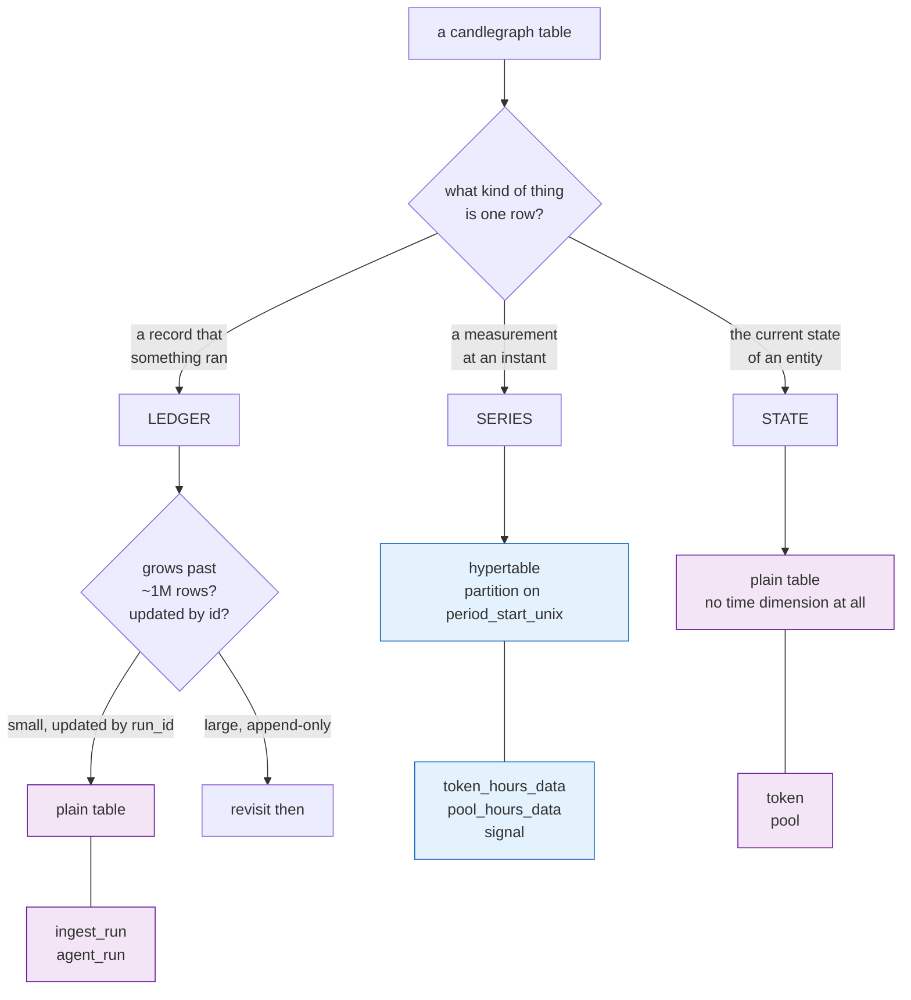

# Table placement: which tables are hypertables, and which stay plain

**Status:** implemented — 2026-10-25
**Area:** `alembic/versions/`, `candlegraph/storage/statements.py`
**Companion:** [`../timescaledb/DESIGN.md`](../timescaledb/DESIGN.md) — why we
adopted the extension at all, and how the migration works.

"We store time-series data, so make everything a hypertable" is the wrong
conclusion. Chunking buys range-scan exclusion and bounded index sizes on
tables that grow without limit and are read by time window. It costs a
planning overhead on every query, a composite primary key, and a worse story
for updates that do not carry the partitioning column. Four of our seven
tables are better off plain, and saying so precisely is the point of this
document.

## The rule

A table becomes a **hypertable** only when all four of these are true:

1. **Observation grain.** A row is one measurement at one instant, and the
   time column is part of the natural key — not merely an audit stamp.
2. **Time-ordered writes.** Rows arrive at, or are upserted on, their own
   time coordinate. Any `UPDATE` carries the partitioning column in its
   `WHERE`, so it lands in one chunk instead of searching all of them.
3. **Range reads.** The dominant query filters on a time window.
4. **Unbounded growth.** Nothing deletes the table (invariant 4), so it only
   ever gets bigger.

Miss any one and the table stays plain. In practice the tables split cleanly
into three kinds:



## The decision, table by table

| Table | Rows/year at current config | Grain | Placement | Partition column |
|---|---:|---|---|---|
| `token_hours_data` | ~88k (10 tokens) | token × hour | **hypertable** | `period_start_unix` |
| `pool_hours_data` | ~260k (30 pools) | pool × hour | **hypertable** | `period_start_unix` |
| `signal` | ~260k (3 strategies × 10 symbols) | strategy × symbol × bar | **hypertable** | `period_start_unix` |
| `token` | 10, upserted in place | current state | plain | — |
| `pool` | ~30, upserted in place | current state | plain | — |
| `ingest_run` | ~105k (5-minute poll) | one run | plain | — |
| `agent_run` | ~35k (15-minute observer) | one run | plain | — |

### `token_hours_data` and `pool_hours_data` — hypertables

The two core series. Every one of the four tests passes without argument:
the natural key *is* `(entity, period_start_unix)`, every statement that
reads them filters on `period_start_unix`, ingestion upserts on that key, and
invariant 4 forbids deleting anything. `pool_hours_data` grows roughly three
times faster because pools outnumber tokens, and it is the table that makes
the case on its own — at `POOLS_PER_TOKEN=3` across both sides of each pair
it is the largest thing in the database within a year.

Chunk exclusion is real, not theoretical. A one-hour window against a
twelve-chunk table plans as a single chunk:

```
Index Scan using _hyper_2_1_chunk_th_period_start_unix_idx on _hyper_2_1_chunk
  Index Cond: ((period_start_unix >= 1700000000) AND (period_start_unix < 1700003600))
```

### `signal` — hypertable

This one deserved an argument, because its read pattern is not purely by
range. `get_signals` is a window read (hypertable territory), but
`get_latest_signals` is `DISTINCT ON (strategy, symbol) … ORDER BY …
period_start_unix DESC`, which has to reach the newest row of each series.
The worry was that chunking turns that into a scan of every chunk.

Measured on 72k rows across twelve monthly chunks, against an identically
indexed plain table holding the same data:

| Query | Plain table | Hypertable |
|---|---|---|
| `get_signals` (window read, the backtest path) | bitmap scan, 72k rows considered | index scans on **2 of 12 chunks**, 1001 rows |
| `get_latest_signals` (`DISTINCT ON`) | seq scan 72k + sort | append over 12 chunks 72k + sort |

So the window read improves substantially and `DISTINCT ON` is **no worse** —
both storages full-scan it, because the cost is a property of that query
rather than of chunking. That settles it: `signal` is a hypertable. The
`DISTINCT ON` plan is a separate, pre-existing matter (a covering index or
TimescaleDB's SkipScan would fix it on either storage); it is not a
regression introduced here, and it is not worth solving at nine result rows.

`signal` also grows as a *product* — strategies × symbols × bars — so it
overtakes `token_hours_data` as soon as a fourth strategy lands. Converting
it now, while it is small, is strictly cheaper than converting it later.

### `token` and `pool` — plain

These are **state**, not series: one row per entity holding its latest
metadata, upserted on `id` by every ingest run. There is no time column to
partition on — `updated_at` is an audit stamp, not a coordinate, and nothing
ever queries "the pool as it was in July". Ten and thirty rows respectively.
A hypertable here would add a partitioning dimension that no query filters
on, which is pure overhead.

If we ever want pool state *as of* a time, that is a new slowly-changing
dimension table with its own grain — not a reshaping of this one.

### `ingest_run` and `agent_run` — plain

The ledgers are the interesting "no". They look like series — they are
time-ordered, append-mostly, and read newest-first — but they fail tests 2
and 4:

- **`ingest_run` is updated by `run_id`, not by time.** `start_run` inserts a
  `running` row and `finish_run` updates it minutes later with
  `WHERE run_id = %(run_id)s`. On a hypertable partitioned by `started_at`
  that `UPDATE` carries no partitioning column, so it must search every
  chunk — the exact anti-pattern chunking creates. Restructuring the ledger
  into insert-only events to dodge this would be the tail wagging the dog;
  the two-phase row is what makes a crashed run visible as `running`.
- **Volume does not justify it.** ~105k rows a year for `ingest_run` and
  ~35k for `agent_run`. Both read patterns — "the newest N" and "the last
  successful one" — are single index lookups that a B-tree answers in
  microseconds at a hundred times that size.
- **They are operational, not analytical.** Nothing joins them to price data
  or aggregates them over windows. The observer reads a week of runs and
  takes medians in Python.

Revisit `ingest_run` if the poll interval ever drops to seconds, or if run
detail grows enough that the JSONB columns dominate. Not before.

## Consequences for the schema

Converting a table to a hypertable forces one change: **every unique index,
including the primary key, must contain the partitioning column.** The three
hypertables carry a surrogate `id BIGSERIAL PRIMARY KEY`, so each primary key
becomes `(id, period_start_unix)`. The natural-key unique constraints already
contain `period_start_unix` and are untouched, which is why upserts and
invariant 4 survive the migration unchanged.

`id` is no longer *declared* unique on its own. It remains unique in fact —
it is a sequence — and nothing reads it as a key; it exists so the batch
upserts can `RETURNING id` and count rows. Dropping it entirely and promoting
the natural key to primary was the tidier alternative, and was rejected: it
would touch the write path, `missing_hours`, and a dozen tests to remove a
column that costs eight bytes and breaks nothing.

## How to apply this to a new table

Ask the four questions in "The rule" before writing the migration, and record
the answer in this table. If the new table is a series, partition it on its
integer epoch column with a monthly `chunk_time_interval`, and give it a
composite primary key. The `add-migration` skill has the mechanics.
