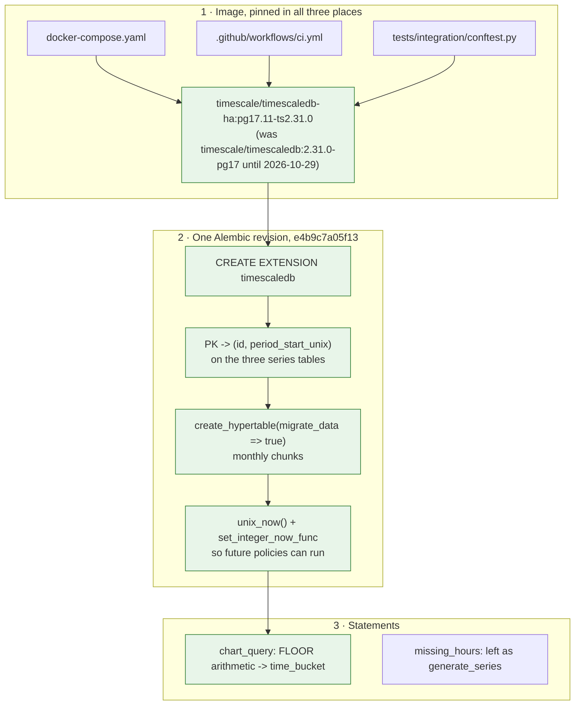

# TimescaleDB: adoption, migration, and what we deliberately did not turn on

**Status:** implemented — 2026-10-25; preflight added and image moved to `-ha` 2026-10-29
**Area:** `docker-compose.yaml`, `.github/workflows/ci.yml`,
`tests/integration/conftest.py`, `alembic/versions/`, `candlegraph/storage/statements.py`
**Companions:** [`../table-placement/DESIGN.md`](../table-placement/DESIGN.md) —
which tables are hypertables and why; this document is the *how*.
[`../pgvector-coexistence/DESIGN.md`](../pgvector-coexistence/DESIGN.md) —
how pgvector will share the instance in stage 1 (proposed).

## What was there before

candlegraph stored hourly market data — time-series data by any definition —
in plain PostgreSQL 17. No code referenced `timescaledb`, `time_bucket`,
hypertables, continuous aggregates or compression. The one time-series-shaped
statement was `chart_query`, which bucketed with
`FLOOR(period_start_unix / interval) * interval` and re-aggregated on every
request.

That was a defensible first choice: at ten tokens and one row per hour,
PostgreSQL answers everything from a B-tree without noticing. Nothing was
slow. The reason to move was not today's query latency.

## Why we moved now

Three forces, in order of how soon they bite:

1. **The data only grows.** Invariant 4 says ingestion never deletes.
   `pool_hours_data` at `POOLS_PER_TOKEN=3` is the largest table within a
   year, and the index on an ever-growing table is the thing that eventually
   stops fitting in cache.
2. **The next phases read windows, not points.** The run observer already
   compares a 24-hour window against a 7-day baseline for every token on a
   15-minute schedule. The harness wants pre-aggregated candles rather than
   a `GROUP BY` per GraphQL request.
3. **Migrating is cheapest now.** The project is not deployed; the only data
   anywhere is test and local-development data. Converting a populated
   hypertable later is strictly more work than converting an empty one now,
   and the conversion changes primary keys — not something to do under load.

TimescaleDB is an extension, not a different database. Every invariant,
statement and test in the repo keeps working, which is what made this a
contained change rather than a rewrite.

## What was implemented



### 1. The image

`postgres:17` became **`timescale/timescaledb:2.31.0-pg17`** on 2026-10-25, and
that became **`timescale/timescaledb-ha:pg17.11-ts2.31.0`** on 2026-10-29 (stage 1,
step 1: the `-ha` image carries pgvector; see
`../pgvector-coexistence/DESIGN.md`). Same PostgreSQL 17.11, same TimescaleDB
2.31.0; Ubuntu instead of Alpine, and `PGDATA` at `/home/postgres/pgdata/data`.
The pin lives in compose, in
the CI service container, and in the testcontainer. All three are pinned to
an exact version, for the reason the `Dockerfile` already records in a
comment: an unpinned image is how this build broke before. `latest-pg17`
would have been a rolling tag.

The image is PostgreSQL 17 with an init script that, **on `initdb` only**,
writes `shared_preload_libraries = 'timescaledb'` into `postgresql.conf` and
creates the extension in the default database. An existing `pgdata` volume
does **not** inherit any of that: the server reuses the data directory as it
finds it, the preload stays empty, and `CREATE EXTENSION timescaledb` is a
backend `FATAL` rather than an error. That is how the stack went down on
2026-10-28 (see
[`docs/incidents/2026-10-28-stack-would-not-start/`](../../incidents/2026-10-28-stack-would-not-start/POSTMORTEM.md)).
Two things now make the preload a property of the service rather than of the
volume's history: compose starts the server with
`-c shared_preload_libraries=timescaledb`, and `alembic/env.py` runs a
preflight that refuses to migrate a server that is not preloading it, with a
message naming the cause. The image is also Alpine where `postgres:17` was
Debian, so a volume carried across records a glibc collation version the
musl server cannot honour; that is one more reason an old volume is rebuilt,
not migrated.

The extension is now **required**, not optional. The migration raises a
clear error if it is missing *or not preloaded* rather than silently leaving
plain tables, because a schema that differs between a developer's database
and CI's is worse than a failure that says what to do. "Available" and
"preloaded" are checked separately: `pg_available_extensions` lists the
library the moment it is on disk, which is exactly the state of an old volume
under the new image.

### 2. The migration

One revision, `e4b9c7a05f13`. For each of `token_hours_data`,
`pool_hours_data` and `signal`:

- Replace the primary key `(id)` with `(id, period_start_unix)`. A
  hypertable requires every unique index to contain the partitioning column.
  The natural-key unique constraints already do, so they are untouched and
  idempotent upserts (invariant 4) survive unchanged.
- `create_hypertable(…, 'period_start_unix', chunk_time_interval => 2592000,
  migrate_data => true)`.

Then a `unix_now()` function and `set_integer_now_func` for each table.

Four decisions inside that:

- **Partition on `period_start_unix`, not `timestamp`.** Every statement
  filters on `period_start_unix`; partitioning on the column the planner
  actually sees is what produces chunk exclusion. The two columns are
  redundant by construction, so nothing is lost. The cost is that an integer
  time dimension needs an explicit "now" function before any policy can run,
  which is what `set_integer_now_func` provides.
- **Monthly chunks** (`2592000` seconds). At one row per entity-hour this
  keeps the chunk count in the low hundreds for years, and keeps a typical
  analytics window to one or two chunks.
- **`migrate_data => true`**, so the revision works on a populated database
  rather than only a fresh one. Verified against a real local volume.
- **It all runs in one transaction.** Verified on 2.31: the primary-key
  swap, `create_hypertable` with `migrate_data`, and `set_integer_now_func`
  commit together, so a failure leaves the schema untouched rather than half
  converted.

### The downgrade

Converting a hypertable back is not something the extension offers, so the
`downgrade` rebuilds each table:

```sql
CREATE TABLE t__plain (LIKE t EXCLUDING ALL);   -- columns, types, NOT NULL
INSERT INTO t__plain SELECT * FROM t;
DROP TABLE t;                                    -- takes the hypertable and its chunks
ALTER TABLE t__plain RENAME TO t;
-- recreate the sequence the dropped table owned, then the named constraints
```

`EXCLUDING ALL` is deliberate: `LIKE` always copies column names, types and
`NOT NULL`, and excluding everything else means the primary key, the natural
key, the check constraints and the indexes are recreated **by their original
names** rather than inheriting generated ones. The `id` sequence is dropped
with the old table and recreated with `setval` at the current maximum, so the
round trip preserves both the rows and the next id.
`test_the_timescale_migration_round_trips` proves it on a populated database.

### 3. Statements

| Statement | Before | After | Why |
|---|---|---|---|
| `chart_query` | `FLOOR(period_start_unix::numeric / interval) * interval` | `time_bucket(interval, period_start_unix)` | Identical semantics — verified `bool_and(...)` equal across a real series — but it is the form a continuous aggregate can be defined on, and it says what it means. Invariant 5 (bucket labels are boundaries) is unaffected: both compute the boundary from the interval, never from `MIN(timestamp)`. |
| `missing_hours` | `generate_series` left-joined against the table | unchanged | `time_bucket_gapfill` is the TimescaleDB idiom, but it requires explicit bounds in the `WHERE` and exists to *emit* placeholder rows. Gap detection wants a set difference, which `generate_series` states more plainly. Invariant 6 also means nothing outside the quality report may gap-fill, so adopting the function here would invite exactly the wrong reuse. |

Nothing else changed. The upsert statements, the cursor queries and the
quality statements run unmodified against hypertables, which was the point of
choosing an extension over a different database.

## What we deliberately did not turn on

- **Compression.** Chunks older than `LOOKBACK_DAYS` are read-mostly, but
  `backfill` can rewrite any hour at any time (invariant 13). Writing into a
  compressed chunk works but decompresses first, and the upsert path is the
  one place a surprise is unacceptable. Not until there is a measured storage
  problem.
- **Retention policies.** Never. Invariant 4 says ingestion never deletes,
  and a retention policy is a scheduled `DELETE`.
- ~~**Continuous aggregates.**~~ **Built 2026-11-18** (revision
  `9d4b7a2c6e15`), as predicted: a new object, not a rewrite, because
  `chart_query` had already moved to `time_bucket`. What it holds and why it
  holds it that way is the next section.

## `token_daily`: the continuous aggregate, and what the measurement said

One aggregate, `token_daily`, one bucket per token per day, and one
consumer: `fetch_chart_data` when the requested interval is a whole number
of days. The route is in `api/schema.py::chart_statement`; a four-hour
candle still comes from the hourly rows, because daily buckets cannot make
one.

### What was measured first

The rollout said to measure before keeping it. On a real TimescaleDB,
median of seven runs, one token:

| rows in `token_hours_data` | daily, hourly rows | daily, aggregate | weekly, hourly rows | weekly, aggregate |
|---|---|---|---|---|
| 43,800 (1 year × 5 tokens) | 8.6 ms | 2.1 ms | 8.1 ms | 0.8 ms |
| 219,000 (5 years × 5) | 36.9 ms | 5.2 ms | 25.2 ms | 1.4 ms |
| 2,628,000 (10 years × 30) | 63.6 ms | 9.8 ms | 52.3 ms | 2.5 ms |

Four to seven times faster, and **nothing was slow to begin with** — a
decade of hourly data re-aggregates in 64 ms. On candle latency alone this
was not worth a second definition of a candle.

What is slow is a different query. The Market dashboard reads raw hourly
rows and aggregates in pandas:

| window | hourly rows | daily aggregate |
|---|---|---|
| 30 days | 12.7 ms (3,600 rows) | 0.7 ms (150) |
| 180 days | 53.3 ms (21,600) | 2.3 ms (900) |
| everything (5 years) | **610 ms** (219,000) | 22 ms (9,125) |

That one is **not** switched over, and the reason is not performance: the
dashboard plots hourly bars, and serving it daily data changes what the
chart shows. Downsampling long windows is a display decision for whoever
owns that page, and the 610 ms is recorded here so it is argued from a
number when someone takes it.

So the aggregate is kept for the candle API, where it is a strict
improvement with no change in what is returned, and the dashboard is left
alone.

### Four things the definition gets right

1. **It materialises sums and counts, never an average.** `AVG(price_usd)`
   per day, averaged again per week, weights every day equally — and days
   here are not equal, because Uniswap emits no row for an hour with no
   swaps (invariant 19). A four-hour day would count as much as a full one.
   `price_sum` and `price_hours` are stored and divided at read time.
2. **It counts non-NULL values separately from rows.** `hours` is
   `COUNT(*)`; `price_hours` and `tvl_hours` are `COUNT(column)`. A column
   that was not collected is `NULL`, not zero (invariant 11), and dividing
   by the wrong count would turn "half the hours reported TVL" into half the
   real figure.
3. **`first()`/`last()`, not `array_agg(… ORDER BY …)`.** TimescaleDB's
   aggregates for exactly this; they parallelise and do not store a whole
   day of values to use two of them.
4. **Real-time aggregation is left on** (`materialized_only = false`), so a
   bucket newer than the materialisation watermark is computed live from the
   hourly rows. Without it, the newest candle would be absent between
   refreshes and the API's answer would depend on when the pipeline last
   ran. It also measured no slower than materialized-only.

### Refreshing: the whole range, every time

| | |
|---|---|
| full refresh, nothing changed | **0.79 ms** |
| full refresh after one new hour | 1.04 ms |
| full refresh after a 90-day backfill | 12.0 ms |
| full refresh after a 3-year backfill | 133 ms |
| 90-day *windowed* refresh, same change | 12.6 ms |

`refresh_continuous_aggregate` works from the invalidation log, so
refreshing everything costs what refreshing the changed part costs. A
window would buy nothing and would introduce a failure that is hard to see:
`backfill --days 365` can rewrite any hour (invariant 13), and anything
older than the window would stay wrong until somebody noticed.

There is **no refresh policy**. `refresh_aggregates` is a registered job and
a step of `pipelines/hourly.yaml`, so the refresh is a recorded run with a
`trigger`, an outcome and the view's extent in its counts — the same
treatment as every other piece of work (invariant 27). A background policy
would be a second schedule with its own window to keep in step with
`LOOKBACK_DAYS`.

### The one thing to know about staleness

The watermark is a high-water mark: it moves forward with each refresh and
never back. So

- an hour **newer** than the watermark — what ingest has just written — is
  served live and needs no refresh;
- an hour **behind** it — what a backfill rewrote — is served from the
  stored bucket until a refresh runs.

Both are tested (`test_an_hour_newer_than_the_watermark_needs_no_refresh`,
`test_an_hour_written_behind_the_watermark_waits_for_a_refresh`). The second
is why the refresh runs every hour rather than daily: the drift after a
backfill is bounded by one pipeline cycle. `AGGREGATES_ENABLED=false` pins
every request to the hourly rows if that is ever in doubt.

### The test that matters

`test_the_aggregate_and_the_raw_path_agree` reads the same data both ways at
daily, two-day, weekly and monthly widths and compares bucket by bucket.
The risk a continuous aggregate introduces is not slowness, it is two
definitions of a candle that drift apart — a missing hour, a NULL column, a
partial bucket. Each of those is a test in
`tests/integration/test_aggregates.py`.

### Mechanics worth remembering

`CREATE MATERIALIZED VIEW … WITH (timescaledb.continuous)` and `DROP` both
run inside a transaction, so the Alembic revision is ordinary — but it must
say `WITH NO DATA`, because creating it with data refreshes, and
`refresh_continuous_aggregate()` **cannot** run inside a transaction block.
That is also why `DatabaseManager.execute_outside_transaction` exists: the
ordinary write helper opens a transaction before the first statement.

## Test plan, and what it proves

| Test | Proves |
|---|---|
| `test_the_series_tables_are_hypertables` | the three tables are chunked, partitioned on `period_start_unix` |
| `test_the_ledger_and_state_tables_are_not_hypertables` | the four plain tables stayed plain — the placement decision is enforced, not just documented |
| `test_a_hypertable_still_upserts_on_the_natural_key` | invariant 4 across chunk boundaries |
| `test_rows_spread_across_chunks_by_time` | partitioning actually partitions |
| `test_the_timescale_migration_round_trips` | `downgrade` then `upgrade` on a populated database, rows and sequence intact |
| `test_a_server_that_does_not_preload_timescaledb_is_refused_before_any_ddl` | the preflight stops a server with the library on disk but not preloaded, before the first revision runs |
| `test_a_version_table_stamped_with_an_unknown_revision_is_refused_with_a_cause` | a database at a revision this checkout lacks is refused with both causes named |
| `test_compose_forces_the_timescale_preload_on_every_volume` (unit) | the service, not the volume's history, decides the preload |
| the existing `test_database.py` suite, unchanged | candles, bucket boundaries, gaps, idempotency and "never deletes" all behave identically on hypertables |

The last row is the important one: the migration is correct to the extent
that the tests written before it still pass without modification.

## Rejected alternatives

- **pg_partman on plain PostgreSQL.** Chunking without the extension, but
  none of the time-series functions, and more to operate than one preloaded
  extension.
- **A separate time-series store (ClickHouse, InfluxDB).** Two databases to
  keep consistent for a dataset that fits in memory, when the ledger, the
  signals and the planned knowledge-graph entities all want to be joined to
  the prices in one place.
- **Making everything a hypertable.** See the companion document. Four of
  seven tables are better off plain, and `ingest_run` would actively regress.
- **Deferring to the harness phase.** The original proposal suggested this.
  It was overtaken by the observation that the project has no deployment and
  no production data, which makes now the cheapest moment this migration will
  ever have.
